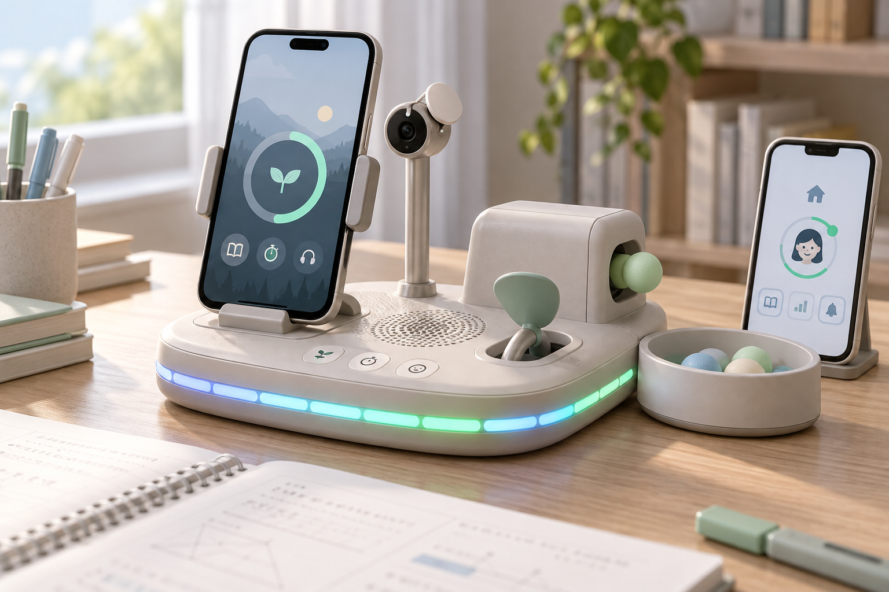
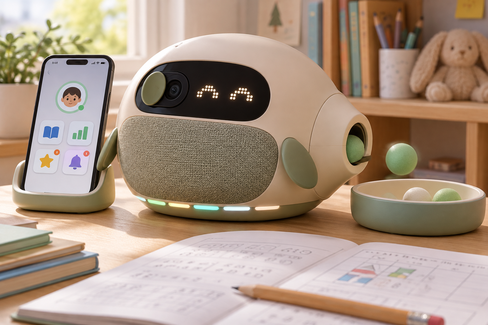
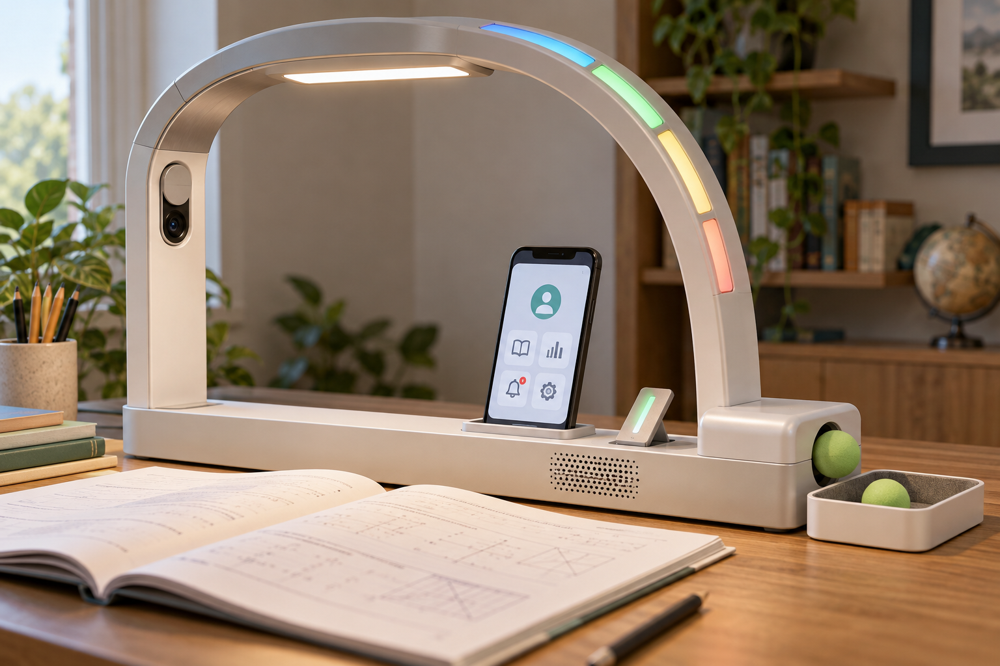
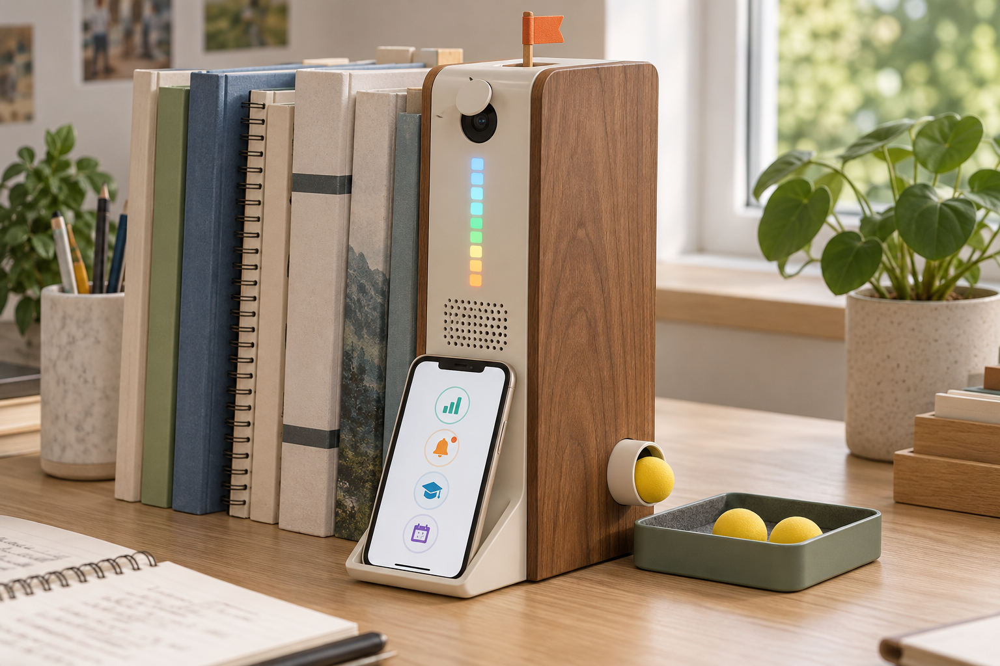
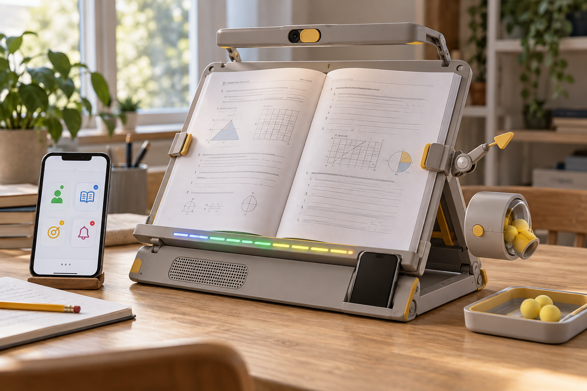
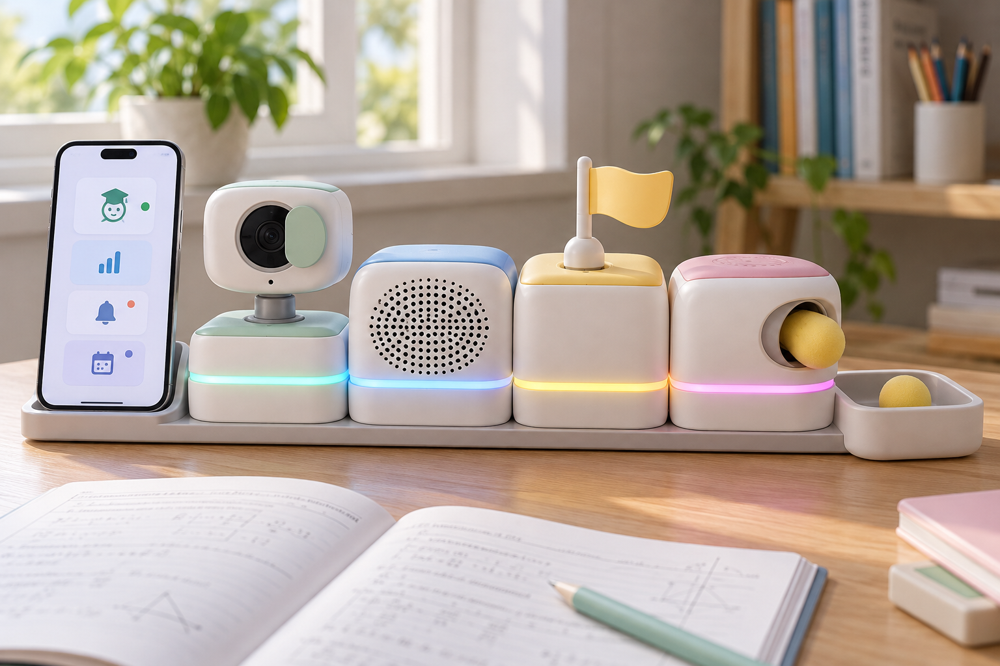
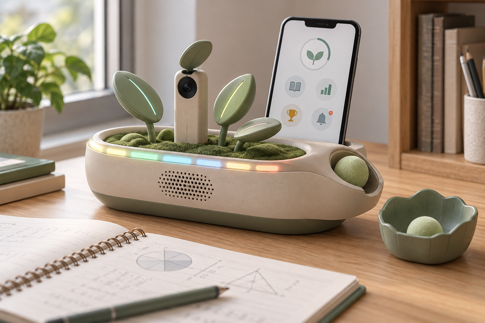
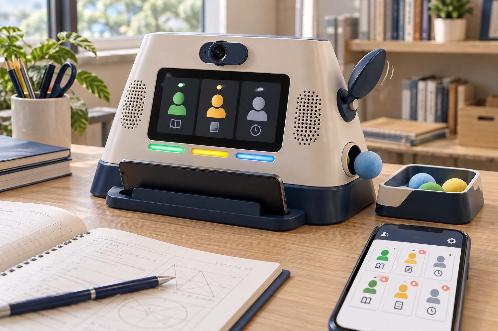
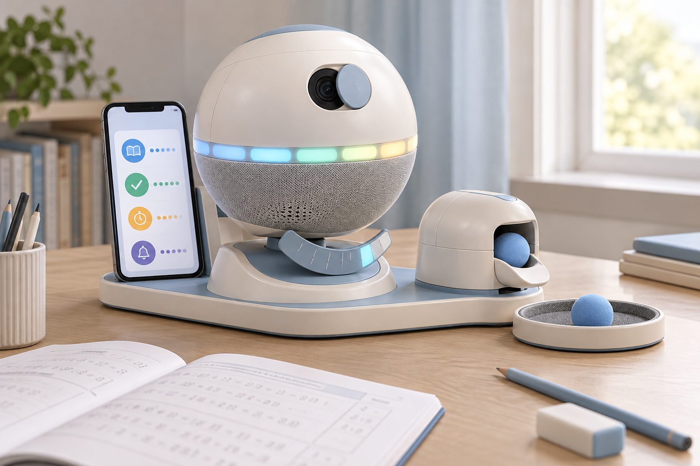
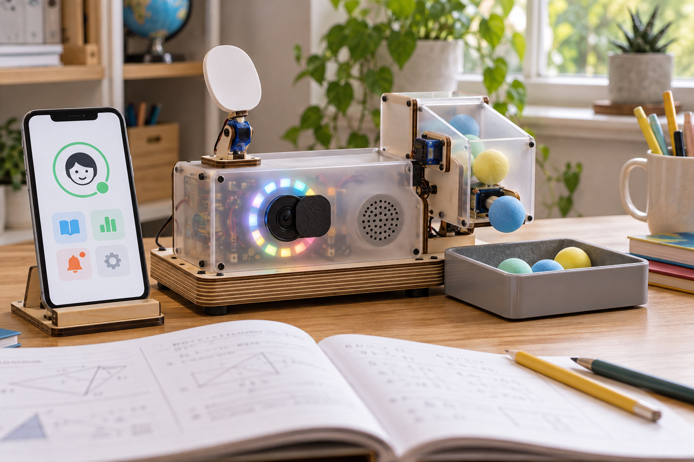

# 300 Seconds 제품 디자인 시안 10종

2026-10-16 · 피지컬 AI 학습관리 시스템 · 제품 외형과 사용 경험 비교용

> 아래 이미지는 사업계획서와 추가 기능 요청을 바탕으로 생성한 **AI 제품 콘셉트 렌더링**입니다. 실제 제작 사진·완성된 앱·배선 설계가 아니며, 부품 배치와 작동 가능성은 실물 설계에서 검증해야 합니다.

## 공통으로 반영한 기능

- **학습 관찰:** 카메라와 프라이버시 셔터, 기존 종이책·문제집 사용.
- **빛 피드백:** 네오픽셀의 색·밝기·점등 패턴으로 학습·휴식·자리 비움·목표 달성을 표현.
- **즉각 피드백:** 스피커·서보 움직임과 연질 발사체 모듈. 발사 방향은 학습자가 아닌 별도 표적·수거함으로 구성.
- **학습 화면:** 스마트폰 거치 또는 세션·목표 상태 표시.
- **모바일 확장:** 학부모·관리자 휴대폰의 상태 변화 알림과 원격 현황 조회를 화면 콘셉트로 표현.

## 시안 갤러리

번호별 이미지를 클릭하면 원본을 크게 볼 수 있습니다. 이미지 속 빛과 화면은 기능 표현 예시입니다.

| 01 · 헤일로 독 | 02 · 페블 버디 |
| :--- | :--- |
|  |  |
| **스마트폰 거치대형** 베이스의 네오픽셀 링, 독립 카메라, 스피커·서보 패들, 측면 발사 모듈과 수거함 활용: 가정용 일체형 | **둥근 데스크 친구형** 표정 표시와 서보 날개, 패브릭 스피커, 하단 네오픽셀, 측면 연질볼 피드백 활용: 아동용 친근한 학습 코치 |

| 03 · 아치 램프 | 04 · 북엔드 코치 |
| :--- | :--- |
|  |  |
| **책상 조명 결합형** 읽기 조명과 구분된 상태 LED, 아치 카메라, 베이스 스피커·서보·발사 모듈 활용: 조명과 학습관리 통합 | **책꽂이·북엔드형** 수직 네오픽셀 바, 상단 카메라·서보 깃발, 전면 스피커, 하단 거치·발사부 활용: 작은 책상·기존 책 활용 |

| 05 · 폴딩 스터디 | 06 · 모듈 큐브 |
| :--- | :--- |
|  |  |
| **접이식 독서대형** 페이지 받침 LED, 상단 카메라, 받침 스피커·휴대폰 슬롯, 측면 피드백 모듈 활용: 종이 문제집 중심 학습 | **기능별 블록 결합형** 카메라·스피커·서보·발사 블록을 분리하고 LED 상태를 연결 활용: 기능 교체·유지보수·단계별 확장 |

| 07 · 그로스 가든 | 08 · 클래스 허브 |
| :--- | :--- |
|  |  |
| **성장 오브제형** 서보 잎의 자세와 네오픽셀로 진척 표현, 카메라·스피커와 씨앗 트레이형 피드백 활용: 보상·습관 형성 중심 | **공부방 관리자형** 학생 상태 화면·LED 구역, 카메라·스피커·서보, 관리자 휴대폰 상태 카드 활용: 공부방·지역아동센터 |

| 09 · 오빗 코치 | 10 · 메이커 키트 |
| :--- | :--- |
|  |  |
| **구형 데스크 오브제형** 적도 네오픽셀 링, 카메라 셔터, 패브릭 스피커, 서보 진행 표시·별도 피드백 포드 활용: 인테리어와 학습 코칭 결합 | **조립형 메이커톤 시제품** 합판·아크릴 구조에 카메라·네오픽셀·스피커·서보·발사 모듈과 배선 표현 활용: 빠른 시제품 제작·기능 검증 |

## 선택을 위한 비교

| 번호 | 디자인 | 주요 사용 방향 | 제작 시 검토할 점 |
| --- | --- | --- | --- |
| 01 | 헤일로 독 | 가정용 일체형 | 거치 각도·무게중심·배선 공간 |
| 02 | 페블 버디 | 아동용 친근한 학습 코치 | 캐릭터 외장과 내부 구동부 간섭 |
| 03 | 아치 램프 | 조명과 학습관리 통합 | 크기·조도·카메라 화각 |
| 04 | 북엔드 코치 | 작은 책상·기존 책 활용 | 전도 방지·책에 가려지는 화각 |
| 05 | 폴딩 스터디 | 종이 문제집 중심 학습 | 힌지 강도·책 무게·배선 굴곡 |
| 06 | 모듈 큐브 | 기능 교체·유지보수·단계별 확장 | 블록 커넥터·전원·통신 규격 |
| 07 | 그로스 가든 | 보상·습관 형성 중심 | 잎 구동 구조·보상 방식의 수용성 |
| 08 | 클래스 허브 | 공부방·지역아동센터 | 다중 학생 식별 범위·조회 권한 |
| 09 | 오빗 코치 | 인테리어와 학습 코칭 결합 | 구형 외장 제작·안정성·조립성 |
| 10 | 메이커 키트 | 빠른 시제품 제작·기능 검증 | 실제 부품 크기·전원 용량·발사부 시험 |

시제품 제작 검토는 **10번 메이커 키트**, 가정용 일체형은 **01번 헤일로 독**, 종이책 중심 사용 경험은 **05번 폴딩 스터디**를 출발점으로 삼을 수 있습니다. 이는 형태와 구조를 보고 제안한 방향이며 제작비·성능 비교 결과는 아닙니다.

## 생성 기록

- 생성 도구: 내장 imagegen.
- 입력 근거: [사업계획서](../계획서/300_Seconds_사업계획서.md), 네오픽셀·발사체·스피커·서보·학부모/관리자 모바일 기능에 대한 추가 요청.
- [시안별 최종 생성 프롬프트와 파일 목록](img/design-prompts.json).
- 실물 설계에서 확정할 항목: 크기·재질·카메라 화각·네오픽셀 수량·서보 동작 범위·발사부 구조·전원·스피커 음량·통신 방식·모바일 조회 권한.

