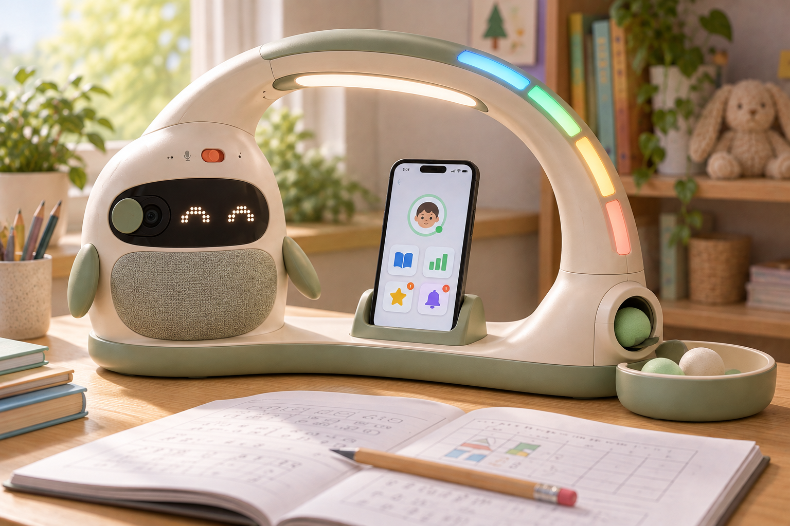
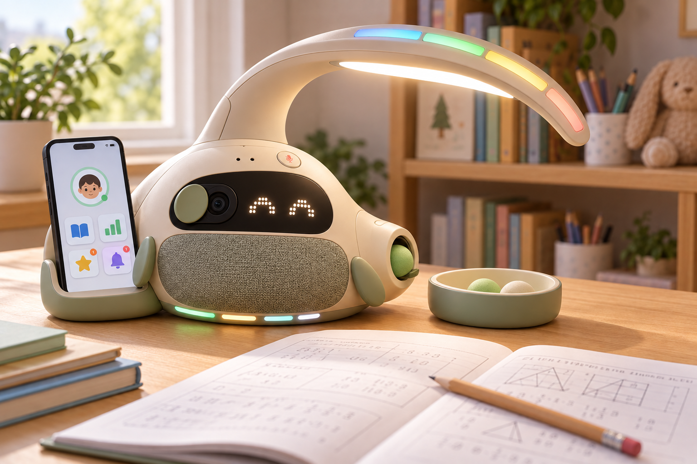
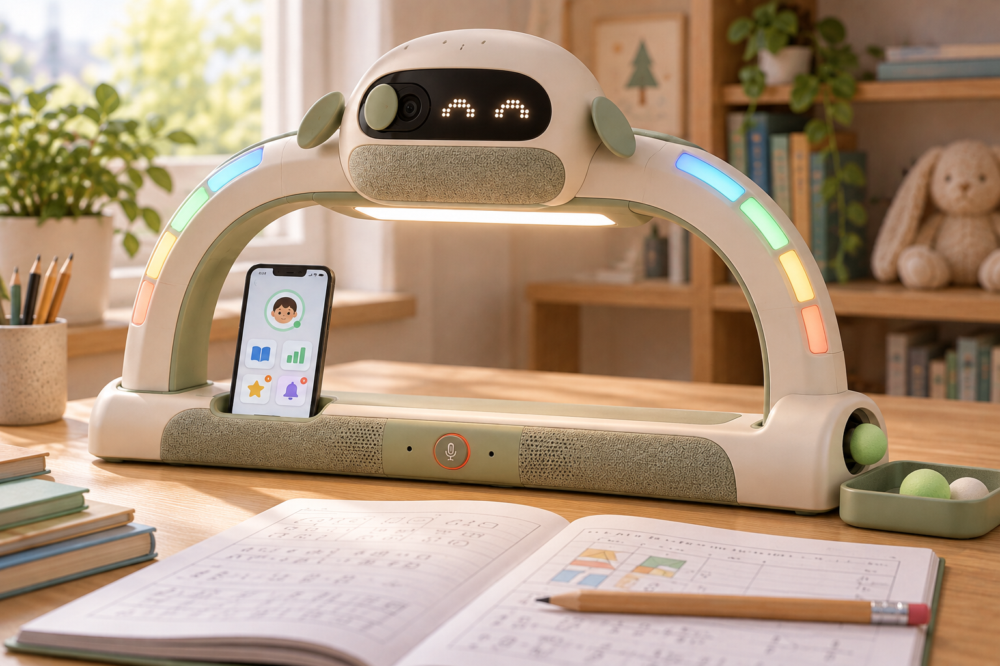
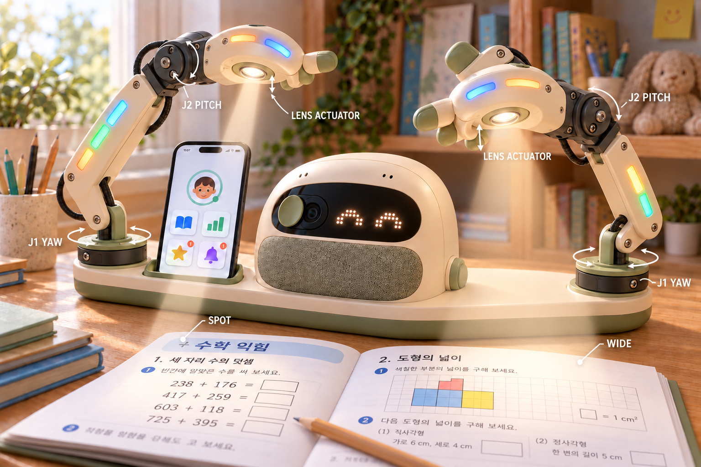
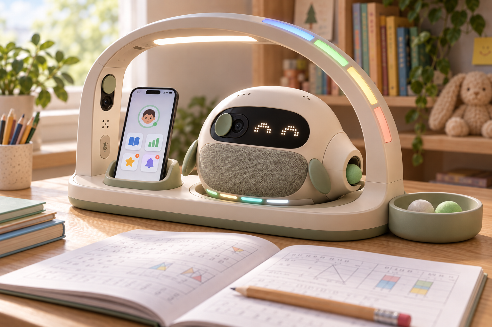
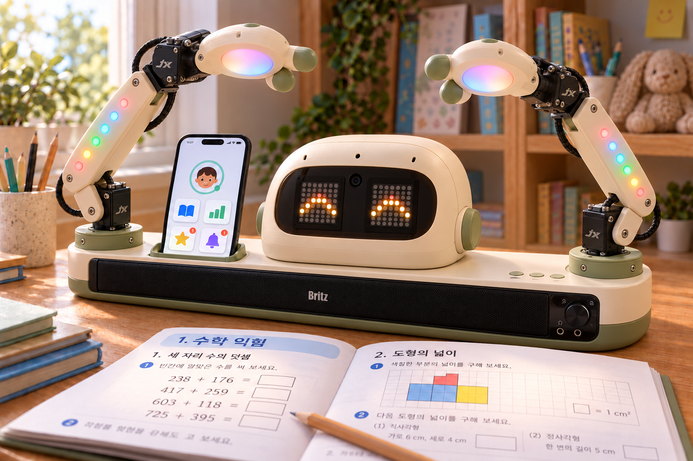
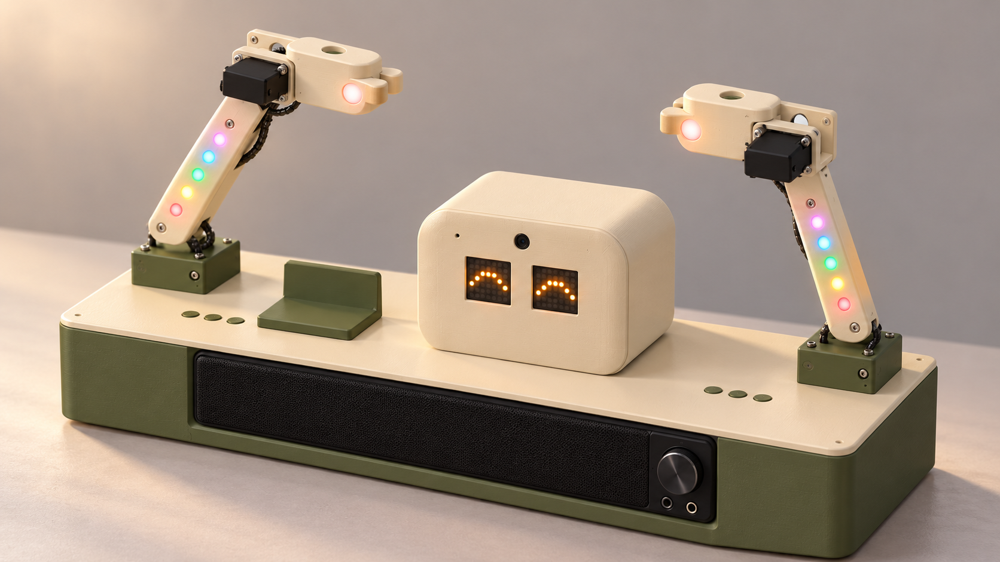
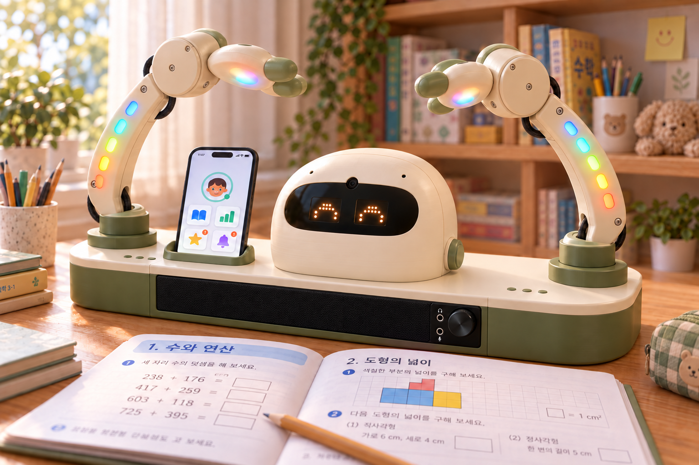

# 300 Seconds 제품 디자인 시안 2 — 페블 버디 × 아치 램프

2026-10-18 · 기존 02번과 03번을 결합한 신규 콘셉트 5종

> AI로 생성한 외형 콘셉트입니다. 실제 제작 사진·기구 설계·기능 구현 결과가 아니며, 크기·조도·음성 성능·구동 구조는 실물 시험이 필요합니다.

## 현재 제작 기준 — v8 P5, 6서보·Yaw / Pitch / Roll

최신 사용자 정정에 따라 각 팔은 **Yaw → Shoulder Pitch → Wrist Roll**의3회전 DOF로 구성한다. 서보6개를 좌우 각3개에 배정하고, 손목 원점 `[±220,40,315]`에서 손 길이 방향 X축 Roll을 검토한다. 초기 손 안쪽 방향은 왼쪽 +X·오른쪽 -X이며 부모 링크에 붙은 축으로 움직인다.

P5는 조인트 이름만 바꾸지 않고 손목의 서보·혼·베어링·하우징도 X동축 구조로 바꾸는 중이다. 고정 코어Ø80×54를 안쪽 회전 캡·후방 요크로 감싸고 바깥 베어링 캡을 마지막에 닫는3분할 손을 설계한다. 예정 원본은 `mechanical_v8/cad/fold_wing_v8_P5_RPY.solidcraft`다. **P5 기하·운동·출력 검증은 진행 중**이다. 아래 P4의 두 Pitch 구조와 옛 이미지·도면은 이전 이력으로 보존하며 P5 제작·검증 결과로 사용하지 않는다. [최신 상태](mechanical_v8/README.md) · [P5 조립·6축 RPY 상세](mechanical_v8/source/ASSEMBLY_JOINTS_P5.md).

## 이전 v8 P4 — 6서보·두 Pitch 구성

이전 P4에서 **보유 JX 서보6개를 왼팔3개·오른팔3개에 모두 배정**하고 **J1 베이스 Yaw → J2 어깨 Pitch → J3 손목 Pitch → 손**을 작성했다. 기존 상부 J2를 P4의 J3로 바꾸고 어깨 회전 구조를 추가한 이력이다. 최신 P5는 마지막 J3를 손목 Roll로 바꾼다. 기존 v5/P3의4모터·2DOF도 이전 이력이다.

이 문서의 v3/v4에서 말하던 `총 6축`은 팔 회전4축과 별도 렌즈 직선2축이었다. P4/P5의6서보·6회전축과 구별한다. 보유 부품 기반 개정에서는 렌즈 액추에이터·가변 광학계·손가락 구동을 추가하지 않고 머리는 고정한다.

초기 CAD 중립의 축 위치는 좌우 각각 J1 `±275,40,130`(+Z), J2 `±275,40,180`(초기 +Y), J3 `±220,40,315`(초기 +Y)다. J1을 돌리면 J2·J3가, J2를 돌리면 J3와 손이 함께 따라간다. 신규 어깨 높이·서보 수납·출력 분할은 P4 기하 검토 대상이다. 임시 CAD 제한 ±15°와 동작 확인 ±10°는 실물 가동 범위를 확정한 값이 아니다.

[최신 P5 상태](mechanical_v8/README.md) · [이전 P4 두 Pitch 안내](mechanical_v8/source/ASSEMBLY_JOINTS_P4.md) · [이전 P4 네이티브 원본](mechanical_v8/cad/fold_wing_v8_P4_6servo.solidcraft).

P4의 두 Pitch 형상·엔진 구동·재열기·출력 검사는 완료된 이전 이력이며 도면3페이지와 동작 GIF도 보존한다. 데스크톱에서는 파일 열기·6축 표시·구동 패널 선택까지 확인했고 GUI 각도 변경 시험은 미완료다. **P4 ZIP은 미발행·제공 제외이며 최종 묶음은P5로 제공한다.** P4/P0~P3 결과를 최신 Wrist Roll 기구의 검증으로 옮겨 쓰지 않는다. 실제 서보 PWM·토크·전력·출력·체결 검증은 별도다.

## 결합 방향

[기존 02 페블 버디](img/design-02-pebble-buddy.png)의 둥근 몸체·표정·패브릭 스피커·서보 제스처와 [기존 03 아치 램프](img/design-03-arch-lamp.png)의 독서 조명·상태 LED를 하나의 제품으로 결합했습니다.

- **아이 곁의 과외 동반자:** 표정·카메라·마이크·스피커로 친근한 대화 장치를 표현합니다.
- **대화 상태 피드백:** 네오픽셀로 듣기·생각하기·말하기 상태를 표현하는 방향입니다. 조명 하단의 독서용 백색광과 외곽 상태 표시를 구분합니다.
- **양방향 대화 지향:** 마이크 입력·물리 음소거 조작을 외형에 반영합니다. 말하면서 듣기·인터럽트·장기 기억은 이미지로 검증할 수 없으며 별도 소프트웨어·음향 설계가 필요합니다.
- **기존 기능 연결 이력:** 휴대폰 거치·학부모/관리자 상태 화면과 서보 제스처를 구상했습니다. 당시 04번 v4는 발사체를 제외하고 각 팔의 2 DOF 관절과 손가락형 조명 손, 렌즈 구동부를 구상했습니다. 현재 제작 기준은 위 P5의 6서보·팔당 Yaw/Pitch/Roll 3DOF와 상태 LED 손이며, 다른 시안의 발사체 표현도 초기 구상입니다.

## 시안 갤러리

이미지를 클릭하면 원본을 크게 볼 수 있습니다. 색·표정·화면은 사용 경험을 보여주는 예시입니다.

| 01 · 허그 아치 버디 | 02 · 크레센트 버디 |
| :--- | :--- |
|  |  |
| **캐릭터와 아치의 일체형** 왼쪽 기둥을 페블 버디 몸체로 만들고 조명 아치를 하나의 베이스로 연결 활용: 표정과 음성이 가까이 느껴지는 가정용 일체형 | **버디 몸체와 반아치 조명** 둥근 버디를 무게중심으로 삼고 뒤에서 뻗은 반아치가 문제집을 비춤 활용: 작은 책상에 놓는 친근한 대화 중심 스탠드 |

| 03 · 크라운 브리지 | 04 · 폴드 윙 버디 |
| :--- | :--- |
|  |  |
| **아치 상단의 캐릭터** 표정·카메라를 상단 중앙에 통합하고 아래쪽을 독서 조명과 작업 공간으로 사용 활용: 책 위에서 눈을 맞추는 학습 동반자 경험 | **관절형 조명 팔·손 · v4** 각 팔에 좌우 회전·상하 회전 2 DOF, 끝에는 고정 손가락과 렌즈 이동 구동부 활용: 손 흔들기와 학습지의 위치·조사 폭·밝기 조절 |

| 05 · 네스트 독 버디 | 공통 검토 기준 |
| :--- | :--- |
|  | **조명과 대화의 결합** 책을 비추는 빛과 상태 LED를 구분하고, 아이와의 시선·말소리·제스처가 자연스럽게 연결되는지 비교합니다. |
| **아치 독과 분리형 버디** 아치 베이스의 전용 홈에 버디를 결합해 일체형으로 사용하고 분리 가능성을 검토 활용: 조명부와 대화 장치의 유지보수·확장 | **제작 검토** 마이크와 스피커의 배치, 자기 재생음 유입, 카메라 화각, 조명 눈부심, 베이스 안정성, 관절·배선을 확인합니다. |

## 형태 비교

| 시안 | 구조의 차이 | 실물 설계에서 검토할 점 |
| --- | --- | --- |
| 01 · 허그 아치 버디 | 캐릭터와 아치의 일체형 | 넓은 베이스의 크기·책상 점유·스피커와 마이크 간격 |
| 02 · 크레센트 버디 | 버디 몸체와 반아치 조명 | 외팔 조명의 처짐·전도·조명 범위 |
| 03 · 크라운 브리지 | 아치 상단의 캐릭터 | 상단 무게·눈부심·카메라 높이와 시선 |
| 04 · 폴드 윙 버디 | 팔당 회전 2 DOF + 별도 렌즈 직선 구동, 고정 손가락·발사체 없음 | 관절 축·도달 범위·토크·배선·렌즈 이동량·조사 균일도·눈부심 |
| 05 · 네스트 독 버디 | 아치 독과 분리형 버디 | 도킹 정렬·고정·전원 접점·분리 시 기능 |

## 04번 v4 이력 — 2 DOF 조명 손과 가변 조사

일체형 곡선 윙을 분리된 링크·모터 하우징·회전 베어링·배선 구조로 바꿨습니다. v4는 한글 초등 수학 교재를 사용하고, 길게 돌출된 광원을 손바닥 내부에 렌즈 구동부를 수납한 얕은 매립형 렌즈로 수정했습니다. 관절과 렌즈의 화살표는 동작 방향을 보여주는 콘셉트 표현입니다.

| 요소 | 설계 방향 | 역할 |
| --- | --- | --- |
| J1 YAW | 각 팔 베이스의 수직축 회전 | 손·조명을 좌우로 이동·조준하고 손 흔들기 동작 구성 |
| J2 PITCH | 각 팔 말단의 수평축 회전 | 손바닥 조명의 상하 조사각 조절·제스처 구성 |
| LENS ACTUATOR | 손바닥 내부의 렌즈군을 광축 방향으로 이동하는 별도 직선 구동. 외부는 얕은 렌즈 베젤로 마감 | 빛을 좁은 영역으로 모으거나 넓게 퍼뜨리는 줌 광학계 구상 |
| LED 밝기 제어 | 좌·우 조명의 광량을 각각 조절 | 선택한 문제 영역은 더 밝게, 주변은 부드럽게 비추는 동작 |
| 손가락 | 손 끝의 둥근 고정 손가락·엄지 형태 | 조명 윙이 캐릭터의 손으로 보이게 함. 손가락 개별 구동은 포함하지 않음 |

**자유도 구분:** 팔의 자세는 좌우 각각 회전 2 DOF로 계획합니다. 렌즈 직선 이동은 팔 자세와 별개인 광학 구동 1축입니다. 따라서 좌우 팔의 회전 구동은 총 4축, 좌우 렌즈 구동은 총 2축으로, 이 시안의 기계 구동은 총 6축을 구상합니다. 별도 손목 회전이나 손가락 관절 구동은 추가하지 않습니다.

**동작 예시:** 설명할 문제의 위치 선택 → J1·J2로 손바닥 조준 → 렌즈로 조사 폭 조절 → LED 밝기 조절. 한쪽은 좁고 밝은 SPOT으로 문제를 강조하고, 다른 쪽은 넓고 부드러운 WIDE로 페이지를 비추는 구상입니다. 주의 환기 때는 팔 제스처·네오픽셀·음성 안내를 연동하고, 독서 때는 팔을 정지합니다. 조사 폭과 밝기는 별도 제어 항목입니다.

학습지 위치와 조명 좌표를 보정하고, 두 관절로 도달 가능한 범위 내에서 영역을 선택하도록 설계할 예정입니다. 실제 토크·기구 간섭·광학계·조도 분포·미세 위치 정확도와 눈부심은 부품 선정과 실물 시험으로 검증해야 합니다.

## 04번 v5 — 보유 부품 기반 시제품 외관

2026-10-23 보유 부품 목록과 사용자 요청을 반영한 새 시안이다. 기존 v4 이미지는 보존했다.

- **눈:** MAX7219 8×8 매트릭스 두 개를 좌우에 배치한다. 사용자와 합의한 계획 수량은 2개이며 사진에서 확인된 보유 수량은 1개다. 1개 추가 확보가 필요하다. 생성 이미지의 점 배열은 도면이 아니므로 실제 8×8 표시 패턴은 구현 시 확정한다.
- **스피커:** 긴 Britz BA-R9를 베이스 전면에 배치하고 볼륨 노브와 단자를 노출한다. 실제 제품 폭 400mm를 기준으로 베이스 치수를 설계해야 하며 렌더링의 비율은 치수 보증이 아니다.
- **팔 — 이전 v5 배정:** 당시 JX 서보를 좌우 베이스·손목에 각2개씩, 총4개 사용하고 나머지2개를 미정으로 남겼다. 이후P4에서 좌우각3개·총6개로 늘렸고 최신P5는 Yaw/Pitch/Roll로 개정 중이다. 이 v5 생성 이미지는 이전4모터 시안으로 보존한다.
- **LED:** 전완의 점형 표시등과 얕은 손바닥 확산 커버를 네오픽셀 상태 표시용으로 표현했다. v4의 SPOT/WIDE 조명·가변 렌즈 구동은 보유 부품으로 확인되지 않아 이번 시안에서 제외했다. 실제 학습지 조명 기능에는 별도 광원·광학계 검토가 필요하다.
- **터치·오디오·카메라:** 터치 센서 6개는 외장 아래 배치하는 구상이며 일부는 시점이나 휴대폰 받침에 가려질 수 있다. 마이크·카메라의 전면 개구부와 내부 USB 오디오 어댑터 수납을 계획한다.
- **내부:** Jetson·PCA9685·전원 모듈·배터리의 베이스/후면 수납을 가정했다. 실제 간섭, 방열, 전원 용량과 배선은 검증하지 않았다. 외장에 보이는 개구부 수를 마이크 센서 수로 해석하지 않는다.

[생성 프롬프트와 참조 이미지 기록](img/design2-04-fold-wing-v5-prompts.json). 도구: 내장 imagegen. 이 이미지는 완성 외관 콘셉트이며 제작 도면·실물 조립·구동 시험 결과가 아니다.

## 04번 v6 — 치수 기반 CAD와 출력 검토

BA-R9 완제품 400×73×68 mm, JX 서보 판매처 기구도, 카메라 공식 기구도와 SpotMicro 관절 STEP/STL을 대조했다. SolidCraft MCP로 원본 관절 3개를 별도 세션에서 분석했다.

[전면·측면·평면도 PDF](mechanical_v6/drawings/FWB_ASM_001_orthographic_A3.pdf)와 [CAD STEP](mechanical_v6/cad/fold_wing_v6_P0_assembly.step)은 같은 형상에서 생성했다. 베이스 설계값은 640×200×100 mm, 현재 자세 전체 높이는 337 mm이며 베이스는 3분할했다. 이는 시제품의 설계값으로 현품 실측값이 아니다. [원본 CAD 렌더](mechanical_v6/renders/v6_CAD_isometric.png)가 기하 기준이며 위 AI 외관 참고 이미지는 미세 형상이 다를 수 있다.

[전체 자료와 출력 순서](mechanical_v6/README.md), [SpotMicro 관절 분석](mechanical_v6/reference/joint_reference.md), [SolidCraft MCP 실제 결과](mechanical_v6/reference/solidcraft/README.md)를 참조한다. **P0 배치·끼움 검토용**이며 혼 어댑터·지지축·PCB 체결부는 실측 전이므로 최종 조립용 제작도로 확정하지 않았다. 출력 형상 17개와 먼저 출력할 작은 시험편 2개를 구분했다.

## 04번 v7 — 내장 서보·감싸는 관절·곡선 복원

2026-10-23 사용자 지적에 따라 외부 서보와 긴 연결축 구성을 수정했다. 곡선 팔 끝의 원형 코어 안에 서보를 넣고, 앞쪽 혼 홈과 뒤쪽 동축 베어링판을 연결한 부품이 코어를 감싸며 손과 함께 회전한다. 직선 기둥·각진 외형은 둥근 페블 머리, 검정 캡슐 얼굴, 스플라인 팔, 오목한 타원형 손과 둥근 베이스로 바꿨다. 실제 STEP/STL에도 곡면을 반영했다.

[새 관절 상세 PDF](mechanical_v7/drawings/FWB_JOINT_P1_reference_A3.pdf), [전면·측면·평면도](mechanical_v7/drawings/FWB_ASM_001_orthographic_A3.pdf), [조립 STEP](mechanical_v7/cad/fold_wing_v7_P1_assembly.step), [실제 CAD 렌더](mechanical_v7/renders/v7_CAD_isometric.png), [전체 자료](mechanical_v7/README.md)를 함께 제공한다. 베이스 640×200×100mm, 현재 자세 높이360mm는 새 설계값이다. 원본 CLS STEP의 홈은 6갈래여서 요청한 4갈래 십자는 현품 혼 실측 전 시험 형상으로 구분했다.

AI 이미지는 외형 참고이며 도면의 픽셀 수·나사·구멍과 일부 다르다. P1은 최종 조립 전 형상·끼움 검토용이다. SolidCraft에 가져온 손 외장 4개는 열린 셸 경고가 남아 있어 [가져오기 결과](mechanical_v7/reference/solidcraft/README.md)에 명시했다. 지적된 v6 상세도 경로는 P1으로 교체했고 이전 전체 CAD는 이력으로 유지한다.

## 생성 기록

- [v4 한글 교재·매립형 광원 편집 프롬프트](img/design2-04-fold-wing-v4-prompts.json)

- 도구: 내장 imagegen. 두 기존 이미지를 디자인 참조로 제공해 5개의 새 이미지를 생성했고, 04번은 요청에 따라 윙 흔들기 방식으로 개정했습니다.
- 04번 이력: [원래 시안](img/design2-04-fold-wing.png) → [v2 윙 흔들기](img/design2-04-fold-wing-v2-wave.png) → [v3 관절형 조명 손](img/design2-04-fold-wing-v3-joints-focus.png) → [v4 한글 교재·매립형 광원](img/design2-04-fold-wing-v4-korean-flush.png). 이전 이미지와 프롬프트는 보존했습니다.
- [v3 최종 생성·관절 보정 프롬프트](img/design2-04-fold-wing-v3-prompts.json) · [v2 편집 프롬프트](img/design2-04-fold-wing-v2-prompts.json). 렌더링은 실제 구동·광학 성능의 검증 결과가 아닙니다.
- [최종 생성 프롬프트·참조 이미지·파일 목록](img/design2-prompts.json)
- [최신 사업계획서](../계획서/300_Seconds_사업계획서.md) · [기존 시안 10종](design%20sample.md)

