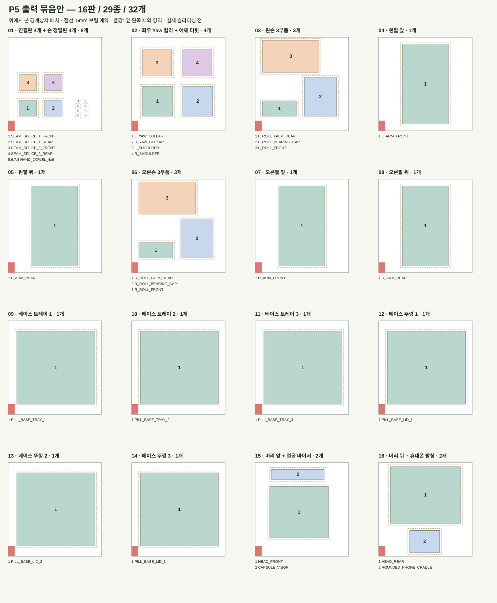

# P5 3D 프린터 출력판별 묶음표

**총 16판에 29종·32개를 나누는 제안입니다.** X1 Carbon 0.4mm 노즐 기준으로, 작은 부품은 함께 묶고 큰 베이스와 팔은 한 판에 하나씩 배치했습니다. 각 판은 1회씩 출력합니다.

작성: 2026-10-24 · 상태: **경계상자 배치·수량 검사 완료 / Bambu Studio 슬라이싱·실물 출력 전**

## 판별 파일과 수량

아래 파일은 모두 [`print/oriented_stl/`](print/oriented_stl/)에 있습니다. `×1`은 한 개, `×4`는 같은 파일을 네 개 복제한다는 뜻입니다.

| 판 | 묶음 | 넣을 STL 파일과 수량 | 한 판의 부품 수 |
| ---: | --- | --- | ---: |
| 01 | 연결판 4개 + 손 정렬핀 4개 | [SEAM_SPLICE_1_FRONT.stl](print/oriented_stl/SEAM_SPLICE_1_FRONT.stl) ×1 [SEAM_SPLICE_1_REAR.stl](print/oriented_stl/SEAM_SPLICE_1_REAR.stl) ×1 [SEAM_SPLICE_2_FRONT.stl](print/oriented_stl/SEAM_SPLICE_2_FRONT.stl) ×1 [SEAM_SPLICE_2_REAR.stl](print/oriented_stl/SEAM_SPLICE_2_REAR.stl) ×1 [HAND_DOWEL_4x6.stl](print/oriented_stl/HAND_DOWEL_4x6.stl) ×4 | **8개** |
| 02 | 좌우 Yaw 칼라 + 어깨 터릿 | [L_ROUND_YAW_COLLAR_TRIAL.stl](print/oriented_stl/L_ROUND_YAW_COLLAR_TRIAL.stl) ×1 [R_ROUND_YAW_COLLAR_TRIAL.stl](print/oriented_stl/R_ROUND_YAW_COLLAR_TRIAL.stl) ×1 [L_SHOULDER_YAW_TURRET.stl](print/oriented_stl/L_SHOULDER_YAW_TURRET.stl) ×1 [R_SHOULDER_YAW_TURRET.stl](print/oriented_stl/R_SHOULDER_YAW_TURRET.stl) ×1 | **4개** |
| 03 | 왼손 3부품 | [L_ROLL_PALM_REAR.stl](print/oriented_stl/L_ROLL_PALM_REAR.stl) ×1 [L_ROLL_BEARING_CAP.stl](print/oriented_stl/L_ROLL_BEARING_CAP.stl) ×1 [L_ROLL_YOKE_PALM_FRONT.stl](print/oriented_stl/L_ROLL_YOKE_PALM_FRONT.stl) ×1 | **3개** |
| 04 | 왼팔 앞 | [L_CURVED_ARM_CORE_FRONT.stl](print/oriented_stl/L_CURVED_ARM_CORE_FRONT.stl) ×1 | **1개** |
| 05 | 왼팔 뒤 | [L_CURVED_ARM_CORE_REAR.stl](print/oriented_stl/L_CURVED_ARM_CORE_REAR.stl) ×1 | **1개** |
| 06 | 오른손 3부품 | [R_ROLL_PALM_REAR.stl](print/oriented_stl/R_ROLL_PALM_REAR.stl) ×1 [R_ROLL_BEARING_CAP.stl](print/oriented_stl/R_ROLL_BEARING_CAP.stl) ×1 [R_ROLL_YOKE_PALM_FRONT.stl](print/oriented_stl/R_ROLL_YOKE_PALM_FRONT.stl) ×1 | **3개** |
| 07 | 오른팔 앞 | [R_CURVED_ARM_CORE_FRONT.stl](print/oriented_stl/R_CURVED_ARM_CORE_FRONT.stl) ×1 | **1개** |
| 08 | 오른팔 뒤 | [R_CURVED_ARM_CORE_REAR.stl](print/oriented_stl/R_CURVED_ARM_CORE_REAR.stl) ×1 | **1개** |
| 09 | 베이스 트레이 1 | [PILL_BASE_TRAY_1.stl](print/oriented_stl/PILL_BASE_TRAY_1.stl) ×1 | **1개** |
| 10 | 베이스 트레이 2 | [PILL_BASE_TRAY_2.stl](print/oriented_stl/PILL_BASE_TRAY_2.stl) ×1 | **1개** |
| 11 | 베이스 트레이 3 | [PILL_BASE_TRAY_3.stl](print/oriented_stl/PILL_BASE_TRAY_3.stl) ×1 | **1개** |
| 12 | 베이스 뚜껑 1 | [PILL_BASE_LID_1.stl](print/oriented_stl/PILL_BASE_LID_1.stl) ×1 | **1개** |
| 13 | 베이스 뚜껑 2 | [PILL_BASE_LID_2.stl](print/oriented_stl/PILL_BASE_LID_2.stl) ×1 | **1개** |
| 14 | 베이스 뚜껑 3 | [PILL_BASE_LID_3.stl](print/oriented_stl/PILL_BASE_LID_3.stl) ×1 | **1개** |
| 15 | 머리 앞 + 얼굴 바이저 | [PEBBLE_HEAD_FRONT_TRIAL.stl](print/oriented_stl/PEBBLE_HEAD_FRONT_TRIAL.stl) ×1 [CAPSULE_VISOR_TRIAL.stl](print/oriented_stl/CAPSULE_VISOR_TRIAL.stl) ×1 | **2개** |
| 16 | 머리 뒤 + 휴대폰 받침 | [PEBBLE_HEAD_REAR_TRIAL.stl](print/oriented_stl/PEBBLE_HEAD_REAR_TRIAL.stl) ×1 [ROUNDED_PHONE_CRADLE_TRIAL.stl](print/oriented_stl/ROUNDED_PHONE_CRADLE_TRIAL.stl) ×1 | **2개** |
| **합계** | **16판, 각 1회** | **29종** | **32개** |

**출력 순서:** 01에서 핀·너트 홈을 먼저 확인하고, 02~05로 왼쪽 어깨·팔·손을 맞춰 본 뒤 나머지를 진행합니다. 이 계획은 재출력·별도 공차 시험편 수량을 포함하지 않습니다.

## 묶음 배치 그림

아래는 실제 모델 윤곽 대신 각 부품의 최대 가로·세로 경계상자를 표시한 그림입니다. 번호와 파일명은 각 판 아래 범례에서 대응됩니다. 좌표 원점은 출력판 앞 왼쪽입니다.

## Bambu Studio에 넣는 방법

1. X1 Carbon과 실제 노즐·재료·출력판을 선택하고, 표의 한 행을 출력판 하나로 만듭니다.
2. 같은 판의 STL을 각각 독립된 물체로 가져옵니다. 단위는 mm, 배율은 100%로 유지합니다. 01판의 `HAND_DOWEL_4x6.stl`은 네 개로 복제합니다.
3. 기존 `oriented_stl`의 눕힘 방향을 유지하고 XY 위치만 옮깁니다. 자동 배치 후에도 방향·상호 간격·제외 영역을 다시 확인합니다.
4. 여러 부품이 든 판은 **레이어별 출력(By layer)**으로 설정합니다. 이 묶음안은 헤드가 부품을 하나씩 완성하는 순차 출력의 충돌 검사를 하지 않았습니다.
5. 각 판을 슬라이싱하고 서포트 제거 경로, 첫 레이어, 브리징, 실제 브림과 가장자리 여유를 확인합니다. 확인된 슬라이서 프로젝트를 판 번호로 저장합니다.

현재 제공된 `single_part_3mf/`는 부품 하나의 모델 파일입니다. 이 문서의 여러 부품 묶음이 저장된 Bambu 프로젝트나 G-code는 아직 생성하지 않았습니다.

## 배치 검사의 범위

- 기존 P5 manifest의 출력 방향·치수를 사용했습니다. 원본 STL의 SHA-256 일치와 29종·32개 수량을 대조했습니다.
- 각 부품에 브림 5mm를 사방으로 예약하고, 출력판 가장자리 1mm와 앞 왼쪽 18×28mm 제외 영역을 피했습니다. 예약 사각형 사이에는 최소 2mm를 남겼으며 계산상 실제 최소 간격은 약 3.01mm입니다.
- 동일 재료·동일 색상을 쓰고 프라임타워가 없는 판을 가정했습니다. 서포트·타워가 추가되면 배치와 판 수가 달라질 수 있습니다.
- 판별 실제 모델 배치의 경계상자만 검사했습니다. 서포트·툴패스·필라멘트 소요량·출력 시간·수축·현품 끼움은 확인 전입니다. 특히 손 요크와 어깨 터릿의 내부 서포트를 미리 확인합니다.
- 16판은 이 묶음안의 수량이며 최소 판 수를 증명한 값은 아닙니다. 재료·색·공정이 다른 부품은 판을 나눕니다.

배치 좌표와 검사 결과: [`print/plate_groups.json`](print/plate_groups.json). 각 `model_lower_left_xy_mm`는 모델 경계상자의 왼쪽 아래 좌표이며, Bambu Studio의 모델 중심 좌표와 다릅니다.

## 근거 문서

- [P5 전체 부품·치수·수량](PARTS.md) · [P5 출력·조립 안내](PRINT_ASSEMBLY.md)
- [Bambu Studio 공식 X1 Carbon 0.4mm 프로파일](https://github.com/bambulab/BambuStudio/blob/master/resources/profiles/BBL/machine/Bambu%20Lab%20X1%20Carbon%200.4%20nozzle.json): 앞 왼쪽 제외 영역. 2026-10-24 확인.
- [Bambu Studio 공식 공통 프로파일](https://github.com/bambulab/BambuStudio/blob/master/resources/profiles/BBL/machine/fdm_bbl_3dp_001_common.json): 256×256mm 출력판. 2026-10-24 확인.
