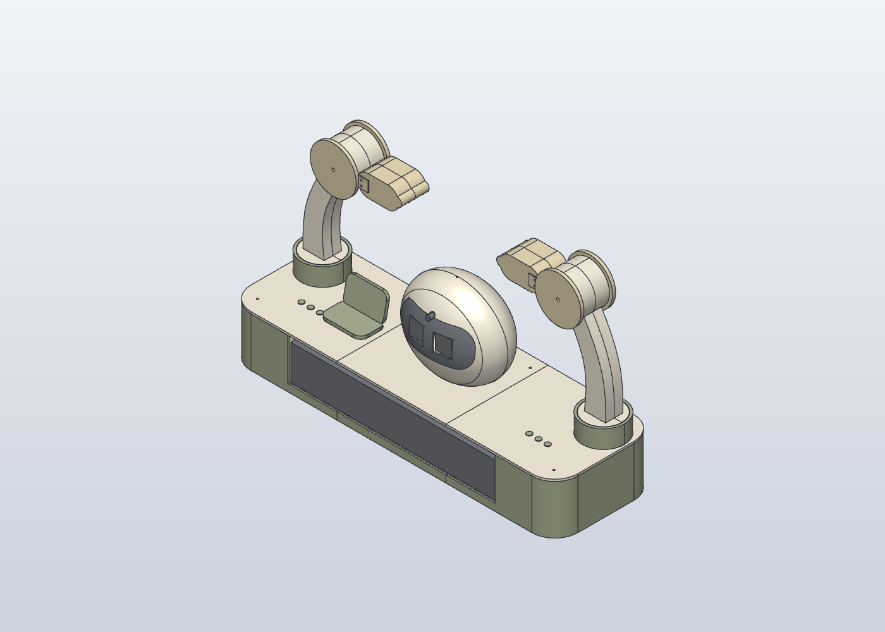

# 폴드 윙 버디 v8 P5 - 6서보·Yaw / Pitch / Roll 개정 중

2026-10-23 · mm · **현재 정지 자세의 설계·끼움 시험용**

**구동할 때는 [cad/fold_wing_v8_P5_RPY.solidcraft](cad/fold_wing_v8_P5_RPY.solidcraft)를 연다.** `*_geometry.solidcraft`는 조인트 연결 전 중간 형상 체크포인트이므로 최종 구동 파일이 아니다. [지정 SolidCraft로 열기](Open_SolidCraft.cmd)도 P5 RPY 원본을 연다.

## 최신 P5: Yaw → Shoulder Pitch → Wrist Roll

**최신 사용자 정정은 팔당 Yaw·Pitch·Roll 3DOF다.** 서보6개를 좌우 각3개에 배정하고, 마지막 손목 축을 손의 길이 방향 **Roll**로 다시 설계한다. P4의 `Yaw → Shoulder Pitch → Wrist Pitch` 두 Pitch 구성은 이전 이력이며 현재 최종 설계로 배포하지 않는다.

P5는 손목 원점 `[±220,40,315]`를 기준으로 왼쪽은 손 안쪽 +X, 오른쪽은 손 안쪽 -X를 초기 Roll 방향으로 둔다. 조인트 축뿐 아니라 실제 서보·혼·베어링·하우징을 X동축 구조로 개정한다. Ø80×54 고정 코어와 Ø88 회전 캡, 마지막에 닫는 분리 베어링 캡을 설계한다. **P5 기하·운동·출력 검증은 진행 중**이며 P4의 검사 결과를 P5 결과로 사용하지 않는다.

편집 원본 `cad/fold_wing_v8_P5_RPY.solidcraft`에79바디·스케치74개(dof0),6revolute·7Study를 저장했고 타임라인 오류·경고0을 확인했다. 형상 이력513개에 그룹 이동48개를 더한 최종 타임라인은561개다. 독립 구동·출력 검사와 새 도면·GIF·ZIP은 진행 중이다. 아래 P4 출력물은 두 Pitch 구조의 이력으로, P5 손목과 혼용하지 않는다.

- [P5 조립·서보 배정·6축 RPY 구동 안내](source/ASSEMBLY_JOINTS_P5.md): 축 원점·부모/자식·X동축 손목·분리 캡·조립 순서와 현재 확인 범위.
- [P5 형상 생성기](source/build_geometry_P5.py) · [6축 구동 생성기](source/build_motion_P5.py). 최종 운동 연구는 `P5_SIX_JOINT_RPY_DEMO`다.
- [P5 전용 출력 목록 — 29종/32개](P5/PARTS.md) · [분할·출력·조립 안내](P5/PRINT_ASSEMBLY.md) · [정적 배치manifest](P5/print/manifest.json). 원형/방향STL·3MF87개 해시와 부품집합·수량을 대조했다.

출력 팔4종은 최초 직접 STL의 비폐합 때문에 같은 STEP에서 OCP로 재테셀레이션했고, 왼앞 팔의 미세 누락 삼각형1개를 추가 수선했다. 네이티브·STEP 원본은 변경하지 않았다. [최종 배포 메시와 재생성 근거](source/P5_geometry_files/arm_tessellation.json)를 구분해 확인한다. 실제 슬라이싱·출력·현품 끼움·하드웨어 구동은 미검증이다.

## 이전 P4: 6서보·두 Pitch 구성

**이전 P4는 왼팔3개 + 오른팔3개 = 서보6개**를 `J1 Yaw → J2 Shoulder Pitch → J3 Wrist Pitch`로 구성했다. P3에서 상부 손목에 쓰던 J2를 P4의 J3로 바꾸고, 베이스와 곡선 팔 사이에 어깨 Pitch 서보·고정측·회전측을 추가한 이력이다. 최신 P5에서는 마지막 J3를 Wrist Roll로 바꾼다.

P4는77바디·329피처·스케치40개(dof0),6 revolute·7 Study의 두 Pitch 구성으로 저장했고 엔진 구동·직렬 변환·새 프로세스2회 재열기 검사를 마쳤다. 출력27종/30개와 어깨 선택12쌍의 -10/0/+10° 교차 체적0도 확인한 **이전 이력**이다. [P4 독립 QA](evidence/native_motion_P4_qa.json). 이 결과를 X동축 Wrist Roll로 바꾸는P5에 그대로 적용하지 않는다.

데스크톱에서는P4 열기·77바디·6축 표시·구동 패널의 L_J1_YAW 인식까지 확인했다. 물리 Escape로 화면 제어가 종료되어 **GUI 각도 변경 시험은 미완료**다. 별도 엔진 구동과 데스크톱 열기·패널 확인을 구별한다. [P4 화면 확인 범위](evidence/P4_desktop_observation.json). 하드웨어 구동·전체 연속 가동·현품 끼움도 미검증이다.

- [P4 조립·서보 배정·6축 구동 안내](source/ASSEMBLY_JOINTS_P4.md)
- [P4 전용 출력 목록 — 27종/30개](P4/PARTS.md) · [P4 분할·조립 안내](P4/PRINT_ASSEMBLY.md) · [정적 배치 manifest](P4/print/manifest.json)
- [이전 P4 네이티브 원본](cad/fold_wing_v8_P4_6servo.solidcraft)
- [이전 P4 A3 도면 3페이지](drawings/FWB_v8_P4_6DOF_A3.pdf)
- [이전 P4 두 Pitch 동작 GIF](renders/P4_six_joint_demo.gif)
- **P4 ZIP은 미발행이며 최종 제공에서 제외한다. 최종 묶음은 P5로 제공한다.**

SolidCraft의 **조립 → 관절 구동**에서 여섯 회전 조인트를 선택하거나 **조립 → 운동 연구**에서 `P4_SIX_JOINT_DEMO`를 사용한다. 아래 P2/P3 자료와 검증 수치는 해당 이전 개정의 기록이며 신규 어깨 형상·P4 출력 수량·6축 검증을 대신하지 않는다.

## 이전 P3: 4축 회전 조인트와 운동 연구

**움직이는 조립품은 [fold_wing_v8_P3_motion.solidcraft](cad/fold_wing_v8_P3_motion.solidcraft)를 연다.** 이전 P2에는 가져오기 강체 연결 87개만 있었고 회전 조인트는 0개였다. 형상·출력 검증과 관절 구동 검증은 별개다.

P3에는 `L_J1_YAW`, `L_J2_PITCH`, `R_J1_YAW`, `R_J2_PITCH`의 회전 조인트 4개와 조립 기준 Ground, 고정부·팔·손 강체 묶음을 저장했다. 각 조인트의 중립은 0°, 임시 CAD 제한은 ±15°다. **조립 → 관절 구동**에서 각도를 바꾸거나 **조립 → 운동 연구**에서 `P3_FOUR_JOINT_DEMO`를 선택한다. 데모는 네 관절을 차례로 ±10° 구동하고 중립으로 돌아온다. 개별 축의 운동 연구 4개도 함께 있다.

- [조인트·고정부·회전부·축·구동 순서 상세](source/ASSEMBLY_JOINTS_P3.md)
- [P3 조인트 설정 A3 도면](drawings/FWB_v8_P3_joint_settings_A3.pdf)
- [실제 CAD 조인트 동작 GIF](renders/P3_joint_demo.gif)
- [P3 전체 묶음](Fold_Wing_Buddy_v8_P3_motion.zip)
- [재현 가능한 설정 생성기](source/build_motion_P3.py) · [실행 명령 원본](source/motion_P3.json)

P2의 중립 형상·출력 부품은 보존했다. P3는 조립 운동 관계를 추가한 개정이며, 실제 서보 전원·PWM 제어 또는 실물 가동 범위의 검증 결과가 아니다. 아래 P2 도면과 출력 파일은 같은 중립 형상에 대한 자료다.

네 축의 ±10° 실제 변위·중립 복귀와 부모 Yaw에 따른 손목 축 이동을 검사했다. 별도 프로세스 2회의 재열기에서도 네 회전 조인트·5개 Study가 유지됐다. 지정한 데스크톱 앱에서 회전축 표시와 관절 구동 선택·슬라이더도 확인했다. [독립 QA](evidence/native_motion_P3_qa.json) · [화면 확인](evidence/P3_desktop_joint_drive.json).

지정한 SolidCraft 0.20.0 portable의 공식 CLI/MCP 엔진으로 수정했다. 기존 v7은 별도 분석 세션의 저장본이었으며 사용자 앱에 열린 결과가 아니었다. 이번 개정은 편집 가능한 네이티브 원본, 3D 조립 STEP, 출력 방향을 적용한 STL/3MF, 실제 CAD 렌더와 A3 도면을 함께 제공한다.

지정한 데스크톱 실행파일에서 최종 원본을 실제로 열고 **53바디의 3D 등각 모델과 타임라인 표시**를 확인했다. 파일 생성·별도 엔진 재열기·사용자 앱 표시를 각각 확인한 결과다.

## 이전 P2/P3 파일과 출력 이력

- **[이전 4축 구동 원본 - fold_wing_v8_P3_motion.solidcraft](cad/fold_wing_v8_P3_motion.solidcraft)**: P3의 회전 조인트 4개, 강체 연결 39개, 운동 연구 5개를 보존한다. 현재 P4의 6축 기준과 구별한다.
- [이전 P2 형상 원본](cad/fold_wing_v8_P2.solidcraft): 전체 53바디, 179피처, 스케치 38개. 가져온 기준 STEP도 파일 내부 blob에 포함돼 원본 CAD를 여는 데 외부 STEP 경로가 필요하지 않다.
- [지정한 SolidCraft로 원본 열기](Open_SolidCraft.cmd): 이 PC의 사용자 지정 실행파일을 사용한다.
- [A3 도면 3페이지](drawings/FWB_v8_P2_A3.pdf): 3D·정면·평면·측면, 베이스 접합 상세, X1 Carbon 출력판 배치.
- [실제 CAD 등각 렌더](renders/P2_iso.png)
- [전체 조립 STEP](cad/fold_wing_v8_P2_assembly.step)
- [출력 부품 목록](PARTS.md), [분할·체결·출력 안내](PRINT_ASSEMBLY.md)
- [방향 적용 STL](print/oriented_stl), [단일 모델 3MF](print/single_part_3mf), [출력 배치 검사](print/manifest.json)



## P2 형상 개정 이력

640×200×100 베이스는 폭 약 213.33 mm의 트레이 3개와 뚜껑 3개로 유지했다. 후방에만 있던 연결판 2개를 **전후 연결판 4개**로 바꾸고 Ø4 정렬핀, Ø4.4 소켓, M3 사각 너트 포켓과 바닥 나사머리 홈을 추가했다. 볼트 16세트로 조립하고 접착은 베이스 맞댐선의 선택 보강으로 검토한다. 서비스 분할과 관절에 영구 접착을 전제로 하지 않는다.

기존 손 앞뒤 4개는 SolidCraft STEP 가져오기에서 열린 셸 경고가 났다. 이 네 형상을 네이티브 스케치·extrude·Boolean으로 다시 설계했다. 원형 앞뒤 캡, 고정 코어를 감싸는 연결부, 십자 혼 홈, 반대편 베어링 자리와 둥근 손가락을 포함한다. 캡슐 단면의 손바닥은 이전 타원체와 곡률·부피가 다르다. 표면 동등 수리가 아닌 **의도적인 형상 개정**이다. [변경 치수·체적·체결 상세](source/HANDS_NATIVE.md).

손 한쪽에 M3×65 볼트 2개와 Ø4×6 별도 맞춤핀 2개를 쓰는 시험 구조다. 핀을 따로 만들어 손 앞뒤의 Y40 분할면을 바닥으로 눕힐 수 있게 했다. 핀 STL 1종은 **4개 출력**한다. 너트·와셔·볼트 머리의 현품 치수는 확인해야 한다.

전원·배터리의 미확정 예약 공간은 바닥을 Z8에서 Z14로 올렸다. 연결판 상단 Z12 위 2 mm를 남긴 배치이며, 실제 보드·배터리의 고정 설계나 현품 치수를 확정한 결과가 아니다. BA-R9 외형 하부와 연결판 사이 정적 여유는 4 mm다.

## P2/P3 형상을 편집하는 방법

SolidCraft에서 위 `.solidcraft`를 열고 **매개변수 변경** 또는 타임라인 피처 편집을 사용한다. `splice_L/W/T`, `m3_clear`, `square_nut`, `nut_depth`, `key_d`, `key_socket_d`는 베이스 연결부를 조정한다. 손의 사용자 매개변수는 `L_WRAP_HAND_FRONT__cap_d`처럼 부품 접두사로 구별한다. 허용 범위와 현품 확인 사항은 각 매개변수 설명 및 [손 안내](source/HANDS_NATIVE.md)에 있다.

새 연결부·손은 피처 이력을 유지한다. 기존 머리·팔·칼라·베이스 기본 외형은 **가져온 기준 형상**이므로 v7의 모든 치수가 SolidCraft 스케치 치수로 바뀐 것은 아니다. 기본 외형의 원래 생성 코드는 `../mechanical_v7/cad/build_v7.py`에 보존했다. 가져온 형상에도 직접 편집 피처를 추가할 수 있다.

원본을 수정하면 다른 이름으로 저장한 뒤 STEP/STL과 출력 패키지·도면을 함께 다시 생성한다. STL은 편집 이력 원본을 대신하지 않는다.

## P2 X1 Carbon 출력 검토 이력

사용자 확정 장비는 Bambu Lab X1 Carbon이다. [제조사 규격](https://public-cdn.bambulab.com/store/bambulab-X1-carbon-tech-specs.pdf)은 256×256×256 mm다. 출력 패키지는 Bambu Studio 기본 프로파일 높이 250 mm, 앞 왼쪽 18×28 mm 제외 영역, 가장자리 1 mm 및 **브림 5 mm 예약**을 검사한다. 실제 브림이나 G-code를 생성한 결과는 아니다.

25종의 출력 방향 적용 결과 가장 높은 부품은 약 96 mm다. 팔은 약 131×226×36, 손은 172×90×34, 베이스 트레이는 약 213.33×200×96으로 배치했다. 3MF는 부품 하나의 mm 모델과 좌표만 담고, Bambu 재료·공정 프리셋은 넣지 않았다. 작은 핀 4개를 포함한 실제 출력 수량은 28개다.

## P2/P3 검증 이력과 남은 확인

- SolidCraft 피처 오류·경고 0, 스케치 38개 모두 dof 0. 새 손 STEP 재가져오기 경고도 0이다.
- 베이스 연결판 폭 48→50→48 mm 왕복과 손 매개변수 84상태 왕복을 확인했다.
- 독립 OpenCascade 검사에서 베이스 절삭/연결판 예상 형상의 차이 0, 닫힌 단일 솔리드, 정지 자세의 손-코어·손-기존 배치 간섭 0을 확인했다. [기록](evidence).
- 25 STL/3MF의 폐합·방향·경계상자·제외 영역·입력 해시 검사는 [manifest](print/manifest.json)에 있다.

**실물 출력·슬라이싱·재료 강도·접착·실제 체결·전체 회전 범위는 검증하지 않았다.** 서보 혼/축 오프셋, 반대편 축과 베어링 이탈 방지, Yaw 지지, 머리와 얼굴 보드의 최종 체결·배선은 현품 실측 및 후속 설계가 필요하다. 현재 파일은 최종 양산 승인 도면이 아니다.

## MCP·스킬과 재생성

[SolidCraft 공식 MCP](https://github.com/tangency-labs/solidcraft/blob/v0.20.0/docs/mcp.md)와 공식 `solidcraft-modeling`, `solidcraft-editing`, `solidcraft-checking` 스킬을 읽고 적용했다. `source/mcp_client.py`가 공식 `solidcraft-cli.exe mcp`의 stdio를 사용한다. 새 형상 작성은 격리된 엔진 세션에서 수행하고, 완성된 네이티브 파일을 지정한 데스크톱 앱으로 연다. Windows 화면 확인에는 computer-use, A3 문서 생성·시각 확인에는 PDF 스킬을 사용했다.

```powershell
python -X utf8 doc/BOM/mechanical_v8/source/build_hands_native.py
python -X utf8 doc/BOM/mechanical_v8/source/build_p2.py all
python -B doc/BOM/mechanical_v8/source/pack_x1c.py
python -X utf8 doc/BOM/mechanical_v8/source/build_drawing_pack.py
```

지정한 CLI 경로는 `source/mcp_client.py`와 `source/build_hands_native.py`에 있다. Python 검사/도면 생성에는 numpy, trimesh, reportlab, PyMuPDF와 선택적으로 CadQuery/OCP가 필요하다. `tmp/cad-runtime`이 있으면 독립 검사와 출력 패키지는 이를 우선 사용한다. 배포 폴더만 복사해도 `.solidcraft`는 열 수 있으며, 재생성에는 해당 실행 환경을 맞춰야 한다.
