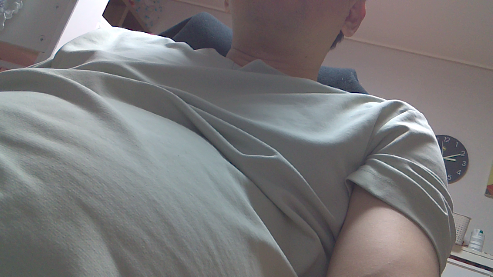
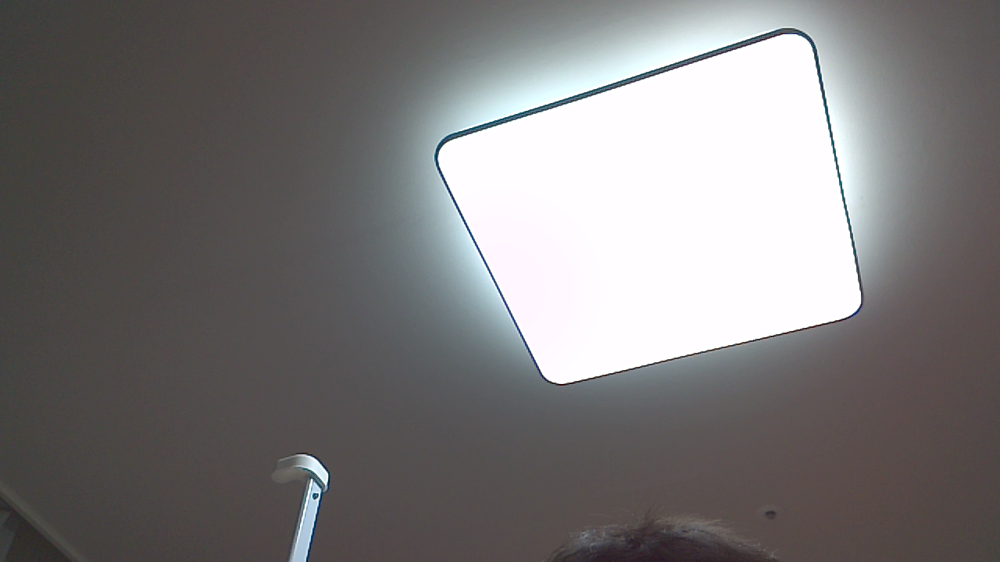

# Camera V2 두 개의 실물 촬영 검증

확인일: **2026-10-24 KST**, 보드 `jetson@192.168.219.127`. 사용자가 Camera V3 두 개를 Camera V2로 교체한 뒤 검사했다. **센서 두 개의 인식·개별 촬영·동시 촬영과 실제 PNG 이미지 확인에 성공했다.**

## 부팅·센서·권한

처음 SSH가 응답하지 않았으나 이후 접속 시 보드는 이미 새로 부팅된 상태였다. 이 작업에서 추가 재부팅은 실행하지 않았다. boot ID는 `db574766-5526-4878-8218-4cb5d9a9f2c3`이다. 초기 부팅 로그는 시각 동기화 전 날짜가 들어 있어, 날짜 문자열만으로 촬영 시점을 판단하지 않는다. 프레임 속도는 GStreamer PTS, 동시 수신 구간은 monotonic clock으로 계산했다.

| 장치 | 커널·media topology | 결과 |
| --- | --- | --- |
| `/dev/video0` | IMX219 `7-0010`, `imx219_v2.0.6`, VI에 bound | sensor-id 0의 실제 영상 수신 |
| `/dev/video1` | IMX219 `8-0010`, `imx219_v2.0.6`, VI에 bound | sensor-id 1의 실제 영상 수신 |

기존 live DT의 IMX219 설정과 교체한 모듈이 맞아 별도 DTB·커널·BSP 변경 없이 촬영됐다. 시험은 GUI가 꺼진 프로젝트 모드에서 transient systemd unit으로 실행했다. 실제 촬영 UID는 **997(camerad)**, 그룹은 `camerad,video,render`이며 `NoNewPrivileges=yes`, `PrivateDevices=no`, `PrivateTmp=no`, 빈 DISPLAY로 실행했다. root로 카메라를 연 결과가 아니다. 영구 카메라 서비스나 GUI 자동 시작을 추가하지 않았다.

## 프레임 수신 결과

각 pipeline은 `nvarguscamerasrc → NVMM NV12 → nvvidconv → BGRx → RGB appsink`다. 요청한 출력은 **1280×720, 30fps**, 각 스트림 90프레임이다. Argus는 자동으로 Camera mode 5를 선택했다. 이 모드는 로그의 1280×720 모드이며 목록상 최대 120fps가 표시되지만, 이번 앱의 요청과 PTS 실측은 아래와 같이 약 30fps다. 120fps 촬영 성공으로 해석하지 않는다.

| 시험 | 센서 | 수신 프레임 | PTS 기준 fps | 최대 PTS 간격 |
| --- | --- | ---: | ---: | ---: |
| 개별 | 0 | 90 | 30.065 | 44.474ms |
| 개별 | 1 | 90 | 30.049 | 33.850ms |
| 동시 | 0 | 90 | 30.048 | 79.668ms |
| 동시 | 1 | 90 | 30.055 | 36.584ms |

모든 스트림의 PTS는 증가했다. 두 카메라가 실제로 겹쳐 수신된 구간은 **2.919초**다. 동시 센서0의 첫 프레임 간격은 79.668ms이고 다음 두 간격은 9.378/9.978ms로 시작 구간의 지터가 있었다. 이후 수신은 약 30fps였다. appsink는 최신 프레임 우선 `max-buffers=4 drop=true`이므로 이 결과를 무손실 보장이나 장시간 안정성·하드웨어 동기화 검증으로 보고하지 않는다.

시작 로그에 `nvbuf_utils: Could not get EGL display connection`, Argus의 `No override file found`·`LSC surface is not based on full res` 경고가 있었다. 이번 headless pipeline에서는 실제 프레임 취득과 정상 종료에 성공했다. 경고 자체를 없앤 것은 아니다. 촬영 후 커널 조회에서 IMX219 두 센서의 bound 상태를 확인했고 조회한 CHANSEL/PXL_SOF/VI 오류 패턴은 나타나지 않았다. Argus·SSH active, GUI·ROS inactive, 기본 target `multi-user.target`을 유지했다.

## 실제 촬영 이미지

수신한 RGB 프레임을 PNG로 저장하고, 보드와 다운로드 파일의 SHA-256 일치를 확인한 뒤 두 동시 촬영 이미지를 직접 열어 검토했다. 영상이 검정 화면이나 같은 화면의 복제가 아니며 두 모듈은 서로 다른 방향의 장면을 보여 준다. sensor0은 가까운 피사체의 윤곽·옷감이 보이고, sensor1은 천장과 조명이 보인다. 조명 부분은 과노출돼 있으며 장착 방향·노출·정밀 초점 보정은 별도다.

sensor-id 0, 두 카메라 동시 촬영:



sensor-id 1, 두 카메라 동시 촬영:



개별 촬영 원본: [sensor0](camera-check/2026-10-24-v2/single-0-sensor-0.png), [sensor1](camera-check/2026-10-24-v2/single-1-sensor-1.png).

## 재현과 원본 기록

구현은 [verify-csi-cameras.py](../../tools/jetson/verify-csi-cameras.py)다. 기존 `check-csi-camera.py`의 1프레임 점검도 보존했다. 보드 설치본은 root 소유 `/opt/300seconds/jetson/verify-csi-cameras.py`이며 결과 원본은 camerad 전용 `/var/tmp/300seconds-camera-v2-20261024/`에 있다. 다음 재시험에는 기존 결과와 구분되는 새 출력 폴더와 unit 이름을 사용한다.

```bash
sudo systemd-run --unit=300seconds-camera-recheck --wait --collect --pipe \
  -p User=camerad -p Group=camerad -p 'SupplementaryGroups=video render' \
  -p NoNewPrivileges=yes -p PrivateDevices=no -p PrivateTmp=no --setenv=DISPLAY= \
  /usr/bin/python3 -B /opt/300seconds/jetson/verify-csi-cameras.py \
  /var/tmp/300seconds-camera-recheck --frames 90
```

| 원본 | 내용 |
| --- | --- |
| [센서·드라이버 조사](board-info/2026-10-24/camera-v2-preflight.json) | video0/1, V4L2 포맷, media links, IMX219 driver bound, live DT. `modules` 항목의 inline Python 명령은 인용 오류로 실패했으며 실제 capture 프로그램의 import·실행 성공이 후속 근거다 |
| [촬영 결과 JSON](board-info/2026-10-24/camera-v2-capture-results.json) | 실제 UID/그룹, 360프레임 전체 PTS, pipeline·fps·해상도·PNG 해시·동시 수신 구간 |
| [transient 서비스 실행 로그](board-info/2026-10-24/camera-v2-capture.log) | 센서 모드·경고·실제 프레임 정보·정상 종료, 전체 runtime 14.100초 |
| [촬영 후 상태](board-info/2026-10-24/camera-v2-postcheck.log) | 모드, SSH/Argus/GUI/ROS 상태, 커널·Argus journal |

이전 IMX708의 취득 실패는 [기존 실물 점검 문서](Jetson_Nano_디바이스_권한과_실물점검.md)에 이력으로 남긴다. 이번 결과는 교체한 V2 두 개의 짧은 촬영 검증이며 Rust `camerad` 구현·AI 추론·Pico/오디오와 전체 동시 부하까지 완료한 결과는 아니다.
