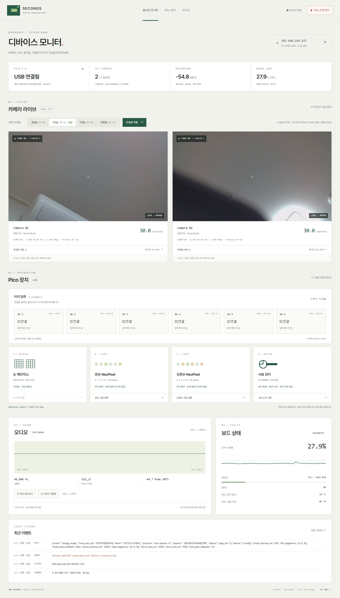

# Jetson Nano FastAPI 장치 대시보드

최신 운영 변경(2026-10-24): 사용자 요청으로 이 모니터는 **disabled/inactive**다. 아래 자동 시작·화면 결과는 이전 구현 검증 이력이며, 이후 [Rust runtime 전환](Rust_마이크로아키텍처_실행과_검증.md)을 따른다.

2026-10-24 KST, 실제 `192.168.219.127` Nano와 USB Pico 2 W에서 구현·배포·점검했다. 소스는 [apps/device-dashboard](../../apps/device-dashboard/README.md)에 있다.

## 접속과 최종 배포 상태

- 웹: <http://192.168.219.127:8000>
- RTSP/RTP: `rtsp://192.168.219.127:8554/cam0`, `rtsp://192.168.219.127:8554/cam1`
- JSON: `/api/status`, `/api/health`, `/openapi.json`; WebSocket: `/ws/status` (2 Hz)
- `300seconds-dashboard.service`: **enabled / active(running)**. 사용자가 전원을 다시 켠 뒤에도 자동 시작된 것을 SSH에서 확인했다. 최종 안정 경로로 재배포 후 상태도 다시 확인했다.
- 기본 영상은 두 채널 **1280×720 / 30fps**, 브라우저는 **640×360 / 최대 15fps**다.
- GUI는 `multi-user.target` / display-manager inactive, ROS 실행 unit 0개를 유지했다. ROS/DDS RTPS는 사용하지 않으며 요청의 영상 전송은 RTSP/RTP로 구현했다.

마지막 실제 연결 상태·설치는 [최종 상태 JSON](board-info/2026-10-24/dashboard-final-safety-config.json), [배포 파일 해시](board-info/2026-10-24/dashboard-source-manifest.json)를 따른다. 핵심 소스 8개의 Nano clone/실행 배포본/로컬 저장소 바이트 일치를 확인했다.

## 화면과 실제 데이터



[모바일 전체 화면](dashboard-check/2026-10-24/dashboard-mobile.png), [카메라 0 원본](dashboard-check/2026-10-24/camera0.jpg), [카메라 1 원본](dashboard-check/2026-10-24/camera1.jpg).

| 장치 | 구현·실제 확인 | 판정의 한계 |
| --- | --- | --- |
| Pico USB | 통합 `c0de:cafc`, `/dev/pico-device`, 세션·상태 수신, Stop ACK `Ok`, OE HIGH, faults 0 | USB 응답을 물리 구동 성공으로 해석하지 않음 |
| 터치 6개 | **미연결**, 사용자 확인. UI에서 미연결 표시, 로컬 시험 비활성 | 미연결 GPIO의 raw `55` 등은 실제 눌림으로 해석하지 않음 |
| NeoPixel | 왼손/오른손 각각 4+4+10=18개, ACK Ok·done=true·fault=false 및 **사용자 실제 LED 점등 확인** | 발광 센서 피드백은 없음 |
| MAX7219 | **미연결**, 사용자 확인. 눈/전체 시험 API와 버튼 비활성 | SPI 출력만으로 설치 여부를 자동 감지하지 않음 |
| PCA9685/서보 | 6채널 유한 순차 시험 ACK Ok·done=true·fault=false, 종료 후 OE HIGH, **사용자 실제 움직임 확인** | 개별 6축 각도·부하 계측은 별도 |
| CSI 0·1 | IMX219 두 대 동시 촬영, H.264 인코딩, 실제 RTSP 디코딩과 MJPEG 표시 | 카메라 방향은 실제 설치 상태를 그대로 표시 |
| 마이크 | C-Media, 48,000 Hz / S16_LE / mono, 파형·RMS·peak, 최근 3초 WAV | 임의 샘플·가상 파형을 사용하지 않음 |
| 스피커 | 실제 `aplay` PCM 재생 종료 코드 0, 유한 3음 시험·최근 녹음 재생 버튼 | 이번 재생의 청감 확인을 대신하지 않음. 이전 장치 점검에서는 사용자가 시험음 청취 확인 |

사용자가 스위치와 매트릭스가 미연결이라고 확인한 뒤 `installation.json`에 반영했다. `local_tests_enabled=false`, `test_switch=0`을 적용해 미연결 SW6 입력을 정지/로컬 시험 선택에 사용하지 않는다. 미연결 터치 이벤트는 UI 이벤트 목록에도 넣지 않는다. 원본 GPIO mask는 진단용 JSON에 남기되 눌림·장치 연결의 증거로 해석하지 않는다. 향후 실제 스위치 연결 시 설치 정보와 극성을 확인한 뒤 기능을 활성화한다.

이전 설정에서는 미연결 GP11 HIGH를 SW6 정지 입력으로 취급해 `RunTest`가 `Fault`로 거부됐다. 설정을 고친 뒤 왼손·오른손·서보 세 시험이 모두 완료됐다. [구동 시험 원본 로그](board-info/2026-10-24/dashboard-actuator-check.log), [전체 JSON](board-info/2026-10-24/dashboard-actuator-results.json)의 각 모듈은 HTTP 200/ACK Ok, `done=true,fault=false`이고 최종 Stop 후 faults 0/OE HIGH다. 사용자가 LED 점등을 확인했고, 서보는 처음에는 외부 V+ 전원 미연결이었으나 후속 답변에서 실제 움직임도 확인했다. 개별 축의 정확한 각도나 부하를 계측한 것은 아니다. 명령 완료 자체가 전원·각도 센서 피드백을 뜻하지 않으며, [핀·전원 문서](Pico2_핀배정_및_전원.md)의 외부 서보 전원과 공통 GND가 필요하다.

## 구성과 라이브러리

```text
브라우저 ─ HTTP/MJPEG + WebSocket ─ FastAPI (Uvicorn 1 worker)
                                   ├─ Rust USB owner ─ COBS/Postcard/CRC ─ Pico
                                   ├─ media_worker ─ Argus CSI 0 / CSI 1
                                   │                ├─ NVMM / H.264 ─ 공유 RTSP
                                   │                └─ 640×360 / JPEG ─ 최신 사진
                                   └─ ALSA capture/playback ─ USB 오디오
```

API와 네이티브 멀티미디어를 별도 프로세스로 분리했다. USB는 Rust만 연다. FastAPI는 검증한 JSON 명령을 loopback UDP `127.0.0.1:37920`으로 전달한다. 세션·lease·Stop 선점·상관된 Status/ACK 확인은 기존 Rust 경계를 유지한다. 구동 명령 재생이나 자동 시험은 없다.

Python 3.8 호환 조합을 전용 `/opt/300seconds/dashboard/venv`에 설치했다: FastAPI 0.115.12, Uvicorn 0.33.0, Pydantic 1.10.24, websockets 13.1. 정확한 의존성은 [freeze](board-info/2026-10-24/dashboard-python-freeze.txt), 검사 결과는 [pip check](board-info/2026-10-24/dashboard-pip-check.txt)에 보존했다. distro `gi`, `numpy`, `psutil` 세 패키지만 venv에 연결하며 `/usr/local`의 전역 TensorFlow 의존성을 가져오지 않는다. FastAPI/RTSP 의존 패키지 외에 GUI나 ROS를 추가 설치하지 않았다.

전용 계정은 `boarddash`(uid 996), 그룹은 audio/video/render/robot-device/dialout이다. `/dev/video*`는 video 0660, USB 오디오는 audio 0660, Pico는 기존 robot-device udev 규칙으로 접근한다. root 웹 서버나 0666 권한을 사용하지 않는다. [서비스·권한 실제 상태](board-info/2026-10-24/dashboard-service-state.txt)를 따른다.

앱/바이너리는 root 소유, runtime은 `/run/300seconds-dashboard` tmpfs, 저장 설정은 `/var/lib/300seconds-dashboard`, 환경은 `/etc/300seconds/dashboard.env`다. 마이크는 최대 약 6초 RAM 링 버퍼, 카메라는 JPEG 두 장과 현재 상태만 보관한다. 네이티브 로그는 256 KiB에서 순환한다. 웹 탭이 숨겨지면 WebSocket과 MJPEG를 닫고 다시 보일 때 연결한다. HTTP POST는 동일 Origin과 랜덤 CSRF 토큰을 검사한다. 인증은 없는 지정 LAN 주소 서비스다.

## 영상 최적화와 실측

최종 경로는 `nvarguscamerasrc → NVMM NV12 → tee`를 사용한다. 각 H.264 갈래는 최신 1프레임 queue와 `nvvidconv → omxh264enc → h264parse`를 거친다. JPEG 갈래는 `nvvidconv(I420 640×360) → videorate(15fps) → jpegenc quality=72`다. RTSP는 appsrc로 인코딩 결과를 공유하며 카메라를 다시 열지 않는다. H.264 약 2.5 Mbps/채널, I-frame 간격 30, SPS/PPS 삽입, `rtph264pay config-interval=1`, RTSP queue 2프레임을 사용한다. 검증 클라이언트는 TCP, `latency=100`으로 설정했다.

이 보드의 GStreamer/NVIDIA 버전 조합에서 `nvv4l2h264enc`는 프레임을 만들지만 `gst_buffer_resize_range` critical 경고가 반복됐다. 같은 조건의 `omxh264enc`는 해당 경고 없이 동작해 최종 기본값으로 선택했다. 전역 GStreamer 교체나 경고 숨김을 하지 않았다. 이는 이 이미지에서의 비교 결과이며 다른 JetPack에도 OMX를 권장한다는 뜻은 아니다. 관련 공식 참고: [NVIDIA 버퍼 풀 설명](https://forums.developer.nvidia.com/t/bufferpool-issue-with-v4l2-elements-jetpack-5-0-2/243916), [GStreamer shared RTSP factory](https://gstreamer.freedesktop.org/documentation/gst-rtsp-server/rtsp-media-factory.html).

최종 재부팅·안정 경로의 [원본 검증 JSON](board-info/2026-10-24/dashboard-final.json)에서:

| 항목 | 카메라 0 | 카메라 1 |
| --- | ---: | ---: |
| 실제 촬영 FPS | 30.01 | 30.00 |
| 실제 인코딩 FPS | 30.00 | 30.00 |
| JPEG 전달 FPS | 15.02 | 15.00 |
| H.264 Mbps | 2.502 | 2.481 |
| RTSP 실제 I420 디코딩 | 90프레임 / 30.24fps | 90프레임 / 30.01fps |

샘플 12개의 전체 보드 CPU 평균은 29.8%, 사용 메모리 평균 1,535 MiB, 최고 센서 온도 50°C였다. 이는 앱 프로세스 전용 메모리나 장시간 벤치마크가 아니다. 원격 개발 등 다른 보드 작업을 포함한다. FPS는 설정값과 분리해 실제 프레임 PTS 및 전달 시각으로 계산한다. 인코더 최신 PTS 차이는 0~수십 ms였지만 실제 유리창 간 영상 지연을 측정한 것은 아니다.

Windows에서도 [cam0](board-info/2026-10-24/dashboard-lan-rtsp0.log), [cam1](board-info/2026-10-24/dashboard-lan-rtsp1.log)을 ffmpeg로 각각 60프레임 디코딩했다. ffmpeg 처리 속도 `speed`는 영상의 실제 FPS와 구분한다.

### 후보 프로필 시험과 제외한 변경

360p30, 720p60, 1080p30, 720p30을 두 센서에서 시험했다. 아래 후보 측정은 **미리보기의 videorate를 NVMM 단계로 옮긴 실험 경로**의 짧은 측정이다. 최종 배포 경로의 성능표로 사용하지 않는다.

| 후보 | RTSP 디코딩 FPS 0 / 1 | 전체 CPU 평균 | 원본 |
| --- | --- | ---: | --- |
| 640×360 / 30 | 30.01 / 30.23 | 24.2% | [JSON](board-info/2026-10-24/dashboard-360p30.json) |
| 1280×720 / 60 | 59.98 / 59.98 | 36.6% | [JSON](board-info/2026-10-24/dashboard-720p60.json) |
| 1920×1080 / 30 | 30.01 / 29.98 | 23.1% | [JSON](board-info/2026-10-24/dashboard-1080p30.json) |
| 1280×720 / 30 | 30.02 / 30.01 | 24.2% | [JSON](board-info/2026-10-24/dashboard-720p30.json) |

이 실험 뒤 최종 반복 검증 중 Nano의 SSH/HTTP/ping 응답이 모두 끊겼다. 개발 PC는 같은 LAN에 남아 있었고, 사용자 전원 재인가로 복구됐다. 이전 부팅의 persistent journal이 없어 원인을 확정할 수 없다. 실험 경로와 단절의 인과관계를 입증하지 않았다. 보수적으로 videorate를 CPU 프레임 변환 뒤의 기존 경로로 되돌렸고 기본값을 720p30으로 유지했다. 기존 경로에서도 네트워크 단절을 다시 관찰했으므로 영상 변경을 원인 또는 해결책으로 단정하지 않는다. 최종 경로에서는 양 채널 재디코딩·오디오·Pico Stop·브라우저 검증을 다시 통과했다. 60fps는 최종 경로에서 실제 표시 FPS와 부하를 확인하며 선택한다.

## Wi-Fi 연결과 제한된 진단 로그

실제 `192.168.219.127` 경로는 유선 eth0가 아니라 USB `0bda:8179` RTL8188EUS / `r8188eu` / wlan0다. 복구 후 eth0는 DOWN, Wi-Fi 링크 72.2 Mbps, WEXT Power Management off, USB `power/control=on`을 확인했다. 드라이버 내부 `rtw_power_mgnt=1`, `rtw_ips_mode=1`, `rtw_enusbss=0`이 별도로 남아 있었다. 재연결 뒤 보드 uptime도 짧아 이전 부팅의 단절 로그를 보존하지 못했다. 드라이버·전원·호스트 정지 중 무엇이 원인인지는 미확정이다.

[dashboard-network.py](../../tools/jetson/dashboard-network.py)는 기존 값을 `/var/lib/300seconds/dashboard-network/baseline.json`에 백업한다. 활성 wlan0 프로필의 NetworkManager powersave를 disable(2)로 명시했고, 다음 드라이버 로드 때 내부 절전을 끄도록 modprobe 옵션을 저장했다. **현재 런타임 내부 값 1을 0으로 바꾼 것은 아니다.** SSH를 유지하려고 드라이버 재로드나 NetworkManager 재시작은 하지 않았다. 값의 의미는 [NetworkManager 공식 문서](https://networkmanager.pages.freedesktop.org/NetworkManager/NetworkManager/nm-settings-nmcli.html)를 따른다.

다음 오류를 조사할 수 있도록 기존 journald의 영구 로그를 최대 16 MiB/파일 4 MiB/2일 보존, runtime 8 MiB로 제한했다. 새 감시 데몬을 추가하지 않았다. 적용 직후 사용량은 4 MiB였다. [실제 설정 결과](board-info/2026-10-24/dashboard-wifi-after.json)를 따른다. 원인 해결 또는 장시간 무중단을 입증한 것은 아니다.

```bash
sudo python3 ~/ict_makerton_2026/tools/jetson/dashboard-network.py status
sudo python3 ~/ict_makerton_2026/tools/jetson/dashboard-network.py restore
# 다시 적용
sudo python3 ~/ict_makerton_2026/tools/jetson/dashboard-network.py apply
```

restore는 원래 Wi-Fi 프로필/모듈 정책을 복원한다. 이전 프로젝트 journald 설정이 없었다면 volatile 기록으로 돌아가며 이미 수집한 파일은 보존한다. 기존 프로젝트 설정 파일이 있었다면 그 내용을 복구한다. 모듈 옵션 변경·복원은 다음 드라이버 로드 때 반영된다.

## Pico 펌웨어 교체와 연결 복구

사용자가 통합 펌웨어 교체를 명시적으로 승인했다. 기존 NeoPixel `c0de:caff`를 picotool USB Reset으로 BOOTSEL에 진입시킨 뒤, 4 MiB 전체 flash를 먼저 백업하고 통합 UF2를 썼다. load/verify/readback, 같은 serial의 `c0de:cafc` 재열거, `pico-device-v1` Status·OE HIGH를 확인했다. [실제 flash 결과](board-info/2026-10-24/dashboard-pico-flash-result.json)를 따른다.

- 보드 chip ID: `E679675A69C4039B`
- UF2 SHA-256: `e4f2352f342465035603079809e4103ef51acfde3f9cd5986199ebc230f9d44f`
- 기존 4 MiB 백업은 Nano의 `~/ict_makerton_2026/tmp/pico-flash/20261023T182828.948488Z-linux/previous-flash.bin`에 보존한다. Git에는 백업 바이너리를 넣지 않았다.
- 백업 SHA-256: `7570ec1f26cb83e2435acf285603f02ecdb46b49bac109eee0927f07a81512b8`
- 최종 Nano 호스트 바이너리 SHA-256: `05f62a8b0461593d34b10019da87ef5add3a6ef681e86278a3e543a696dc5569`

초기 연결에서 신원 응답 CRC 오류 및 HelloReply 유실을 관찰했다. 이전 소유자의 일부 텔레메트리가 남아 있는 초기 수신 상황과 비교했으나, 모든 유실의 물리적 원인을 확정한 것은 아니다. 호스트는 최초 신원 확인 전 **정지 효과를 가진 Hello만 250ms 간격/총 3초 한도로 재시도**하도록 보완했다. 신원 확인 후 구동 명령을 재전송하는 기능은 추가하지 않았다. 신원 응답 유실 회귀 검사를 포함한 Rust 호스트 9개 테스트와 기존 Stop 선점 검사가 통과했다. [빌드·검사 로그](board-info/2026-10-24/dashboard-rust-tests-build.log)를 따른다.

## 검증과 운영

실제 검사에서는 CSRF 누락/외부 Origin 403, 허용하지 않은 명령/프로필 422, 없는 카메라 404를 확인했다. 미연결 매트릭스/전체 시험은 USB 명령 전에 409로 거부한다. 마이크 WAV는 mono 48,000 Hz, 144,000샘플(3초)이었다. 스피커 PCM 종료 코드 0, Pico Stop HTTP 200 / ACK Ok / OE HIGH / running null을 확인했다. 별도 자동 회귀 3개는 오래된 Pico 상태, 이전 카메라 worker의 남은 파일, 미연결 매트릭스 시험 차단을 검사한다. API 응답만으로 모든 장치의 물리 시험을 완료했다고 판정하지 않았다.

Playwright에서 실제 MJPEG 두 장의 naturalWidth 640, 마이크 WAV duration 3초/readyState 4/재생 종료, 미리보기 중지 시 img src 제거와 Pico 텔레메트리 유지, 모바일 390px 가로 넘침 없음, 최종 새 브라우저 세션 콘솔 오류 0개를 확인했다. 미연결 스위치·매트릭스 표시와 관련 시험 차단을 확인했다. [브라우저 QA 기록](board-info/2026-10-24/dashboard-browser-qa.json)을 참고한다.

```bash
sudo systemctl status 300seconds-dashboard
sudo journalctl -u 300seconds-dashboard -n 60 --no-pager
sudo systemctl restart 300seconds-dashboard
sudo systemctl disable --now 300seconds-dashboard # 자동 시작/실행 중지
sudo systemctl enable --now 300seconds-dashboard  # 복원
```

프로필은 화면에서 적용하고 성공 시 저장한다. 실패하면 이전 프로필로 복구한다. Pico USB가 빠졌거나 세션이 종료되면 다시 연결한 뒤 화면의 재시도 버튼을 누른다. 펌웨어 업데이트 전에는 USB 독점을 해제하기 위해 이 서비스를 중지한다. 자동 flash나 자동 구동 시험은 서비스 설치·시작에 포함되지 않는다. 설치·검증 재현 명령과 API 목록은 [앱 README](../../apps/device-dashboard/README.md)를 따른다.
