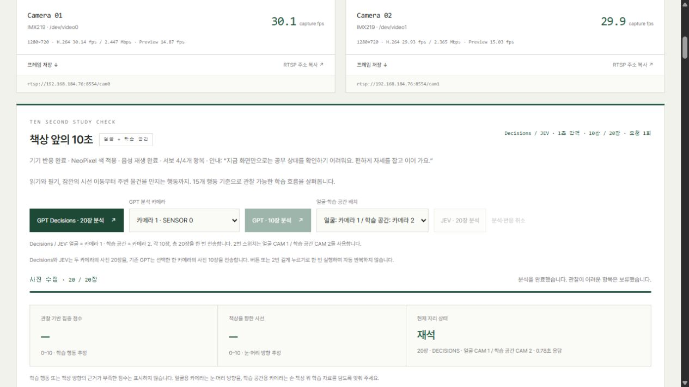

# Decisions 20장 분석과 기기 반응 검증

2026-10-25 KST. 사용자 요청으로 SW2 길게 누르기와 웹 Decisions 버튼을 추가하고 Nano에 배포했다. 기능·운영 방법은 [설계 문서](../../../Decisions_학습분석과_기기반응.md)를 따른다.

## 실제 결과

| 항목 | 최초 실행 | 최종 코드 재검증 |
| --- | --- | --- |
| 작업 ID | `4d6219ee27094e7db8b8b43c4668d311` | `3184d231ff944d699ede0a000d9506f1` |
| 시작 | 2026-10-25 04:39:45 KST | 2026-10-25 04:43:54 KST |
| 이미지 | 두 카메라 각 10장 / 총 20장 | 두 카메라 각 10장 / 총 20장 |
| Decisions 요청 | 1회 | 1회 |
| API 응답 | 4,126.6ms | 777.3ms |
| 입력 토큰 | 7,115 | 7,115 |
| 추정 비용 | $0.0007115 | $0.0007115 |
| 반응 | 주황 RGB230,155,25 / 근거 부족 안내 | 같은 분류·색·안내 |
| 음성 | cached Typecast → aplay 성공 | cached Typecast → aplay 성공 |
| 서보 | 1~4번 각각 90→94→90° 완료 ACK | 1~4번 각각 90→94→90° 완료 ACK |
| 반응 종료 | Stop / 활성 서보 세션 없음 / faults0 | Stop / 활성 서보 세션 없음 / faults0 |
| 중복·Live 진입 | 모두 409 | 모두 409 |

최종 실행은 수집부터 반응 종료까지 약16.42초였다. 두 요청의 추정 합계는 $0.0014230이며 기존 OpenAI 5회 테스트 원장은 변하지 않았다. 실제 청구는 OpenAI 사용량을 따른다. 최종 상태는 연속 관찰 enabled=true다. 카메라 장면에 학습 행동·책상 시선 근거가 충분하지 않아 두 점수 모두 보류했고, 재석만 표시했다.

## 검사 범위

- Nano 배포 전 대시보드 관련112개, 제공자·수집 관련82개 검사 통과(`dashboard-tests.log`, `provider-tests.log`).
- 제공자 예외 타입 보완 후 서비스2개 검사 통과(`final-service-tests.log`).
- 최종 각도 기준 보완 후 Nano 반응·버튼·서보41개 검사 통과. Stop 후0 초기화가 다음 실행의 실제 각도 기준으로 사용되지 않도록 별도 회귀 검사를 추가했다.
- JavaScript 구문 검사와 변경 파일 `git diff --check` 통과.
- 웹의 실제 Decisions 버튼으로 두 번 실행했다. UI의 완료·음성·LED·4/4개 서보·안내 문장 표시를 확인했다.
- 실제 SW2 물리 입력은 이번 원격 검증에서 누르지 않았다. 번호 안내·실제 4회 비프음 완료·요청1회·세션 변경·취소 게이트는 펌웨어 이벤트를 사용한 자동 검사 범위다.
- LED 명령 ACK·서보 완료 ACK·ALSA 재생 성공은 실제 발광·청감·축 각도의 센서 측정과 구분한다.

## 증거

- `public-verification.json`: 최초·최종 실제 분석과 장치 반응의 기술 검증 요약. 개인 관찰·대화가 섞일 수 있는 원본 JSON·로그 네 파일은 로컬에만 보관한다.
- `dashboard-completed.png`: 최종 웹 화면.
- `speech-cache.log`: 네 문구 캐시 생성 완료.
- `deployment.json`, `install.log`, `restore-status.log`, `final-fix-deploy.log`: 배포·백업·서비스 복구 기록.

Nano의 완료 결과는 `/var/lib/300seconds-dashboard/study-reactions/<job-id>.json`에 남긴다. 배포 전 백업은 `/var/lib/300seconds-dashboard/backups/decisions-reaction-20261024T193006Z`다. 기존 자동 눈 표정·관찰 프롬프트·로그 분석 변경을 보존하며 작업 파일만 교체했다.

