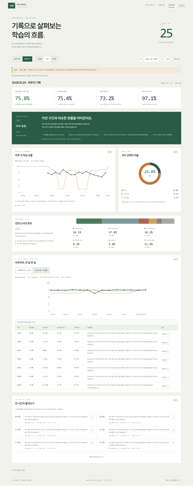

# 로그 분석 검증 · 2026-10-25

[사용 방법·집계 기준·배포 문서](../../../로그_분석_총평과_데모.md)

- `deployment.json`: 초기 배포의 백업 위치·파일 해시·기존 관찰 4,380건 보존·데모 분리·관찰과 자동 눈 상태 복원.
- `live-check.json`: 배포 후 실제/데모 지표의 합계 일치, 시간·날짜·월별 총평 저장, 수집·눈 활성 상태를 조회한 읽기 전용 실측 결과. 측정값은 당시 시점이다.
- `checks.json`: 로컬 96개·Nano 66개 검사와 배포 브라우저 검증 요약, 최종 로컬 소스 해시.
- `desktop.png`, `mobile.png`: 실제 Nano에서 렌더링한 데모 화면. 단순 목업이 아니다.

초기 배포 뒤 감정 단서의 세 번째 장기 추세선과 표 열을 추가해 HTML·JS만 갱신했다. `deployment.json`의 두 자산 해시는 초기 버전이며 최종 소스는 `checks.json`을 따른다. 최종 브라우저 검사에서 세 추세선, 14일·12개월 전환, 24개 시간별 총평, 날짜/월별 상세 이동, 실제/데모 전환, 메인 진입 링크를 확인했다. 1440·800·390px에서 메인·분석 화면 가로 넘침과 자바스크립트 오류가 없었다.

검증 동작은 분석 GET 조회와 화면 이동으로 제한했다. 새 카메라 분석이나 장치 제어 명령을 보내지 않았으며 기존 연속 관찰은 복원 후 계속 동작한다.

