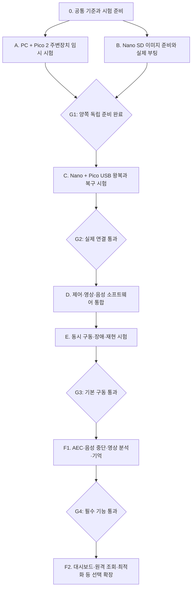

# Pico 2 · 구형 Jetson Nano 개발 단계 및 점검표

작성일: 2026-10-23, 한국 시간

문서 상태: A 트랙의 Rust 환경 구성·펌웨어 업로드·실제 USB/I2C 통신과 단회 순차 출력 명령을 확인했다. 실제 회전각 보정·기구/전원 측정·최종 통신 규약과 나머지 장치는 미완료이며, 확인된 항목만 체크한다.

기술 기준: [소프트웨어 아키텍처 계획](소프트웨어_아키텍처_계획.md). Nano는 Rust/Tokio, Pico 2는 Rust/Embassy, 보드 간 통신은 USB CDC-ACM을 사용한다.

## 1. 진행 순서

**공통 준비 → A(Pico 임시 구동)와 B(Nano SD 준비)를 병렬 진행 → C(실제 USB 연결) → D(기본 소프트웨어 통합) → E(기본 구동 검증) → F(필수 고급 기능 및 선택 확장)** 순서로 진행한다.



A는 개발 PC에 Pico를 연결해 진행하므로 Nano SD가 없어도 된다. B는 Pico 없이 진행한다. Rust 빌드 도구와 임시 시험 도구 개발은 병렬로 해도 되지만, 같은 실제 장치나 SD 카드에 두 작업자가 동시에 쓰지 않는다.

각 gate는 다음 단계의 시험 범위를 판단하는 기준이다. 불합격·부품 부족은 해당 기능에 의존하는 시험을 차단한다. 독립적인 코드 작성·mock 시험·카메라/오디오 조사는 계속할 수 있으나, 차단된 gate를 통과로 바꾸지는 않는다.

## 2. 점검과 결과 기록 방법

- 작업 ID별 체크박스는 **통과 조건과 증거를 확보했을 때만** 체크한다. 작업 중이거나 빌드만 성공했다면 해당 사실만 시험 기록에 적는다.
- 단계 상태는 `미점검 / 진행 중 / 통과 / 실패 / 차단 / 해당 없음`으로 관리한다. 해당 없음에는 제외 이유·영향 범위를 남긴다.
- 결과 범위는 `빌드 / 모의 시험 / 실물 단독 / 실물 통합`으로 구분한다. 빌드·모의 시험은 실물 시험을 대체하지 않는다.
- 매트릭스 1개 시험은 2개 시험의 완료가 아니다. 서보 1축·LED 일부·다른 SD 이미지의 결과를 전체 결과로 확대하지 않는다.
- 담당자·시작/완료일·목표값은 정해지기 전까지 `미정` 또는 `작성 예정`으로 남긴다.
- 시험 기록은 [시험 기록 양식](시험_기록_양식.md)을 복사해 작성한다. 같은 ID를 재시험하면 기록을 덮어쓰지 않고 새 RUN을 만든다.
- firmware/app commit 또는 소스 스냅샷 해시, 실제 실행 바이너리 해시, 설정·배선 버전을 함께 남긴다. 최신 통과 결과가 어떤 구성의 결과인지 추적할 수 있어야 한다.
- 결함이 발생하면 재현 조건·예상/실제 결과·다음 조치를 기록한다. 수정 뒤 영향받는 시험을 다시 수행한다.

### 전체 진행표

| 단계 | 담당 | 상태 | 최신 RUN/증거 | 차단 사유·다음 조치 |
| --- | --- | --- | --- | --- |
| 0 공통 준비 | 미정 | 미점검 | 작성 예정 | 현품·전원·시험 범위 확인 |
| A Pico 임시 구동 | 미정 | 진행 중 | [RUN-20261023-02](test-results/2026-10-23/RUN-20261023-02.md) | Rust/UF2/USB/0x41 및6채널 순차 움직임 확인. 500~2500µs에서 회전폭 증가·걸림/이상음 없음 보고. 실제 각도·전원·기구와 나머지 장치 점검 필요 |
| B Nano SD 준비 | 미정 | 미점검 | 작성 예정 | A와 병렬 진행 |
| C USB 실제 연결 | 미정 | 미점검 | 작성 예정 | G1 확인 후 진행 |
| D 기본 소프트웨어 | 미정 | 미점검 | 작성 예정 | G2 확인 후 실물 통합 |
| E 기본 구동 시험 | 미정 | 미점검 | 작성 예정 | D 통합 후 진행 |
| F1 필수 고급 기능 | 미정 | 미점검 | 작성 예정 | G3 확인 후 기능별 회귀 시험 |
| F2 선택 확장 | 미정 | 미점검 | 작성 예정 | 필수 기능과 구분해 범위 선정 |

## 3. 단계 0 — 공통 준비

진입 조건: 아키텍처 방향 합의. 실행 대상은 구형 Nano와 Pico 2이며, 양쪽 모두 Rust를 우선한다.

- [ ] **P-01 현품 식별:** Pico 2 모델, Nano 모듈·캐리어·RAM·SD 부팅 방식, 카메라, USB 오디오와 각 말단 장치의 모델/수량을 기록한다. 모르는 값은 미정으로 둔다.
- [ ] **P-02 전원·배선 기준:** 공급원·출력전압·극성·GND·레벨 변환·서보 전원 분기를 확인하고 배선도/핀 표의 버전을 부여한다. 노출·분리된 전원선은 수리·절연 후 시험한다.
- [ ] **P-03 시험 범위:** 서보 6축, LED 실제 픽셀 수, 눈 2개, 터치 6개 중 보유/미보유를 구분한다. 현재 문서상 매트릭스는 보유 1개·계획 2개이므로 추가품 확인을 작업으로 남긴다.
- [ ] **P-04 공통 계약:** protocol version, Hello/Status/Stop, 단위, CRC/COBS, 부팅 시 동작 금지, 재연결 시 이전 동작 폐기 원칙을 고정한다. 지연 목표는 측정 구간과 함께 시험 전에 정한다.
- [ ] **P-05 개발·증거 위치:** host/firmware 빌드 위치, 소스 버전, 배선·보정 설정, RUN 기록 위치, 실물 사진·로그 보관 위치를 정한다.

완료 조건: A/B 시작에 필요한 현품·전원·시험 기준이 기록되어 있다. 특정 부품이 미확정이면 해당 부품의 통전 시험만 보류하고 독립적인 빌드·SD 조사 작업은 진행한다.

## 4. 병렬 A — PC + Pico 2 말단 장치 임시 구동

목적: Nano 없이 각 부품이 실제로 동작하는지 확인하고, 통합에 재사용할 드라이버·보정값·공통 codec을 확보한다.

2026-10-23 진행 기록: Pico 2 / RP2350, SunFounder PCA9685 주소0x41, CH0~CH5에서 Rust 임시 펌웨어의 USB 통신·순차 서보 움직임을 확인했다. [Pico–PCA9685 배선과 초기 점검](A_Pico2_PCA9685_배선과_초기점검.md)에 배선과 전원 구분을 기록했다. [RUN02](test-results/2026-10-23/RUN-20261023-02.md)에500~2500µs 시험 결과를, [SpotMicro 조사](research/CLS6336HV_SpotMicro_구동자료_조사.md)에 관련 원본 설정을 남겼다. 축별 보정·부하·단절/정지와 나머지 장치는 미완료다.

### A1. Rust 최소 펌웨어와 PC 시험 연결

- [x] **A-01 최소 부팅:** Embassy/RP235x target으로 빌드·업로드하고 실제 실행을 확인한다. toolchain·의존성·firmware hash를 기록한다. 부팅만으로 서보가 움직이는 데모는 사용하지 않는다. [실제 결과](test-results/2026-10-23/RUN-20261023-01.md)
- [ ] **A-02 PC ↔ Pico:** PC용 Rust `devicectl`로 USB CDC Hello/Status를 왕복한다. 실물 USB ID·firmware version을 기록하고, 제어 채널에 로그 문자열을 섞지 않는다.

  진행 기록: 임시 Rust `pico-servo-bench` 도구의 ASCII Status/Scan/Sweep/Stop은 실제 COM7에서 확인했다. 최종 공통 protocol의 Hello와 binary framing은 아직 구현하지 않아 A-02 전체 체크는 보류한다.
- [ ] **A-03 프로토콜 기초:** golden vector, 분할/연속 frame, CRC 오류, 초과 길이, 중복 명령, 잘못된 버전과 Arm 전 동작 거부를 확인한다. host codec 테스트와 실물 USB 수신 테스트 결과를 따로 남긴다.

### A2. 말단 장치별 시험

전원·레벨 확인을 마친 부품부터 하나씩 연결한다. **네오픽셀 → 매트릭스 → 터치 → 서보**를 권장하되, 부품 준비 상황에 따라 독립 항목 순서는 바꿀 수 있다.

- [ ] **A-04 NeoPixel 1픽셀:** 실제 IC/색상 순서·전원·신호 방식을 확인하고 낮은 밝기에서 단색/소등을 시험한다. 고정색 유지에 반복 송신이 필요 없는지 확인한다.
- [ ] **A-05 NeoPixel 전체:** 실제 픽셀 수를 확인하고 스트립 연결 순서·영역별 색상·밝기 제한·로컬 효과·Stop 동작을 시험한다. 잠정 42픽셀을 실측값으로 갱신한다.
- [ ] **A-06 매트릭스 1개:** MAX7219 초기화, 점/행/열 bitmap, 방향·밝기·소등을 확인한다.
- [ ] **A-07 매트릭스 2개:** 좌우 다른 표정·연결 순서·전체 소등을 확인한다. 1개만 있으면 이 항목은 차단으로 남기고 A-06 결과만 통과 처리한다.
- [ ] **A-08 터치 1개:** 출력전압·active level·토글/순간 모드를 확인하고 눌림/해제와 debounce를 시험한다.
- [ ] **A-09 터치 6개:** 채널 매핑·연속/동시 입력·중복 억제·현재 bitmask를 확인한다. 외장 안쪽에 붙인 뒤의 감도 시험은 조립 단계 결과로 별도 기록한다.
- [ ] **A-10 서보 1축:** 하중·기구를 분리하거나 지지한 상태에서 작은 범위부터 시험한다. 중립·축 방향·허용 펄스/각도·전원 상태를 기록하고 보간·Stop을 확인한다. 미확인 사양의 최대각도·스톨 시험을 기본 절차로 삼지 않는다.
- [ ] **A-11 서보 6축:** 개체별 보정과 채널 매핑을 마친 뒤 단계적으로 동시 구동한다. 전압 강하·발열·리셋·간섭을 확인한다. 기구 결합 전 전기적 시험과 결합 후 동작 범위 시험을 구분한다.

### A3. 한 펌웨어에서 공존·정지·재시작

- [ ] **A-12 동시 실행:** 장치별 임시 예제에서 검증한 드라이버를 하나의 Embassy 펌웨어로 합치고 LED·눈·터치·서보가 서로 굶기거나 멈추지 않는지 확인한다.
- [ ] **A-13 단절/정지:** USB 분리, PC 시험 프로그램 종료, heartbeat 만료, Pico reset, Stop 뒤 후속 목표값을 각각 시험한다. 재연결 후 과거 동작이 재실행되지 않는지 확인한다.
- [ ] **A-14 인계 묶음:** 통합 시험용 firmware, 공통 protocol, 핀 표, 채널/보정 설정, 미해결 결함, RUN 결과를 고정한다. servo Stop의 토크 유지/출력 차단 정책은 실제 기구 조건과 함께 기록한다.

완료 산출물: PC에서 제어 가능한 통합 시험용 Pico 펌웨어와 장치별 실물 결과. 단순 점등 영상이나 각 부품의 별개 예제 성공만으로 A 전체를 통과시키지 않는다.

**임시 코드 관리:** 처음부터 장치 드라이버·codec은 재사용 모듈로 두고 시험 진입점만 분리한다. mock·자동 반복 demo·출력 제한 해제는 시험용임을 표시한다. Nano 통합 시 통신·Stop·보정 제한을 제거한 임시 코드를 그대로 사용하지 않는다.

## 5. 병렬 B — Nano SD 이미지 준비와 독립 기초 시험

목적: Pico 작업과 별도로 Nano가 재현 가능한 OS·Rust·카메라·오디오 환경으로 부팅되도록 준비한다.

여기서 SD를 ‘빌드한다’는 것은 **보드에 맞는 공식 이미지/플래시 경로 선정 → 카드 기록 → 부팅 → 필요한 런타임과 설정 구성 → 재현/복구 자료 확보**를 의미한다. 초기 단계부터 커널·Yocto 이미지를 새로 만드는 작업을 요구하지 않는다.

### B1. 이미지·카드 선정과 기록

- [ ] **B-01 보드·이미지 일치:** Nano의 2GB/4GB·캐리어·SD/eMMC 구성을 확인하고 해당 보드의 공식 설치 경로를 선택한다. JetPack 4.6.x라는 이름만으로 모든 SD 이미지가 같은 보드·L4T 버전이라고 가정하지 않는다.
- [ ] **B-02 기존 데이터 보존:** SD 카드 식별정보·용량·기존 데이터 보존 필요를 확인한다. 필요한 백업을 확보하고, 기록할 대상 카드와 PC의 다른 디스크를 구분한다.
- [ ] **B-03 이미지 확보:** 원본 URL·파일명·다운로드일·SHA-256을 기록한다. 공식 checksum이 있으면 비교하고, 없으면 자체 해시임을 표시한다. SD 기본 이미지 버전과 설치 후 목표 버전을 따로 기록한다.
- [ ] **B-04 SD 기록·검증:** 선정 도구로 대상 카드에 기록하고 도구의 쓰기 검증 결과를 보관한다. 대용량 이미지 파일은 저장소에 바로 넣지 않고 위치와 해시를 기록한다.

공식 시작 가이드는 SD 이미지 기록 절차를 제공한다.[N1–N2] 다운로드 센터에는 2GB용 JetPack 4.6.1 기반 이미지도 명시돼 있으므로, 최신 JetPack 4 릴리스 번호와 내려받은 SD 이미지 버전을 혼동하지 않는다.[N3] 업그레이드가 필요하면 해당 R32/보드의 공식 절차를 별도 확인하고 변경 전 복구 지점을 남긴다.

### B2. 실제 부팅·개발 환경

- [ ] **B-05 실제 부팅:** Nano에서 초기 설정·로그인·파일시스템 공간·네트워크를 확인하고 재부팅을 반복해 재현한다. 반복 횟수와 결과를 기록한다. 쓰기 도구의 검증 성공과 Nano 부팅 성공은 별도 결과다.
- [ ] **B-06 환경 manifest:** L4T·OS·커널·glibc·RAM·USB·GStreamer/GLib·CUDA/TensorRT 등 실제 버전을 기록한다. 명령 목록은 아키텍처 문서 8장을 참고한다.
- [ ] **B-07 Rust 실행:** Rust 최소 프로그램을 빌드해 실제 Nano에서 실행한다. Tokio/Unix socket 최소 왕복, 필요한 native binding의 빌드·로딩을 확인하고 Cargo.lock/toolchain을 기록한다.
- [ ] **B-08 운영 방식:** SSH/파일 전송·장치 접근 권한·로그 수집·수동 실행을 확인한다. 시험용 프로그램이나 서보 제어를 부팅 자동 시작으로 등록하지 않는다.

### B3. 영상·음성 기초와 복구 지점

- [ ] **B-09 카메라 단독:** Camera V2로 실제 프레임을 취득하고 센서 모드·분석 해상도·fps를 기록한다. plugin 존재와 실제 촬영 성공을 구분한다. V3는 별도 드라이버 검토 항목으로 남긴다.
- [ ] **B-10 오디오 단독:** 실제 MIC 입력으로 녹음하고 녹음 파일을 재생해 확인한다. USB 오디오의 재생 출력을 BA-R9의 아날로그 입력에 연결하고 스피커 USB는 전원으로 사용한다.
- [ ] **B-11 동시 녹음·재생:** 같은 USB 오디오 장치의 full duplex·샘플률·채널·오류/버퍼 상태를 확인한다. 성공해도 AEC/말 끼어들기까지 통과한 것으로 표시하지 않는다.
- [ ] **B-12 기준 SD 묶음:** 부팅 확인된 설정·패키지 목록·설치 절차·이미지/백업 위치·해시·RUN을 고정한다. 복제 이미지가 필요하면 일관된 상태에서 만들고 별도 카드 부팅으로 복원을 검증한다. 복원 미시험이면 그 한계를 기록한다. 개인 데이터·인증정보가 든 이미지를 공개 저장소에 올리지 않는다.

완료 산출물: **실제로 부팅되고 Rust·카메라·오디오 기초 시험이 된 Nano**, 환경 manifest와 재구성/복구 자료. SD 이미지 파일을 만들거나 굽는 것만으로 B 완료가 아니다.

## 6. G1 — 병렬 트랙 합류 확인

| 확인 대상 | 합류 조건 |
| --- | --- |
| Pico | A-01~A-14의 해당 범위가 통과하고 실제 firmware·설정·장치 수량이 기록됨 |
| Nano | B-01~B-12의 해당 범위가 통과하고 실제 부팅·Rust 실행·영상/음성 기초 증거가 있음 |
| 공통 계약 | protocol version·장치 ID·채널 매핑·정지 정책과 미해결 항목이 양쪽에서 일치함 |

전체 통과 전에도 C-01의 USB 식별, 이미 통과한 장치의 C-02/C-03 왕복, controller/picod의 제한 실물 시험처럼 미해결 부품과 무관한 작업은 진행할 수 있다. 예를 들어 추가 매트릭스나 오디오가 준비되지 않았어도 검증된 LED·터치 제어 개발을 중단할 필요는 없다. 다만 누락 부품을 묵시적으로 제외하거나 G1/G2 전체 통과로 기록하지 않는다. 임시 축소 범위는 기록에 명시하고 최종 필수 기능 점검에 미완료 항목을 유지한다.

## 7. 단계 C — 실제 Nano ↔ Pico USB 연결

- [ ] **C-01 장치 식별:** Nano에서 실제 Pico를 USB serial/udev 별칭으로 찾고 Hello/Status/capabilities를 확인한다. `picod`만 포트를 소유하도록 한다.
- [ ] **C-02 명령 왕복:** Nano의 `devicectl → picod → USB → Pico → 장치 출력`을 LED·눈·서보별로 확인하고 ACK/Applied와 실물 결과를 함께 기록한다.
- [ ] **C-03 입력 역방향:** 실제 터치 → Pico 이벤트 → picod → Nano 로그/상태까지 채널별로 확인한다. 중복·연속·동시 입력과 현재 상태 snapshot을 검사한다.
- [ ] **C-04 실제 장애:** USB 분리/재연결, Pico reset, picod 종료/재시작, protocol 불일치, 정지/재무장을 시험한다. 새 session에서 이전 동작이 재생되지 않아야 한다.

**G2 통과 조건:** C의 실제 입출력·왕복·복구 결과가 확보되어 있다. mock-pico 성공 또는 PC에서만 성공한 A 결과로 대신하지 않는다. 이 시점부터 실물 장치를 사용하는 controller 통합을 확대한다.

## 8. 단계 D — Nano 기본 소프트웨어 완성

진입 조건: 실물 제어 경로에 대해서는 G2 통과. 개발·모의 시험은 앞 단계와 병행해도 된다.

- [ ] **D-01 제어 상태기계:** controllerd/picod에 조용한 대기·요청·정지·fault 상태를 구현한다. 목표값 latest-only, bounded queue, controller lease, 세션·epoch·timeout을 연결한다.
- [ ] **D-02 터치 정지 경로:** Pico의 로컬 서보 Stop과 Nano `audiod.stop.sock` 경로를 구현한다. Stop은 후속 목표값으로 해제되지 않고 시작 승인은 controller만 수행해야 한다.
- [ ] **D-03 영상 전달:** camerad에서 실제 영상을 취득해 SHM으로 전달하고 visiond의 최소 소비자가 frame ID·시각·크기를 읽는다. 느린 소비자·producer 재시작·slot 복구를 시험한다. 이 단계는 영상 AI 분석 성공이 아니다.
- [ ] **D-04 오디오 전달:** audiod가 마이크·스피커를 함께 소유하고 전용 PCM socket으로 송수신한다. 파일/시험 PCM으로 전이중·재생 정지·장치 버퍼 flush·이전 epoch PCM 거부를 확인한다.
- [ ] **D-05 최소 실제 대화:** dialogued를 실제 선정 ASR/AI/TTS에 연결한다. 도움 버튼으로 시작하고 짧은 요청·응답·터치 취소·timeout/error를 확인한다. 모델·서비스·latency를 기록하고, mock/녹음 재생 성공과 구분한다.
- [ ] **D-06 배포 묶음:** 각 프로세스 독립 실행·종료·로그·설정·권한·시작 순서를 정리하고 firmware/app/config 버전을 맞춘다. 설치/시작/정지/복구 절차를 작성한다.

완료 범위: 실제 요청에 응답하는 기본 제어·영상 전달·음성 입출력·AI 연결이 갖춰진 상태다. AEC 기반 음성 끼어들기·정교한 영상 분석·장기 기억이 아직 없으면 **기본 구동판**이라고 표시한다. 이 기능들을 이미 완성한 최종 제품으로 표현하지 않는다.

## 9. 단계 E — 통합 구동과 기본판 점검

- [ ] **E-01 정상 흐름:** 수동 시작 → 조용한 대기 → 도움 터치 → 실제 음성 대화 → 필요한 표시/동작 → 정지 → 대기로 복귀하는 시나리오를 실행한다. 요청 없이 다음 설명·제스처가 시작되지 않아야 한다.
- [ ] **E-02 동시 부하:** 실제 카메라·마이크·스피커·Pico 장치를 함께 실행한다. 전원/리셋·CPU/GPU/RAM/온도·frame drop·audio underrun/overrun·USB 오류와 큐 길이를 기록한다. 시험 시간·부하 조건을 명시한다.
- [ ] **E-03 정지 지연:** 터치 감지 → Pico Stop, 터치 이벤트 → Nano 수신, audiod 정지 → 출력 종료 추정 구간을 분리 측정한다. 판정 기준·반복 횟수를 먼저 정하고 p50/p95/최대값을 기록한다. Pico uptime과 Nano 시각을 그대로 빼지 않는다.
- [ ] **E-04 장애 회복:** controller/picod/audiod 각각 종료, USB/네트워크 분리, AI timeout, queue 포화, 늦은 TTS를 시험한다. controller 사망 뒤 picod heartbeat만으로 동작 허가가 유지되면 실패다. audiod 전체 hang의 물리 음소거 한계도 기록한다.
- [ ] **E-05 기구 결합 재시험:** 실제 조립 상태에서 서보 간섭·케이블·터치 감도·조명/눈 방향·마이크와 스피커 배치·전압 강하를 재확인한다. bench 무부하 통과로 대신하지 않는다.
- [ ] **E-06 재현·기준판 고정:** 정해진 시작 상태와 버전으로 재실행한다. 알려진 결함·제한·재구성/복구 결과를 기록하고 기준 firmware/app/config 및 SD 자료를 고정한다.

**G3 통과 조건:** 선언한 기본판 범위의 필수 항목이 실제 통합 환경에서 통과하고, 실패·차단 항목이 완료로 숨겨져 있지 않다. 지연 기준이 미정인 항목은 측정 결과만 남기고 성능 통과로 표시하지 않는다. 기능 추가는 이 기준판에서 한 묶음씩 진행한다.

## 10. 단계 F — 고급 기능 추가와 회귀 점검

### F1. 기존 요구사항을 완성하는 필수 후속 기능

아래는 단순 선택 기능이 아니다. 아키텍처에서 요구한 최종 학습 동반자 동작을 완성하기 위한 후속 항목이다. G3의 기본 구동 성공과 구분한다.

- [ ] **F-01 AEC·음성 끼어들기:** 실제 재생 reference를 포함한 AEC를 적용하고 발화 중 실제 사용자 중단·정정, 생활 소음·스피커 자기 음성 오검출을 시험한다. 네트워크 취소·장치 buffer flush·이전 TTS 거부를 함께 검증한다.
- [ ] **F-02 영상 상태 보조:** 검증 가능한 재석/자리 비움 등부터 분석을 연결하고 최신 frame·timestamp·unknown 처리를 확인한다. 시선·침묵만으로 집중 부족이나 개입 필요를 단정하지 않는다.
- [ ] **F-03 학습 기억·요약:** 아이가 선택한 목표·진도·선호·도움 내용을 저장/조회하고 수정·삭제·오래된 상태 재확인을 구현한다. 현재 대화 문맥과 장기 기록을 구분한다.
- [ ] **F-04 최종 필수 시나리오:** 도움 요청, 힌트 하나 후 대기, 기다려/내가 해볼게, 말 끼어들기, 학습 재개, 종료·요약을 실제 장치에서 다시 시험한다. 원래의 조용한 대기·아이 주도 원칙을 유지한다.

**G4 통과 조건:** 최종 필수 기능과 E의 영향받는 통합/장애 시험이 통과한다. AEC나 기억을 미구현 상태로 두고 필수 기능 전체 완료로 표시하지 않는다.

### F2. 선택 확장 backlog

| ID | 후보 기능 | 착수 조건 | 상태 |
| --- | --- | --- | --- |
| X-01 | 보호자 대시보드·원격 현황·알림 | 기록 데이터·권한·알림 조건 확정 | 미점검 |
| X-02 | 원격 영상 RTSP/RTP | 실제 필요와 전송/저장 범위 확정 | 미점검 |
| X-03 | 더 풍부한 눈 표정·LED 효과·제스처 | 기본 대기/정지와 충돌하지 않는 UX 확인 | 미점검 |
| X-04 | 로컬 모델·부하/지연·NVMM 경로 최적화 | 기준판 프로파일로 실제 병목 확인 | 미점검 |
| X-05 | 자동 시작·운영 이미지·원격 업데이트 | 운영 요구와 복구 절차 확정 후 별도 선정 | 미점검 |
| X-06 | Yocto·커널 최소화·보드 전환 | 측정된 자원/지원 문제와 제품화 요구가 있을 때 검토 | 미점검 |

한 기능을 추가할 때마다 변경한 코드/설정·추가 시험·영향받는 E/F 시험을 기록한다. 확장이 기존 정지·재연결·조용한 대기를 깨면 이전 기준판으로 돌아가 원인을 해결한다.

## 11. 증거 보관·일상 점검

아래 경로는 향후 시험 시 생성하는 구조다. 현재 존재하는 시험 결과를 뜻하지 않는다.

```text
doc/software/test-results/YYYY-MM-DD/RUN-YYYYMMDD-NN.md
doc/software/test-results/YYYY-MM-DD/RUN-YYYYMMDD-NN/
  environment.txt
  host.log
  pico.log
  measurements.csv
  wiring.jpg
  result.mp4 또는 외부 원본 위치·해시
```

큰 영상·SD 이미지·음성 원본은 필요에 따라 외부 저장 위치와 해시를 기록하고, 기록 파일에서는 접근 가능한 증거만 링크한다. 자격증명·개인정보·아이의 원본 음성/영상을 진단 편의를 위해 공개 저장소에 넣지 않는다.

작업을 시작할 때는 현재 단계·실제 버전·직전 실패·전원/배선을 확인한다. 작업을 끝낼 때는 수행한 ID와 RUN을 연결하고 진행표의 상태·차단 사유·다음 작업을 갱신한다. 로그 없이 체크만 하거나, 미완료를 건너뛰며 전체 완료율을 올리지 않는다.

### 다음 시작 지점

1. P-01~P-05를 기록한다.
2. A 담당은 A-01~A-03, B 담당은 B-01~B-04를 병렬 시작한다.
3. 첫 실물 결과부터 시험 양식으로 기록하고, 문제는 해당 트랙에 남긴다.

## 12. 근거 자료

- [아키텍처 계획](소프트웨어_아키텍처_계획.md): Rust/Embassy·Tokio·프로세스·IPC·USB·Stop 계약.
- [보유 부품과 전원 확인 사항](../BOM/재료%20목록.md), [오디오·LED](../BOM/오디오_LED_추가부품.md), [매트릭스·터치](../BOM/매트릭스_터치_추가부품.md): 실물 사양·수량·미검증 항목.
- [사업계획서](../계획서/300_Seconds_사업계획서.md): 아이 주도·조용한 대기·음성 중단·기억 등 최종 요구사항.
- [N1 NVIDIA Nano 개발키트 시작 가이드](https://developer.nvidia.com/embedded/learn/get-started-jetson-nano-devkit)
- [N2 NVIDIA Nano 2GB 시작 가이드](https://developer.nvidia.com/embedded/learn/get-started-jetson-nano-2gb-devkit)
- [N3 NVIDIA 다운로드 센터](https://developer.nvidia.com/embedded/downloads)

웹 자료 확인일: 2026-10-23. 실제 이미지 선정·기록·부팅과 주변장치 시험은 이 문서 작성 중 수행하지 않았다.
