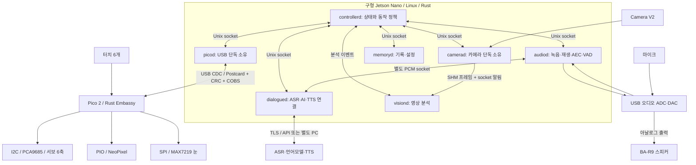

# 구형 Jetson Nano + Pico 2 소프트웨어 아키텍처 계획

작성일: 2026-10-23, 한국 시간

상태: 전체 애플리케이션은 설계안이다. 서보 순차 실물 시험 뒤 사용자가 교체NeoPixel4개 정상 점등과 터치·눈 개별 시험 완료를 확인했다. 현재 [통합 진단](Pico_Nano_USB_통합_진단.md)은6서보·양손NeoPixel·2눈·6터치, 공유binary codec, Nano용USB 브리지를 구현했다. 빌드/모의 검사는 [초기·후속 검증 범위](Jetson_Nano_작업_종합기록_2026-10-24.md), 과거 서보 실물은 [RUN01](test-results/2026-10-23/RUN-20261023-01.md)·[RUN02](test-results/2026-10-23/RUN-20261023-02.md)를 따른다. 후속 작업에서 통합 flash·Nano USB·양손 LED/서보 사용자 확인·두 CSI/오디오·FastAPI 장치 진단과 자동 시작을 검증했다. [최신 종합 기록](Jetson_Nano_작업_종합기록_2026-10-24.md)을 따른다. 아래 최종 controller/SHM/PCM/AI/AEC/기억 구조는 여전히 설계안이며 현재 장치 진단 앱과 구분한다.

## 1. 선택할 구성

**Nano는 Rust + Tokio 기반의 독립 프로세스, Pico 2는 Rust + Embassy 기반의 장치별 async task로 구현한다.** Nano 내부 제어에는 Unix domain socket, 원시 영상에는 공유 메모리, PCM 음성에는 별도 Unix socket을 사용한다. Pico와는 USB CDC-ACM으로 연결한다.

| 영역 | 선택 | 이유 |
| --- | --- | --- |
| Nano OS | 구형 Nano용 JetPack 4.6.x / L4T R32 계열을 확인한 뒤 GUI 없이 운영 | NVIDIA 카메라·GPU·멀티미디어 환경 유지. 일반 Ubuntu 22/24 이미지 설치를 전제하지 않음 |
| Nano 애플리케이션 | Rust, Tokio, Cargo workspace | async 통신, 취소, bounded queue, 프로세스별 소유권 관리 |
| Pico 2 펌웨어 | Rust, Embassy, `embassy-rp`의 RP235x 지원 | USB·I2C·SPI·PIO·GPIO를 async task로 구성 |
| Pico 2 CPU target | 초기에는 Cortex-M33 단일 코어, `thumbv8m.main-none-eabihf` | RISC-V/듀얼코어까지 동시에 도입하지 않고 디버깅 범위 제한 |
| 두 보드의 메시지 | 공통 `no_std` Rust crate + Serde/Postcard | 메시지 타입·단위·codec을 공유해 양쪽 구현 차이 축소 |
| 실행 관리 | Nano의 systemd; 장치 진단 앱은 사용자 요청으로 자동 시작 | 시작 시 상태 확인 뒤 유휴 대기. 장치 시험·재생은 수동 요청으로만 실행 |

Pico 2의 RP2350 지원과 USB CDC/PIO 기능은 Embassy 공식 자료에서 확인했다.[S1–S4] PCA9685·MAX7219·양손PIO NeoPixel·터치 드라이버를 통합 진단에 구현했다. 아래 일반 목표 자세·영상·오디오 제어와 최종 task 분리는 후속 설계이며, 현재 진단은 단일 출력 소유 task에서 유한 순차 시험을 실행한다.

구형 Nano용 JetPack 4는 지원이 종료된 계열이다.[S16] 이번 보유 장비 시제품의 기반으로 사용하되, 장기 배포·보안 유지가 필요한 제품화에서는 지원되는 보드로 이전하는 계획을 별도로 세운다. Yocto·커널 축소는 초기 구현 범위에서 제외한다.

### 현재 하드웨어와 미정 사항

- 2026-10-24 SSH 실측: Jetson Nano4GB, device tree 기준 P3448-0000-B00 모듈/P3449-0000-B00 캐리어, 64GB급 SD, Ubuntu20.04.6·L4T R32.6.1. 물리 리비전 대조·원본 이미지 출처는 미정. [보드 정보·manifest](Jetson_Nano_보드_정보.md)
- RP2350 보드: 사용자 확인 및 업로드 성공. 최신 사진의 보드 실크는 Pico 2 W이며 이번 펌웨어는 무선 기능을 사용하지 않음.
- JX CLS6336HV 서보6개와 PCA9685 1개: 주소0x41과 CH0~CH5 순차 움직임 확인. 500~2500µs에서 회전폭 증가·걸림/이상음 없음은 사용자 관찰이며, 물리 각도·중립·축 방향·하중·부하 전원은 검증 필요. 제조사 보증 최대 펄스폭으로 해석하지 않음.
- 네오픽셀: 사용자 확인 WS2812 계열RGB. 양손 각4+4+10=18개, 총36개. 기존 교체4개 관찰에 이어 통합 앱에서 양손 시험 완료·사용자 점등 확인. 개별36개 전수 계측·전원 주입 실부하는 남아 있음.
- MAX7219 매트릭스: 설계 수량2개 직렬. 과거 별도 기능 시험 사용자 관찰은 있으나 현재 Nano/Pico 통합 구성에서는 미연결이며 시험 API를 차단함.
- 디지털 출력 방식으로 추정되는 정전식 터치 모듈 6개: 현재 미연결. 실제 IC·출력전압·동작 모드는 미정이며 SW6 로컬 입력/정지를 배포 설정에서 비활성화함.
- 현재 카메라는 사용자가 교체한 CameraV2 두 개, CSI 연결이다. 기존 L4T R32.6.1의 IMX219 설정에서 video0/1 생성과 비root camerad의 개별·동시 1280×720 약30fps 취득·실제 PNG 확인에 성공했다. Rust camerad·영상 IPC·장시간 전체 부하는 후속 작업이다. [실물 결과·이미지](Jetson_Nano_Camera_V2_실물검증.md). 이전 V3/IMX708 실패는 [디바이스 점검](Jetson_Nano_디바이스_권한과_실물점검.md)에 이력으로 보존한다.
- USB 오디오는 실제 C-Media0d8c:0014를 확인했다. 48kHz S16_LE mono capture/stereo playback·full duplex·마이크 시험음 검출·사용자 청취를 확인했다. BA-R9 모델/물리 배선 대조와 AEC·장시간 성능은 별도다. 장치 접근은 audiod/audio 그룹과 named ALSA PCM을 사용한다. [권한·측정](Jetson_Nano_디바이스_권한과_실물점검.md)

근거: [사업계획서](../계획서/300_Seconds_사업계획서.md), [부품 목록](../BOM/재료%20목록.md), [오디오·LED](../BOM/오디오_LED_추가부품.md), [매트릭스·터치](../BOM/매트릭스_터치_추가부품.md).

## 2. 전체 구조와 소유권



위 그림의 프로세스 간 양방향 제어선은 요청·응답과 이벤트를 의미한다. `controllerd`가 시작·대화·동작 정책의 단일 소유자이며, 장치별 서비스는 자체 장치를 단독 소유한다. 분석 결과가 서보를 직접 움직이지 않는다. AI 모델이 하드웨어 명령을 직접 생성·실행하도록 연결하지 않는다.

물리 부품마다 Linux 프로세스를 반드시 하나씩 두지는 않는다. **Pico에는 Linux식 프로세스 대신 독립 모듈/task**, Nano의 **마이크·스피커에는 공동 오디오 프로세스**를 둔다. 이 두 예외가 장치 소유권과 AEC를 단순하게 만든다.

| 프로세스 | 담당 | 장애 시 동작 |
| --- | --- | --- |
| `controllerd` | 조용한 대기, 요청 허용, turn/epoch, 취소, 동작 승인 | `picod`의 controller lease 만료, `audiod` 재생 허가 만료로 출력 중단 |
| `picod` | USB 포트, 프레임 codec, Pico 상태·터치, 명령 승인 결과 | Pico의 host lease 만료. 재연결 시 이전 동작 폐기 |
| `camerad` | 카메라 취득·축소·프레임 시각·필요 시 인코딩 | 새 generation으로 재시작, 이전 SHM 프레임 무효화 |
| `visiond` | 최신 프레임의 가벼운 재석·상태 보조 분석 | 영상 상태를 unknown 처리. 추정만으로 개입하지 않음 |
| `audiod` | ALSA 입출력, AEC, VAD, PCM 전송·재생 취소 | 오디오 unavailable 알림, 자동 반복 발화 금지 |
| `dialogued` | 원격/로컬 ASR·AI·TTS adapter와 스트리밍 취소 | timeout/error를 실제 오류로 보고. 가짜 응답을 성공으로 처리하지 않음 |
| `memoryd` | SQLite의 프로필·이력·설정 단독 쓰기 | 저장 pending 표시, 음성·서보 경로와 분리 |

`memoryd`는 첫 수직 통합까지 `controllerd` 내부의 전용 DB worker로 개발해도 된다. API를 먼저 정의해 두고, 기록 기능을 붙일 때 독립 프로세스로 분리한다. 이외 여섯 프로세스는 각각 단독 실행·mock 연결이 가능하도록 개발한다.

## 3. IPC 선택

| 데이터 | 기본 수단 | 계약 |
| --- | --- | --- |
| 명령·응답·터치·인식 결과 | AF_UNIX `SOCK_STREAM` | 4바이트 big-endian 길이 + JSON, 본문 최대 64KiB, request ID·응답·timeout |
| 카메라 원시 프레임 | POSIX SHM/mmap + Unix socket 알림 | 3슬롯, 최신 프레임 우선, 슬롯 소유권·generation 명시 |
| 마이크 PCM·TTS PCM | 각각의 전용 Unix stream | 길이 프레임 + 바이너리 header/PCM. 제어 채널과 분리 |
| 개발 중 CLI 출력 | stdout/stderr pipe | systemd/journald 수집. 장기 RPC에는 사용하지 않음 |
| 원격 영상 보기 | 필요할 때 RTP/RTSP | 하드웨어 H.264 인코딩 분기. 제품 핵심 경로와 별도 |
| 통합 진단의 loopback UDP | `127.0.0.1:37920`, typed JSON 요청/응답 | 현재 USB 브리지의 status/test/stop/configure에만 사용. Ack·최신 Status 확인, 자동 재전송 없음 |

Linux AF_UNIX는 로컬 프로세스 통신용이며 Tokio의 UnixStream으로 바로 사용할 수 있다.[S5] 현재 규모에서는 ZeroMQ·Zenoh·ROS 2·MQTT broker를 먼저 추가할 필요가 작다. 이후 다수 구독자·여러 장치·외부 로봇 연동이 확정되면 그 요구에 맞춰 재검토한다.

현재 구현한 `pico-device-bench bridge`는 Windows/Nano 공용 진단을 위해 loopback UDP와 NDJSON stdout을 제공한다. USB는 이 프로세스 하나만 소유하며 요청 대기 중에도 Stop을 우선 수신한다. 위 Unix socket·controller owner/lease는 전체 애플리케이션의 후속 계약이다. UDP 진단의 성공을 그 전체 IPC 구현 완료로 해석하지 않는다.

각 서비스는 `/run/300seconds/<service>.control.sock`을 제공하고 controller가 연결한다. 이벤트는 해당 연결의 역방향으로 보낸다. 서비스에는 하나의 유효한 제어 owner만 허용하고, 연결 단절 시 상태 snapshot을 재조회한다. 예외적으로 `audiod.stop.sock`은 별도로 제공해 controller와 picod가 정지 명령만 보낼 수 있게 한다. 이 endpoint에서는 재생 시작·허가 갱신을 받지 않는다. socket 접근은 전용 사용자/그룹 권한으로 제한한다.

### 큐와 재시작 규칙

- 목표 각도·밝기·표정은 latest-only 상태로 보관한다. 오래된 목표를 FIFO에 계속 쌓지 않는다.
- 정지·fault는 일반 데이터 큐와 별도 경로로 처리하며, 이미 latch된 STOP을 최신 상태 갱신이 해제할 수 없다.
- 이벤트 큐는 유한 크기다. 저우선 통계는 버리고 drop 수를 기록한다. 터치 이벤트가 누락되면 sequence 차이와 현재 bitmask snapshot으로 상태를 복구한다.
- 중요 요청은 `accepted/rejected`를 확인한다. socket write 성공을 장치 실행 성공으로 취급하지 않는다.
- 공통 header: `schema_version`, `request_id`, `producer_generation`, `session_id`, `turn_id`, `epoch`, `monotonic_timestamp`, `expires_at` 중 메시지별 필요 필드.
- Nano 프로세스 간 기한은 같은 `CLOCK_MONOTONIC` 기준으로 비교한다. UTC 시각은 사람용 기록에만 쓴다. Pico uptime이나 클라우드 시각과 직접 빼지 않는다.
- 프로세스가 다시 시작되면 generation을 변경한다. 이전 연결·이전 세션의 응답을 새 작업으로 사용하지 않는다.

## 4. Pico 2 Rust 펌웨어

현재 통합 진단은 [pico2-device-bench](../../firmware/pico2-device-bench/README.md)다. USB RX/TX·5ms 터치task와 단일 출력 소유 루프로 서보·양손PIO·두 눈을 제어한다. 명시적 USB RunTest 또는 새 SW6 누름만 유한 검사를 시작한다. host200ms KeepAlive·1000ms lease를 구현했으며 단절·정지 지연의 실제 계측은 별도 시험이다. 과거 [서보 벤치](../../firmware/pico2-servo-bench/README.md)의 Arm/Sweep ASCII API와 구분한다.

과거 서보 벤치의 `config 500 2500` 무부하 시험에서 회전폭 증가를 사용자 관찰로 남겼다. 새 진단 기본은1000~2000µs/약50Hz, 중심90도 주변±10도이며 이 명령각을 실측각으로 해석하지 않는다. 설정은 RAM에 저장하고 Nano 설정 파일로 다시 적용한다. 아래 독립 출력task와 일반 축별 목표·보간API는 최종 애플리케이션 계획이다.

Embassy executor에서 다음 task를 구성한다. 초기에는 단일 코어를 사용하고, 각 task는 하나의 peripheral/출력 상태를 소유한다. async는 CPU 연산을 자동 선점하지 않으므로, 긴 루프·blocking sleep·무제한 대기 없이 실행한다.

| task | 담당 하드웨어·기능 | 초기 실행 기준, 실측 전 후보 |
| --- | --- | --- |
| `usb_device_task` | embassy-usb USB device 실행 | 지속 poll, 다른 처리에 의해 굶지 않게 구성 |
| `protocol_rx_task` | CDC 수신·COBS 복원·CRC/버전/세션 검사 | 정적 수신 버퍼, 넘친 프레임은 delimiter까지 폐기 |
| `protocol_tx_task` | ACK·fault·터치·상태 송신 | ACK/fault 우선, 통계는 최신값 교체 |
| `servo_task` | I2C PCA9685, 6축 보정·목표 보간 | 20ms 갱신 후보. PWM 주파수·펄스폭은 현품 검증 후 설정 |
| `neopixel_task` | PIO/DMA 출력, 색상·밝기·효과 | 고정색은 변경 시만 전송, 애니메이션 20~30fps 후보 |
| `matrix_task` | SPI MAX7219, 좌우 눈 bitmap | 표정 변경 시 전송, 로컬 blink 효과는 허용 시만 |
| `touch_task` | GPIO 6입력, debounce·edge·현재 상태 | 1~5ms scan, 20~40ms debounce 후보 |
| `safety_task` | controller lease, motion permission, STOP latch, task health | lease 만료 즉시 새 동작 차단, 하드웨어 watchdog 갱신 판단 |

장치 명령에는 `embassy-sync::Signal` 등의 최신값 슬롯, 이벤트에는 bounded `Channel`을 사용한다. STOP latch는 상태 교체로 사라지지 않도록 별도 보관한다. 한 task만 I2C를 소유하므로 처음부터 버스 mutex를 여러 드라이버에 분산하지 않는다. USB TX가 막혀도 servo/safety task가 같이 멈추면 안 된다.

서보 보간은 Pico에서 수행한다. Nano가 1ms마다 각도를 스트리밍할 필요 없이 `축별 목표각 + 이동시간`을 전달한다. NeoPixel도 `effect/color/period/brightness`를 보내 Pico가 효과를 실행한다. Linux가 바빠도 이미 허용된 로컬 동작은 유지하되, 제어 lease가 만료되면 정해진 정지 정책을 적용한다.

### 현재 통합 진단 핀 배치

| 연결 | Pico GPIO |
| --- | --- |
| PCA9685 I2C0 | GP4 SDA / GP5 SCL |
| PCA9685 OE | GP12, reset 중 상태를 회로에서 결정 |
| NeoPixel PIO | GP16 왼손 / GP17 오른손, 각18개 |
| MAX7219 SPI0 | GP18 SCK / GP19 MOSI / GP20 CS |
| 디지털 터치 6개 | GP6~GP11 |
| 디버그 UART 예비 | GP0/GP1, 기본 디버그는 SWD/RTT 후보 |

통합 이미지에 위 핀을 적용했으며 기존 서보 배선은 유지한다. SW6(GP11/물리15번)은 기본 진단 입력이다. 물리 핀과 전원은 [핀 배정](Pico2_핀배정_및_전원.md)을 따른다. MAX7219·NeoPixel의5V 로직 호환성과 터치 출력전압은 실제 구성에서 확인하고 서보·LED 전원을 Pico GPIO로 공급하지 않는다.

## 5. USB Serial 메시지 계약

**이 절은 전체 애플리케이션 목표 계약이다.** 현재 구현한 진단 subset은 Hello/KeepAlive/GetStatus/Configure/RunTest/Stop/Bootloader이며, USB `c0de:cafc`와 공통 Postcard/CRC32/COBS codec을 사용한다. 정확한 실제 메시지형·세션/중복 제거·범위는 [통합 진단](Pico_Nano_USB_통합_진단.md)과 [공통 crate](../../crates/pico-device-protocol/README.md)를 따른다. 아래 일반 SetServoTargets·Arm·Applied 등의 설계 이름을 현재 wire 스키마로 사용하지 않는다. 과거 ASCII `servo-bench-v1`과 새 binary 이미지는 서로 다른 프로그램이다.

### 물리 연결과 열기

- Nano는 USB host, Pico 2는 USB device CDC-ACM이다. Nano에서는 일반적으로 `/dev/ttyACM*`로 나타난다.
- firmware의 USB serial descriptor를 장치마다 고정한다. `/dev/serial/by-id/` 또는 udev 별칭으로 선택하고 tty 번호를 하드코딩하지 않는다.
- `picod`만 포트를 열고 Rust `tokio-serial`로 비동기 read/write한다.[S6]
- CDC의 baud 설정값은 실제 UART 선로 속도를 의미하지 않는다. 가령 115200을 설정해도 CDC payload를 115200bps로 제한하는 설계는 아니다.
- 전송은 byte stream이다. 한 번의 read가 한 메시지라는 가정을 하지 않는다. USB endpoint packet 경계와 애플리케이션 frame 경계를 구분한다.
- 제어 CDC에 로그 문자열을 섞지 않는다. 초기 진단은 Nano의 decoder CLI와 Pico SWD/RTT, 필요하면 별도 CDC 인터페이스를 사용한다.

### 직렬화와 프레이밍

```text
SharedMessage {
  protocol_version: u8,
  session_id: u64,
  sequence: u32,
  body: typed enum
}

wire = COBS(Postcard(SharedMessage) || CRC32_LE) || 0x00
```

- 공통 crate는 `#![no_std]`, `serde`의 no_std 설정, `postcard`, `crc`, `cobs`, 고정 배열/필요 시 `heapless`를 사용한다.[S7–S8]
- CRC는 `CRC_32_ISO_HDLC`로 고정하고, **COBS 이전 Postcard 바이트 전체**에 계산한다. checksum 4바이트는 little-endian으로 붙인다. 예제 검산 문자열 `123456789`의 CRC는 `0xCBF43926`이다.
- decoded 데이터는 CRC를 포함해 최대 512바이트, encoded frame+delimiter 수신 버퍼는 520바이트로 제한한다. 최대 길이 계산은 codec 테스트에서 확인한다.
- 빈 프레임·CRC 실패·초과 길이·알 수 없는 버전은 거부한다. CRC는 USB를 더 빠르게 하거나 실시간으로 만들기 위한 기능이 아니며, 응용 frame 검증용이다.
- Postcard는 스키마를 공유하는 형식이다. enum 순서·필드 변경을 호환 변경으로 가정하지 않는다. protocol version과 양쪽 firmware/app 조합을 고정한다.
- 시계 동기화를 요구하지 않는다. Pico의 lease는 Pico 단조 시계에서 계산한다. Nano 대기열의 만료와 Pico 수신 후 lease는 별개로 처리한다.

### 메시지 종류

| Nano → Pico | Pico → Nano |
| --- | --- |
| `Hello { protocol, session_id }` | `HelloReply { firmware, device_id, capabilities, uptime_ms }` |
| `Arm { calibrated_config_id }` | `Ack/Rejected { sequence, reason }` |
| `KeepAlive { owner_lease_valid }` | `Status { armed, stopped, touch_mask, commanded_pose, faults }` |
| `SetServoTargets { pose_id, targets_cdeg[6], move_ms }` | `Applied { sequence, output_kind }` |
| `SetLedEffect { effect, rgb, brightness, period_ms }` | `TouchEvent { event_seq, index, edge, uptime_ms }` |
| `SetEyes { left[8], right[8], brightness }` | `Fault { code, affected_device }` |
| `Stop`, `Disarm`, `GetStatus` | `Stopped { reason }` |

`targets_cdeg`는 0.01도 단위의 부호 있는 정수, `move_ms`는 밀리초 단위로 고정한다. **`Applied`는 PWM 레지스터/출력 버퍼 반영을 뜻하며 실제 서보 위치 도달을 보장하지 않는다.** 현재 구성에는 관절 위치 피드백이 확인되지 않았다.

동일한 `(session_id, sequence)`를 재수신하면 이전 결과를 반환하고 동작을 재시작하지 않는다. 목표 상태는 부품별 최신값으로 교체한다. 일반 명령은 소수만 outstanding으로 유지하고 deadline이 지나면 재연결/상태 확인 후 재결정한다. 긴 시퀀스·파일·음성·영상은 이 CDC로 보내지 않는다.

### 연결·정지·재연결

1. Pico 부팅: 미설정·동작 불허 상태. 과거 자세를 자동 복원하지 않는다.
2. `picod` 연결: 이전 host 큐를 비우고 새 session으로 Hello/capability 확인.
3. 보정 설정 확인 뒤 명시적 Arm. Pico가 Arm 전에 동작 명령을 받아도 거부.
4. controller → picod lease와 picod → Pico lease를 함께 감시. KeepAlive 100ms, 만료 500~1000ms를 초기 시험 후보로 사용.
5. controller가 죽었는데 picod만 heartbeat를 계속 보내지 않는다. controller lease가 유효할 때만 motion lease를 갱신.
6. Pico는 Stop/lease 만료 시 보간·미실행 동작을 취소하고 새 동작을 차단한다. 재시작 owner는 새 session과 Arm을 거친다.
7. 같은 byte stream 안의 STOP은 이미 전송된 바이트를 추월하지 못한다. 작은 frame·짧은 송신 큐·로컬 터치 정지로 지연을 제한한다.

STOP은 보간 중단과 명령 차단이고, Disarm은 출력 비활성화로 구분한다. **서보의 토크 유지와 PWM 중지 중 무엇이 안전한지는 기구 하중 시험 후 결정**한다. 전원 차단이면 항상 안전하다고 가정하지 않는다. 이 소프트웨어 정지는 하드웨어 비상 정지를 대체하지 않는다.

지정 터치는 Pico에서 서보 동작을 우선 중단한다. Nano의 `picod`는 `audiod.stop.sock`으로 중단을 전달하고 controller에도 이벤트를 보낸다. 시작·동작 승인은 controller만 수행한다. Pico만으로는 Nano 스피커를 직접 정지시킬 수 없으므로 controller 단절 시에는 오디오 lease 만료도 필요하다.

## 6. Nano 카메라·영상

`camerad`가 카메라를 한 번만 연다. Camera V2/CSI는 NVIDIA GStreamer 경로를 먼저 검증한다.[S9]

```text
Camera V2 → nvarguscamerasrc → NVMM → nvvidconv 축소
    ├─ 필요 시 H.264 인코딩 → RTSP/RTP 모니터링
    └─ appsink → CPU frame → SHM 3슬롯 → visiond → 결과 이벤트
```

- 분석 입력은 640×480, 10~15fps를 초기 후보로 잡고 CPU/GPU·RAM·온도를 측정한다. 지원되는 센서 취득 모드와 분석 해상도는 별도로 설정한다.
- JetPack 4 GStreamer에서는 `appsink max-buffers=1 drop=true sync=false`를 확인한다. 최신 문서의 모든 property가 구버전에 있다고 가정하지 않는다.
- `visiond`는 최신 프레임 하나를 읽고 오래된 프레임은 건너뛴다. 추론 속도가 느려도 전체 카메라 경로에 프레임을 누적하지 않는다.
- 첫 버전은 간단한 재석/자리 비움 보조 분석부터 구현한다. 시선·침묵만으로 개입하거나 심리 상태를 확정하지 않는다.
- 모델 추론은 전용 worker에서 실행한다. TensorRT native 연동이 필요하면 작은 C ABI wrapper를 Rust `visiond`에서 호출하고, async/정책 코드는 Rust로 유지한다.
- **NVMM → CPU SHM에는 readback/복사가 포함된다.** SHM을 쓴다고 GPU까지 zero-copy인 것은 아니다. 실측 병목이면 camera와 추론 모듈 통합 또는 DMA-BUF/FD 전달을 후속 비교한다.

SHM header에는 `layout_version`, `producer_generation`, `frame_id`, `monotonic_timestamp`, `width/height/stride/format`, `payload_len`, 슬롯 상태를 둔다. 메모리에는 포인터나 Rust Vec/String을 저장하지 않고 고정 layout·offset을 사용한다.

초기 동기화는 슬롯별 **process-shared robust pthread mutex**를 감싼 작은 Rust wrapper로 한다.[S10] 생산자는 비어 있거나 사용 가능해진 슬롯에 쓰고, 소비자는 잠근 동안 로컬 버퍼로 복사한 뒤 즉시 풀어 추론한다. producer는 lock 대기로 capture를 멈추지 않고 사용 불가 frame을 버린다. owner 사망 시 해당 frame을 무효화하고 일관성 복구 또는 segment 재생성을 한다.

`std::sync::Mutex`나 Tokio mutex를 SHM 안에 넣는 방식은 사용하지 않는다. `memmap2` 자체가 동기화·재시작 계약을 제공하는 것도 아니다. byte 배열을 동시에 읽고 쓰면서 sequence만 재검사하는 자체 seqlock도 초기 구현에서 제외한다. unsafe는 SHM layout/guard wrapper에 한정하고 native integration 테스트를 둔다. 이 단계에서는 검증 가능한 복사를 허용하며, 이후 필요할 때만 슬롯 lease 방식으로 복사를 줄인다.

## 7. Nano 마이크·스피커·대화

### 하드웨어와 오디오 소유

```text
클립 마이크 → UGREEN 어댑터 MIC/ADC → audiod capture
AI/TTS PCM → audiod playback → UGREEN DAC/아날로그 출력 → BA-R9
BA-R9 USB → 전원 공급
```

BA-R9의 USB는 오디오 데이터 연결이 아니다. 가능한 한 같은 USB 오디오 어댑터에서 녹음·재생을 함께 처리해 clock 관계를 단순화한다. 실제 어댑터의 full duplex·입력 단자·지원 샘플률부터 검사한다. Linux ALSA card 번호도 재부팅 후 바뀔 수 있어 장치 식별자로 선택한다.

`audiod`는 하나의 프로세스 안에서 capture/playback/AEC/VAD를 별도 모듈과 media thread로 실행한다. 마이크와 스피커를 독립 Linux 프로세스로 나누지 않는다. GStreamer `webrtcdsp`의 echo probe는 같은 top-level pipeline 안에 있어야 하고 DSP와 샘플률이 같아야 한다.[S11]

```text
마이크 → capture → AEC/노이즈 억제 → VAD → capture PCM socket → dialogued
                         ↑
                  재생 reference
                         ↑
TTS PCM socket → playback queue/mixer → echo probe → 재생 장치 → 스피커
```

- 장치가 지원하면 AEC 앞 입출력 48kHz, 10ms 블록을 후보로 시작한다. ASR이 16kHz를 요구하면 AEC 뒤에서 mono/resample한다.
- 효과음도 같은 mixer/reference 경로에 포함한다. 앱이 스피커에 보낸 실제 신호·장치 버퍼 지연과 capture 시각을 기록해 AEC를 조정한다.
- capture/playback clock이 다르면 장기 drift를 측정하고 resampling·지연 추정을 적용한다. 같은 USB codec도 동기화가 보장된다고 단정하지 않는다.
- 음성인식·AI·TTS 서비스는 `dialogued`의 Rust adapter로 연결한다. 초기 구형 Nano에서는 무거운 모델을 외부 PC/서버에서 실행하는 구성을 우선한다. 특정 공급자·모델·온라인/오프라인 요건은 미정이다.
- 기본 대기 상태에서는 네트워크 ASR·대화 생성·영상 전송을 자동 시작하지 않는다. 로컬 터치/VAD와 녹음 세션 허가를 분리한다. VAD 단독으로 아이의 대화 의도를 확정하지 않는다.

PCM은 48kHz mono S16 기준 약 96kB/s여서 첫 버전에 별도 SHM 구현이 필수는 아니다. Unix socket의 바이너리 frame으로 전송하며 `stream_id`, `turn_id`, `epoch`, `chunk_seq`, `sample_rate`, `channels`, `sample_count`, `timestamp`를 포함한다. 제어 JSON과 큰 PCM을 같은 FIFO에 섞지 않는다.

### 말 끼어들기·정지 계약

1. 정지 터치 또는 AEC 후 확인된 중단 의도가 들어오면 audiod에서 우선 playback을 중지한다. AEC 검증 전에는 터치 정지를 먼저 완성한다.
2. controller는 해당 대화의 epoch를 올리고 dialogued에 Cancel을 전송한다. 서비스 내부에서는 `CancellationToken`으로 네트워크/생성 작업에 취소를 알린다.[S12]
3. audiod는 대기 PCM과 **ALSA/GStreamer 재생 장치 쪽 버퍼까지** flush/drop한다. capture는 가능한 한 유지하고 AEC의 reference/지연 상태를 함께 갱신한다.
4. 취소 뒤 도착한 이전 epoch의 TTS PCM을 audiod 입구에서 거부한다. Rust task 취소만으로 이미 출력된 소리가 사라진다고 가정하지 않는다.
5. `PlaybackStopped`와 장치 출력으로 추정되는 샘플 범위를 지연 오차와 함께 기록한다. 다음 응답에는 생성 완료 텍스트 전체 대신 이 출력 추정 범위를 사용한다. 아이가 실제로 들었거나 이해한 범위까지 알 수 있다고 가정하지 않는다.
6. 이전 dialogued 데이터 연결을 새 turn에 재사용할 때도 epoch로 검증한다. audiod의 playback lease는 controller 유효성에 묶어 controller 사망 후 남은 음성이 계속 출력되지 않게 한다.

애플리케이션 playback 대기 버퍼는 40~100ms 범위를 초기 후보로 잡되 장치·네트워크 jitter를 실측해 정한다. 줄이면 취소 지연은 줄지만 underrun 가능성이 커진다. 캡처 큐가 가득 차면 조용히 과거 음성을 누적하지 않고 discontinuity를 보고해 해당 ASR 세션을 재동기화한다.

오디오 lease는 audiod가 실행 중일 때 평가할 수 있다. audiod 전체 hang이나 커널 정체까지 물리 음소거를 보장하지는 않는다. 짧은 장치 버퍼, 무한 반복 재생 금지, 실제 media 진행을 확인하는 watchdog과 재시작 후 이전 epoch 폐기로 제한한다. 이 조건에서도 물리적인 음소거 보장이 필요하다면 별도 mute 회로를 후속 설계한다.

## 8. Rust 도구와 native 의존성

현재 개발 PC에는 저장소 내부 `.local-tools/rustup`·`.local-tools/cargo`에 Rust1.90.0을 구성했고 전역 Rust1.75는 유지했다. 저장소 루트 PowerShell에서 `. .\firmware\Use-LocalRust.ps1`을 실행해 현재 셸에 환경을 적용한다. 임시 펌웨어 release 빌드·UF2 변환·업로드와 호스트 CLI 빌드를 완료했으며, 펄스/파서 lib 시험2개와 호스트 인자 검사2개가 통과했다. 이 결과는 Nano target·native 라이브러리 호환성이나 실시간 성능 검증이 아니다. 빌드 도구·버전·UF2 해시는 [RUN-20261023-01](test-results/2026-10-23/RUN-20261023-01.md)에 기록했다.

| 목적 | 우선 도구 |
| --- | --- |
| Nano async I/O | `tokio`, `tokio-util`, `bytes` |
| 내부 통신 | `tokio::net::UnixStream`, length-delimited codec, `serde_json` |
| 작업 간 상태/이벤트 | bounded `mpsc`, `watch`, `oneshot` |
| 취소·종료 | `CancellationToken`, `JoinSet`, timeout + 종료 결과 수집 |
| Pico Serial | `tokio-serial`, 공유 protocol codec |
| 영상·오디오 | `gstreamer`, `gstreamer-app`, `glib` bindings + NVIDIA/ALSA native plugins |
| SHM | `memmap2`, `libc`/`nix`, 작은 process-shared lock wrapper |
| 원격 API | `reqwest`/WebSocket adapter, TLS, timeout/cancellation |
| DB | `rusqlite` + 단일 DB worker/소유 프로세스 |
| 로그·설정 | `tracing`, `tracing-subscriber`, `serde`, TOML |
| Pico runtime/HAL | `embassy-executor`, `embassy-rp`, `embassy-usb`, `embassy-time`, `embassy-sync` |
| Pico 드라이버 계층 | `embedded-hal`, 필요 시 `embedded-hal-async`, PIO WS2812 구현 |
| 공통 직렬화 | `serde` no_std, `postcard`, `crc`, `cobs`, 필요 시 `heapless` |
| 펌웨어 빌드/디버그 | Cargo/rustup, BOOTSEL/UF2 최초 업로드 또는 SWD + `probe-rs`, RTT/defmt 후보. SWD에는 별도 debug probe 필요 |

Tokio executor에서 TensorRT 추론·긴 이미지 변환·blocking ALSA 호출·DB 쿼리를 직접 돌리지 않는다. GStreamer callback도 데이터 전달만 짧게 수행한다. media/DB/추론은 전용 worker thread를 쓰고, 긴 native 호출은 Rust future 취소만으로 중단되지 않으므로 반환 결과를 epoch로 폐기한다. 각 프로세스마다 무조건 CPU 전체 수만큼 worker를 만들지 않고 총 thread 수·RAM을 측정해 제한한다.

### 구형 Nano에서 먼저 확인할 것

Rust의 `aarch64-unknown-linux-gnu` target 요구사항은 Linux 4.1+/glibc 2.17+로 안내돼 있어, 구형 Nano라는 이유만으로 Rust를 배제할 필요는 없다.[S13] 다만 실제 target/sysroot·링커·native library를 함께 검증해야 한다.

현재 GStreamer Rust binding 문서는 최소 GStreamer 1.14를 명시한다.[S14] feature flag·상위 crate·Rust MSRV가 요구사항을 올릴 수 있으므로 최신 crate를 넣으면 된다고 확정하지 않는다. 처음에는 Nano에서 확인한 라이브러리 버전에 맞춰 빌드하고 `rust-toolchain.toml`, `Cargo.lock`, native package manifest를 함께 고정한다. 새 Ubuntu에서 만든 바이너리를 구형 glibc Nano에 그대로 복사하지 않는다. 교차 빌드 시 Nano와 맞는 aarch64 sysroot를 사용한다.

처음 기록할 읽기 전용 명령:

```sh
cat /etc/nv_tegra_release
uname -a
cat /etc/os-release
ldd --version
free -h
lsusb
arecord -l
aplay -l
gst-launch-1.0 --version
gst-inspect-1.0 nvarguscamerasrc
gst-inspect-1.0 webrtcdsp
gst-inspect-1.0 webrtcechoprobe
pkg-config --modversion gstreamer-1.0 glib-2.0
```

2026-10-24에는 위 항목을 포함한 [설치 전 Nano 실측 manifest](Jetson_Nano_보드_정보.md)를 수집했다. 이후 [개발 환경 설치·운영 모드 작업](Jetson_Nano_개발환경_설치와_모드전환.md)에서 libssl/libudev/Clang 개발 패키지와 격리Rust1.90을 설치했다. Nano의 host 테스트8개·Tokio AF_UNIX·C native 링크·합성 DSP는 통과했다. nvcompositor의 libgstbadvideo 의존성 오류는 남아 있고 Rust 미디어 binding은 미검증이다. 후속 Python/GStreamer 경로에서 두 IMX219 실제 촬영·RTSP와 USB 녹음/재생을 확인했다. [장치 대시보드](Jetson_Nano_장치_대시보드.md) GLib/GStreamer/CUDA 기반을 통째로 덮어쓰지 않았으며, 현재 프로젝트 모드에서는 GUI와 미사용 서비스를 끄고 ROS도 별도 비활성화했다.

## 9. 개발 저장소 구성안

현재 통합 코드는 `firmware/pico2-device-bench/`, 공유 `crates/pico-device-protocol/`, PC/Nano 도구 `tools/pico-device-bench/`다. `firmware/Build-PicoDevice.ps1`이 RP2350 UF2를 만든다. 이전 서보 벤치와 분리했으며 아래 최종 software workspace·미디어 서비스는 아직 생성하지 않았다. 별도 `picod.service`는 설치하지 않았으며 이전에 언급한 템플릿도 현재 저장소에는 없다. 현재 실행 구성은 `apps/device-dashboard/`의 FastAPI·Rust USB 브리지·별도 미디어 프로세스이며 `300seconds-dashboard.service`로 자동 시작한다. 이 프로토타입을 아래 최종 software workspace 구현 완료로 표시하지 않는다.

```text
software/
  Cargo.toml                    # host workspace, resolver와 default members 명시
  Cargo.lock
  rust-toolchain.toml
  crates/
    device-protocol/             # no_std, Nano/Pico 공유 message + codec
    host-ipc/                    # UDS framing, request/response, epoch
    frame-shm/                   # layout/guard, unsafe 경계 제한
    app-config/
  services/
    controllerd/
    picod/
    camerad/
    visiond/
    audiod/
    dialogued/
    memoryd/                     # 기록 단계에서 독립
  tools/
    devicectl/                   # status/led/eyes/servo/stop 진단
    mock-pico/                   # serial/protocol 시뮬레이터
    mock-ai/                     # 명시적 테스트용, 실제 성공으로 집계 금지
  deploy/systemd/                # 초기에는 enable하지 않고 수동 실행
  config/
    device.toml
    servo-calibration.toml
  tests/fixtures/                # wire golden vectors, malformed frames
firmware/pico2/
  Cargo.toml                    # MCU target은 host와 별도 빌드
  Cargo.lock
  .cargo/config.toml
  src/{main,usb,protocol,servo,neopixel,matrix,touch,safety}.rs
```

공통 crate를 host/firmware에서 path dependency로 사용하되, firmware 빌드에 std feature가 섞이지 않게 독립 target 빌드와 feature 검사를 둔다. Nano host 프로세스는 동일 IPC 계약을 사용하므로 실제 카메라/Pico/AI 없이 각각 개발할 수 있다.

## 10. 구현 순서와 완료 조건

실제 작업은 [개발 단계 및 점검표](개발_단계_및_점검표.md)를 기준으로 진행하고, [시험 기록 양식](시험_기록_양식.md)에 결과를 남긴다. **Pico 말단 장치 임시 구동과 Nano SD 준비를 먼저 병렬 진행**하고, 아래 합류 조건을 확인한 뒤 실제 통합한다. 이 표는 기술 단계 요약이며 실측 진행 상태는 작업 점검표에서 관리한다.

현재 A의 개별 실물 관찰과 새 통합 코드의 빌드/모의 결과를 구분해 기록했다. 2026-10-24에는 B의 기존 SD 부팅·SSH 접속·환경 수집에 이어 개발 패키지/Rust 설치·native host 테스트·모드 전환과 복원을 확인했다. 후속 통합 flash·Nano USB·LED/서보·실제 영상/음성과 진단 서비스는 확인했다. 현재 미연결 터치/눈, 체계적인 단절/재연결·전원 부하·축 보정, 기준 SD 복원·Rust 미디어 binding·최종 AI 통합은 남아 있다. 장치 진단의 실제 성공을 A/C 전체 gate 통과로 확대하지 않는다.

| 단계 | 구현 범위 | 완료 조건 |
| --- | --- | --- |
| 0. 공통 준비 | 현품·전원·protocol·시험 범위 | 미정/부족 부품과 시험 조건 기록 |
| A. Pico 독립 시험 | PC와 CDC, 장치별→동시 구동 | 실제 출력·입력·보정·정지/lease·재연결 시험 |
| B. Nano 준비, A와 병렬 | SD 이미지·기록·부팅·Rust·영상/음성 기초 | 실제 부팅·최소 실행·장치 시험과 기준 SD 자료 |
| C. 양쪽 합류 | Nano picod/devicectl과 실제 Pico | 실물 입출력 왕복·버전 일치·단절/재시작 복구 |
| D. 기본 통합 | controller·영상 SHM·PCM·최소 실제 AI 대화 | 실제 경로·터치 정지·늦은 TTS 폐기 |
| E. 기본 구동 검증 | 동시 부하·장애·기구 결합·재현 | 선언한 범위의 통합 시험과 기준판 고정 |
| F1. 필수 기능 완성 | AEC/말 끼어들기·영상 분석·학습 기억 | 최종 필수 시나리오와 회귀 시험 통과 |
| F2. 선택 확장 | 대시보드·원격 현황·최적화 등 | 범위 선정 뒤 기능별 추가 시험 |

앞 단계에서 동작하지 않는 부품은 미검증/차단 사유를 기록하고, 임의의 성공값으로 통과시키지 않는다. 먼저 Pico LED/터치와 Nano 상태기계가 이어지는 작은 수직 경로를 완성한 뒤 영상·음성을 붙인다. 기본 구동 성공과 최종 필수 기능 전체 완료는 구분한다.

### 통합 시험에서 반드시 남길 증거

- USB 분리·재연결, Pico reset, controller만 종료, picod만 종료, 오디오 프로세스 종료의 구분된 결과.
- AI 실행 중 터치→Pico Stop→Nano audio flush 지연, 각 구간의 p50/p95/최대값.
- UART baud 표기나 task 주기를 실제 end-to-end 응답 지연으로 보고하지 않음.
- camera 취득→분석 시작/완료 지연, 오래된 frame 폐기 수, CPU/GPU/RAM/온도.
- ALSA underrun/overrun, playback queue 길이, 에코 중 잘못된 중단과 실제 아이 발화 중단 성공률.
- SHM producer 사망·슬롯 owner 사망·layout 불일치 시 복구.
- 무응답·오류·timeout, 이전 turn PCM, 큐 포화, 터치 중복/누락에 대한 결과.
- 하드웨어 시험 전에 host codec/property 테스트와 firmware target build를 수행하되, 빌드 통과와 실제 장치 동작을 별도로 보고.

수치들은 초기 설계 후보이며 성능 보장이 아니다. 구체적인 사용자 응답 목표는 B의 환경·장치 기초 시험과 D의 오디오 지연을 측정한 뒤 정하고, E에서 판정한다. README의 Wi-Fi 영상 10ms 목표와 USB 제어/음성 중단 목표는 별도로 다룬다.

## 11. 참고한 공식 자료

확인일: 2026-10-23. 웹 문서는 변경될 수 있어 구현 시 dependency/commit을 고정한다.

- [S1 Embassy RP235x HAL](https://docs.embassy.dev/embassy-rp/git/rp235xa/index.html)
- [S2 Embassy 공식 RP235x 예제](https://github.com/embassy-rs/embassy/tree/main/examples/rp235x)
- [S3 Embassy USB CDC-ACM](https://docs.rs/embassy-usb/latest/embassy_usb/class/cdc_acm/index.html)
- [S4 RP235x PIO WS2812 예제](https://github.com/embassy-rs/embassy/blob/main/examples/rp235x/src/bin/pio_ws2812.rs)
- [S5 Linux Unix socket](https://man7.org/linux/man-pages/man7/unix.7.html)
- [S6 tokio-serial](https://docs.rs/tokio-serial/latest/tokio_serial/)
- [S7 Postcard no_std 직렬화](https://docs.rs/postcard/latest/postcard/)
- [S8 crc crate](https://docs.rs/crc/latest/crc/)
- [S9 NVIDIA L4T R32 Accelerated GStreamer](https://docs.nvidia.com/jetson/l4t/Tegra%20Linux%20Driver%20Package%20Development%20Guide/accelerated_gstreamer.html)
- [S10 POSIX process-shared mutex](https://man7.org/linux/man-pages/man3/pthread_mutexattr_setpshared.3.html)
- [S11 GStreamer WebRTC DSP와 echo probe](https://gstreamer.freedesktop.org/documentation/webrtcdsp/webrtcdsp.html)
- [S12 Tokio 취소와 정상 종료](https://tokio.rs/tokio/topics/shutdown)
- [S13 Rust aarch64 Linux target 요구사항](https://doc.rust-lang.org/rustc/platform-support/aarch64-unknown-linux-gnu.html)
- [S14 GStreamer Rust binding 최소 버전](https://docs.rs/gstreamer/latest/gstreamer/)
- [S15 Tokio 채널과 단일 소유자 패턴](https://tokio.rs/tokio/tutorial/channels)
- [S16 NVIDIA JetPack 4 최종 릴리스·지원 종료](https://forums.developer.nvidia.com/t/announcing-end-of-life-for-nvidia-jetpack-4-with-the-release-of-jetpack-4-6-6/314409)
- [S17 Embassy RP235x ARM target·probe-rs 설정](https://github.com/embassy-rs/embassy/blob/main/examples/rp235x/.cargo/config.toml)
- [S18 Embassy RP235x USB CDC 사용 예제](https://github.com/embassy-rs/embassy/blob/main/examples/rp235x/src/bin/usb_to_uart.rs)
