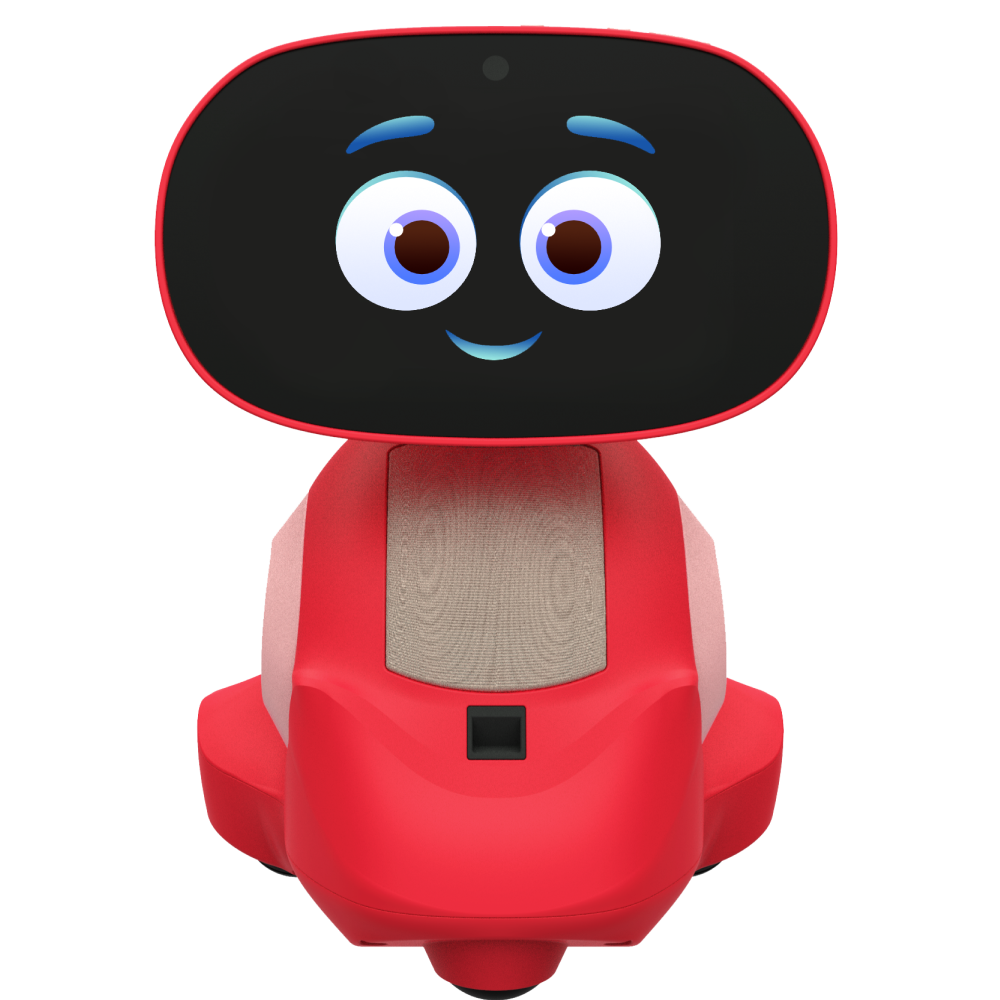
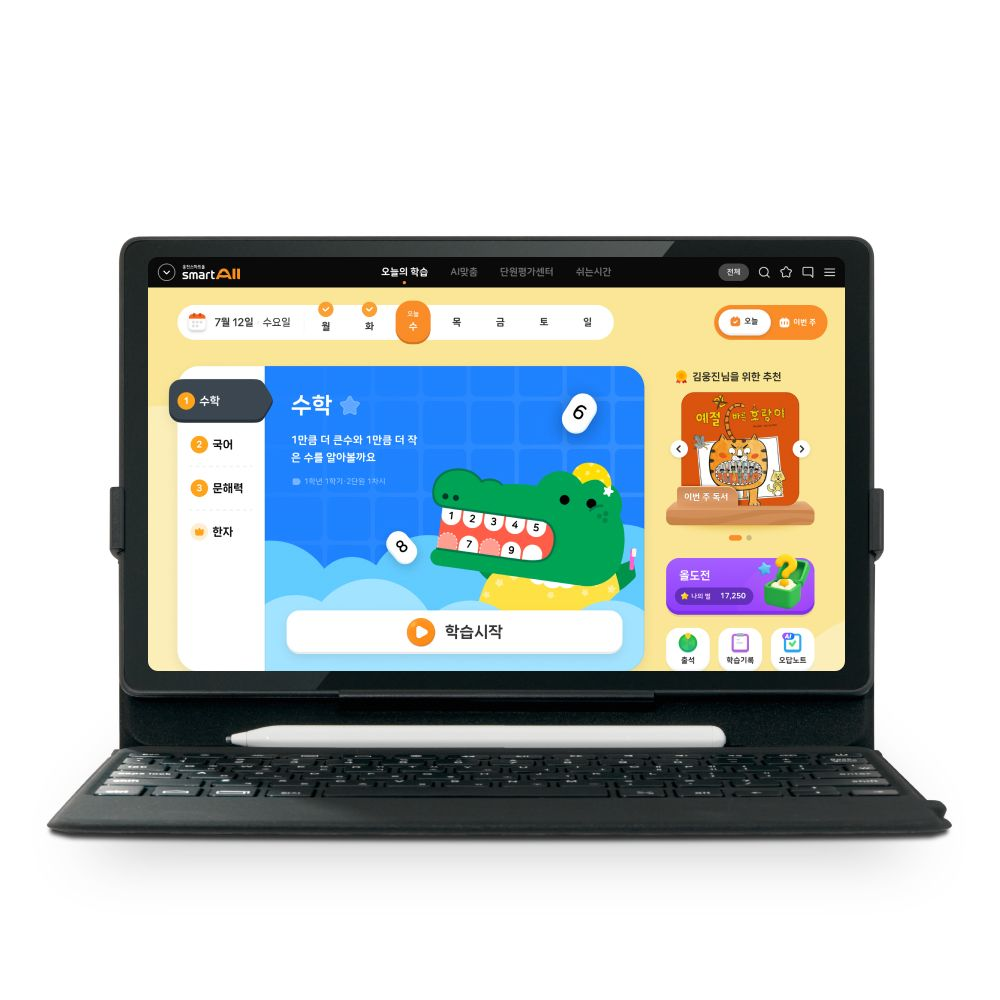

# [배재대 스마트 ICT 메이커톤] 사업계획서

작성일: 2026-10-16 | 팀명: 300 Seconds | 시장조사 반영 개정 초안

## 1. 팀 소개

| 항목 | 내용 |
| --- | --- |
| 팀명 | 300 Seconds |
| 팀장 성명 | 최수길 |
| 연락처 | 010-4573-5540 |
| 창업아이템 명칭 | (가칭) LMS 기반 피지컬 AI 학습 관리 시스템 |

### 메이커톤 팀구성 현황

| 순번 | 이름 | 팀장/팀원 | 담당 업무 |
| --- | --- | --- | --- |
| 1 | 최수길 | 팀장 | S/W 개발 총괄, 영상 송수신, 기능 통합, 일정·제출 관리 |
| 2 | 강민욱 | 팀원 | 기획, 학습 기록 DB·대시보드, 사업화·발표 구성 |
| 3 | 권리원 | 팀원 | 오브제·거치 구조 디자인, 시제품 제작, 시각 자료 |
| 4 | 최요섭 | 팀원 | 이미지 분석, 상태별 피드백 로직, 기능 시험 |

## 2. 창업아이템 개요

### 창업아이템 명칭

(가칭) LMS 기반 피지컬 AI 학습 관리 시스템 — 혼자 공부하는 아이 곁의 AI 책상 친구

### 소개

**개발 배경과 목적.** 혼자 공부하는 학습자가 목표를 세우고 실천하는 과정을 돕고, 보호자·교사가 학습 진행 상황을 확인할 수 있는 장치를 제안한다. 스마트폰의 학습·오락 기능이 같은 기기에 모여 있다는 점에 주목해, 책상 위 장치와 학습 기록을 연결하는 사용 흐름을 설계한다. 이는 회의에서 도출한 문제 가설로, 사용자 조사를 통해 구체화할 예정이다.

**제품·서비스 개요.** 스마트폰 거치가 가능한 일상적인 오브제에 카메라와 조명을 결합한다. 학습자가 목표와 시간을 설정하면 카메라 입력을 분석해 자리 비움 등 관찰 가능한 상태를 추정하고, 빛과 화면 메시지로 학습 복귀를 안내한다. 회의에서 제안한 충전기 형태는 외관 콘셉트로 반영하되, 충전 회로 구현 여부는 전원 구성과 제작 여건 검토 후 확정한다.

**핵심 기능 및 범위(제안).**

| 구분 | 기능 | 구현 계획 |
| --- | --- | --- |
| 핵심 | 학습 목표·세션 설정 | 학습 시간·단어 목표를 입력하고 세션 시작·종료 |
| 핵심 | 카메라 기반 상태 추정 | 재석·자리 비움 등 제한된 상태부터 구분하고 결과를 표시 |
| 핵심 | 네오픽셀 상태 표시 | 학습·휴식·자리 비움·목표 달성을 색상·밝기·점등 패턴으로 표현 |
| 핵심 | 즉각 피드백 모듈 | 발사체·스피커·서보모터를 연동해 소리·움직임·발사 반응 제공. 연질 발사체는 별도 표적 방향 시연 |
| 확장 | 학습 기록·대시보드 | 세션 시간, 목표 달성 여부, 알림 이력을 저장·시각화 |
| 확장 | 학부모·관리자 모바일 알림 | 자리 비움·장시간 미복귀·목표 달성 등 상태 변화와 알람을 등록 휴대폰으로 전송 |
| 확장 | 모바일 원격 현황 조회 | 권한을 부여받은 학생의 현재 상태·마지막 갱신 시각·알림 이력·세션 요약을 휴대폰 화면에서 확인 |
| 확장 | AI 튜터·단어 퀴즈 | 목표와 오답에 따른 짧은 퀴즈·격려 문구 제공 |
| 검토 | 스마트폰 앱 사용 제한 | 단어 정답 후 이용 허용 흐름을 데모 화면으로 시연하고 실제 제어는 별도 검증 |

기존 종이책·문제집을 유지하는 별도 코치를 지향한다. 네오픽셀은 학습=청색, 휴식=녹색, 이탈=주황 점멸, 달성=색상 순환을 예시로 두고 화면 문구도 함께 표시한다. 발사 모듈은 학습자 신체를 겨냥하지 않는 연질 발사체·별도 표적 시연으로 계획한다. 초기 구성은 카메라 → 연산 장치의 분석 → 제어 보드의 네오픽셀·스피커·서보·발사 모듈 → 학습 화면·기록이다. 확장 시 이벤트를 모바일 알림·현황 화면으로 연결한다. 보드·카메라·통신·AI 모델은 부품 호환성 확인 후 확정한다. 영상으로 이해도나 집중도를 확정 판단하지 않는다.

**사용 흐름.** 스마트폰 거치 및 목표 설정 → 학습 시작 → 상태 추정 → 필요 시 빛·메시지 안내 → 퀴즈 또는 목표 달성 확인 → 세션 요약 확인.

**고객 제공 혜택.** 학습자는 공부를 시작하고 다시 돌아오는 계기를 얻으며, 보호자·교사는 세션 기록을 바탕으로 대화할 수 있다. 장기간 관계를 형성하는 감성적 피드백을 지향하며, 즉각 피드백은 네오픽셀·음성·서보 움직임과 별도 표적을 향한 발사 반응으로 구성한다. 강도·빈도·음량은 사용자가 조절·중지하도록 설계한다. 학습 성과 개선 효과는 아직 검증하지 않았다.

**사양·가격.** 탁상형 외관과 스마트폰 거치 구조를 우선 설계한다. 크기·재질·전원 정격·부품 수량은 미정이다. 기기 99,000원은 인터뷰에서 가격 수용성을 확인하기 위한 가설이며, 확정 판매가는 아니다. 부품 원가·운영비·사용자 지불 의사를 확인한 뒤 가격을 결정한다.

### 진출 목표시장

**시장조사 반영.** 사용자가 제공한 2026-10-14 조사 자료를 바탕으로 전략을 정리하고, 2026-10-16 경쟁 제품의 공식 페이지와 공개 프로젝트 원문을 재확인했다. 제품의 유료 판매·서비스 사례는 확인되지만, 본 제품의 수요·시장 규모·교육 효과가 검증된 것은 아니다.

**초기 고객과 구매자.** 1차 시장은 초등학교 고학년의 가정 자율학습으로 설정한다. 직접 사용자는 학생, 구매자 후보는 학부모이다. 2차 시장은 소규모 공부방·지역아동센터로 검토한다. 중·고등학생과 성인 자습자는 초기 제품의 범위를 넓히지 않도록 후속 대상으로 둔다. 이는 시장조사를 바탕으로 한 전략 제안이다.

| 고객군 | 해결할 문제·가치 제안 | 진입 전략(가설) |
| --- | --- | --- |
| 초등 고학년·학부모 | 학습 시작·복귀를 돕고 휴대폰 상태 알림·현황 조회로 반복 확인 부담 완화 | 가정 내 책상 1곳·학습자 1명 체험부터 검증 |
| 공부방·지역아동센터 | 학습 세션 요약과 지도 대화의 근거 제공 | 소규모 운영자 인터뷰 후 관리자 모바일 현황 화면 검토 |
| 청소년·성인 자습자 | 집중 시간 관리와 딴짓 후 학습 복귀 지원 | 초기 고객 반응 확보 후 확장 여부 결정 |

**시장 상황과 경쟁 강도.** 웅진스마트올 초등은 월 79,000원부터의 패드형 AI 맞춤학습을, Miko 3는 US$299의 교육 로봇을 안내한다. Focusmate Plus는 연간 결제 시 월 US$8, 월 결제 시 US$12로 집중 지원 서비스를 제공한다.[S1~S3] 이는 교육·집중 지원의 유료 사례를 보여주며, 본 기기의 구매 전환을 보장하지 않는다. 기기 일시불과 콘텐츠·서비스 구독은 비용 구조가 달라 단순 가격 순위를 매기지 않는다.

**규모·전망 산정 방법.** 국내 해당 세부시장의 매출·판매량과 성장률은 미확인이다. 초기 구매 가능 고객을 기준으로 ‘대상 가구 수 × 체험 도달률 × 구매 전환율’로 기기 수요를 추정하고, ‘구매자 수 × 구독 전환율 × 유지 개월’로 서비스 수요를 추정한다. 모집단·전환율을 조사하기 전에는 이를 실제 시장 규모나 매출 전망으로 제시하지 않는다.

**사업모델과 검증.** 기기 판매와 선택형 학습 기록·튜터 구독의 결합을 검토한다. 초기에는 학부모 10명, 학생 10명, 공부방 운영자 3~5명을 인터뷰하는 안을 제안한다. 반복되는 불편, 카메라 수용성, 기존 앱 대비 구매 이유와 기기 99,000원 가설에 대한 반응을 확인한다. 이후 체험 신청·예약 의향 같은 행동과 1주 사용 기록으로 보완한다. 조사 표본·가격·기간은 계획이며 실제 수행 결과가 아니다.

### 경쟁 제품 및 서비스 조사

**공식 제품 이미지·로고.** 아래 이미지는 각 브랜드의 공식 사이트에 게시된 자료이며, 경쟁 제품 식별·비교 목적으로 수록했다. 이미지·상표의 권리는 각 권리자에게 있다. 확인일: 2026-10-16.

이미지를 클릭하면 원본을 크게 볼 수 있습니다.

| Miko 3 | 웅진스마트올 초등 |
| :--- | :--- |
|  |  |
| **Miko 3 · 교육 로봇 · US$299.** 카메라·마이크·화면, 교육 콘텐츠와 보호자 앱을 제공한다. 물리적 AI 캐릭터와 교육 서비스의 결합 사례다. 우리 제품은 기존 문제집 기반 자율학습 복귀 코칭에 초점을 두는 방향을 제안한다. [공식 제품 및 이미지 출처 S1](https://miko.ai/products/miko-3) | **웅진스마트올 초등 · AI 맞춤학습 · 월 79,000원~.** 초등 전과목 콘텐츠·학습관리·패드학습을 제공한다. 콘텐츠 경쟁을 확대하기보다 기존 책과 학습계획을 유지하는 보완형 기기로 포지셔닝한다. [공식 제품 및 이미지 출처 S2](https://www.wjthinkbig.com/prod/subjectDetail.do?subjectId=S0000068) |

| Focusmate | Forest |
| :--- | :--- |
|  |  |
| **Focusmate · 온라인 공동 집중 · Plus 월 US$8/12.** 예약한 시간에 파트너와 온라인으로 함께 작업하는 서비스다. 연 결제 월 환산 US$8, 월 결제 US$12이며 세금이 추가될 수 있다. 집중 지원 자체의 서비스 모델을 참고한다. [공식 요금·로고 출처 S3](https://www.focusmate.com/pricing/) | **Forest · 집중·습관 앱 · 요금은 플랫폼·플랜별 확인.** 집중을 나무 성장과 시각적 보상으로 연결한다. 공식 사이트는 누적 6,000만 명 이상 이용을 소개하지만 이는 회사의 자체 안내이며 유료 고객 수나 국내 시장 규모가 아니다. 보상형 피드백 설계에 참고한다. [공식 서비스·아이콘 출처 S4](https://forestapp.cc/) |

**직접 유사 구현.** StudyGuard AI는 웹캠 기반 행동 추정, 휴대폰·졸음 감지, 오디오 알림과 세션 기록을 소개하는 공개 소프트웨어다.[S5] MAK-G는 카메라 기반 자세·휴대폰 사용 감지, 음성·OLED 알림, 대시보드를 결합한 탁상형 피지컬 AI 프로젝트다.[S6] 모두 제작자가 공개한 설명을 확인한 것이며, 본 팀에서 실행·성능을 검증하지 않았다. 상용 판매 제품과 공개 프로젝트를 구분해 평가한다.

**재확인 범위.** 기존 조사에 등장한 Focus Friend는 이번 확인에서 원문 본문 접근이 제한되어 핵심 비교표에서 제외했다.[S7] 위 제품·서비스의 공개 기능을 기준으로 비교하며, 소개 페이지에 없는 기능을 ‘미지원’으로 단정하지 않는다.

### 경쟁사 대비 차별성

| 비교 관점 | 확인한 경쟁·유사 사례 | 우리 제품의 목표와 검증 과제 |
| --- | --- | --- |
| 카메라 감지 | StudyGuard AI·MAK-G의 공개 설명에 존재 | 감지 자체의 독창성을 주장하지 않고 오탐·미탐과 반응 지연 측정 |
| 물리적 반응 | Miko 3·MAK-G에서 확인 | 경고보다 격려·복귀 안내를 우선하고 학생의 거부감 확인 |
| 학습 콘텐츠 | 스마트올의 교과 콘텐츠, Miko의 교육 콘텐츠 | 기존 종이책·문제집을 유지하는 별도 코치로 사용성 검증 |
| 집중 동기 | Forest의 시각적 보상·Focusmate의 동반 작업 | 빛·화면 피드백과 목표 달성을 연결한 습관 형성 흐름 |
| 학습 기록 | StudyGuard AI·MAK-G의 기록·분석 기능 | 착석 시간·이탈 이벤트·자기보고 목표 달성을 구분해 요약 |

**핵심 포지셔닝.** ‘기존 문제집으로 공부하는 아이가 다시 공부로 돌아오게 돕는 AI 책상 친구’를 지향한다. 카메라·알림·대시보드의 조합만으로 독창성이나 우위를 주장하지 않는다. 피드백 수용성과 학습 복귀 행동을 체험으로 확인한다. 학부모·관리자의 휴대폰 알림·상태 조회를 확장해 현장 피드백과 원격 관리를 연결한다. 원본 영상의 기본 비저장, 카메라 중지 조작과 최소 이벤트 기록을 설계 원칙으로 제안한다.

### 산출물 및 개발단계

**현재 단계.** 아이디어 기획·기능 구체화 단계이다. 회의록과 README는 최종 영상 AI 시스템의 통합 동작이나 학습 효과의 검증 결과가 아니다. 기획·디자인·영상 송수신·분석·기록 담당이 협업하고 GitHub PR로 아이디어와 결과를 검토한다.

**보드** ESP32-cam, pico2w, Raspberry Pi, Jetson Nano 등 카메라 입력과 제어를 연결할 수 있는 보드를 검토한다. 부품 호환성과 전원·통신 규격을 확인한 뒤 확정한다.

| 최종 산출물(목표) | 형태·수량 | 완료 기준(제안) |
| --- | --- | --- |
| 탁상형 학습 코치 | 실물 1세트 | 거치·카메라·네오픽셀·발사체·스피커·서보 연동 시연 |
| 학습 세션·분석 프로그램 | 실행 가능한 소스 1식 | 목표 입력 → 상태 추정 → 알림 → 세션 종료 재현 |
| 학습 기록 화면 | 웹 화면 1식 | 세션 시간·이탈 이벤트·목표 달성 여부 조회 |
| 모바일 관리·알림 | 화면·알림 연동 각 1식(확장) | 등록 휴대폰의 이벤트 알림 수신·권한별 현재 상태 조회 |
| 설계·검증 문서 | 문서 1식 | 부품·배선·실행 절차·시험 결과·한계 기록 |
| 발표 자료·시연 영상 | 각 1식 | 실제 동작·시뮬레이션·미구현 기능 구분 |

**MVP 시연(제안).** 25분 학습 세션을 목표로 ‘목표 선택 → 학습 시작 → 자리 비움 감지 → 네오픽셀·스피커·서보 및 별도 표적 발사 반응으로 복귀 안내 → 복귀 → 세션 요약’을 구현한다. 발표에서는 시간을 단축한 데모임을 표시한다. 휴대폰 감지는 핵심 흐름 완성 후 추가하고, 휴대폰 상태 알림·현황 조회와 AI 튜터·앱 잠금은 확장 기능으로 둔다.

**추진·검증.** 요구사항·부품 확정 → 영상·분석·출력 개별 시험 → 전체 연결 → 반복 시연 순서로 진행한다. 날짜별 마감은 팀 확인 후 확정한다. 재석·이탈·복귀·입력 실패의 오탐·미탐, 영상 지연과 AI 반응 지연을 각각 기록하고 전 과정을 3회 반복하는 것을 목표로 한다. 모바일 알림의 전달·중복·실패와 권한별 조회를 추가 검증한다. 성능 목표와 실측을 구분한다.

**사용자 검증.** 체험 중 피드백 수용 여부·불편 이유·학습 복귀 행동을 관찰하고 사용 전후 기록을 비교한다. 단기 소규모 체험을 학습 효과의 확증으로 확대 해석하지 않는다. 보드·카메라·전원·예산은 미정이다. 앱 제어는 기기 권한·지원 범위를 별도 검증하고, 실제 적용 범위를 확인한 뒤 확정한다.

**모바일 운영(확장 제안).** 학부모는 연결된 자녀, 관리자는 권한이 부여된 학생의 상태를 조회한다. 상태 변화·알람의 수신 대상·유형·빈도를 설정하고 마지막 갱신 시각을 표시한다. 현재 상황은 상태·이벤트·세션 정보로 제공하고 원본 영상 원격 열람은 별도 동의·권한 검토 후 결정한다. 푸시·메시지 등 전달 수단과 서버는 미정이다.

### 이미지

1. 오브제형 AI 학습 코치 외관 개념도: 스마트폰 거치부·카메라·조명·본체로 구성한 제안 도식. PDF에 수록하며 실제 제작 사진이 아니다.
2. 학습 상태 기반 피드백 구성도: 목표 설정 → 카메라 입력 → 상태 분석 → 피드백 → 기록. PDF에 수록한다.
3. 경쟁사 공식 사진·로고 4종: 위 경쟁 제품 및 서비스 조사에 원본 비율로 삽입했다.

## 작성 근거 및 제출 전 확인

- 기본 자료: 2026-10-12 팀 회의록, 현재 README, 제공 사업계획서 양식, 사용자가 제공한 2026-10-14 시장조사. 경쟁사 원문 재확인일: 2026-10-16.
- [S1 Miko 3 공식 제품·사진](https://miko.ai/products/miko-3)
- [S2 웅진스마트올 초등 공식 제품·사진](https://www.wjthinkbig.com/prod/subjectDetail.do?subjectId=S0000068)
- [S3 Focusmate 공식 요금·로고](https://www.focusmate.com/pricing/), [서비스 방식](https://www.focusmate.com/how-it-works/)
- [S4 Forest 공식 서비스·앱 아이콘](https://forestapp.cc/)
- [S5 StudyGuard AI 제작자 공개 저장소](https://github.com/sandeep749/StudyGuard-AI)
- [S6 MAK-G 제작자 공개 프로젝트](https://devpost.com/software/mak-g)
- [S7 Focus Friend 공개 페이지: 이번 본문 재확인 제한](https://devpost.com/software/focus-friend-0ryftc)
- 이미지 원본 URL·확인일·권리자 안내: [이미지 출처 목록](assets/competitors/sources.json). 브랜드와의 제휴·추천을 의미하지 않는다.
- 제출 전 확인: 팀장 연락처·개인별 경력·학력, 명칭·역할, 부품·전원·예산, 일정·기능 범위와 실제 시험 결과. 가격은 지역·계약·확인 시점에 따라 달라질 수 있다.
